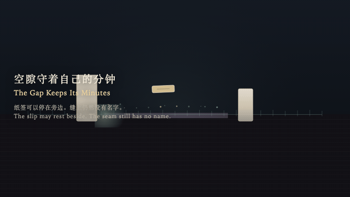
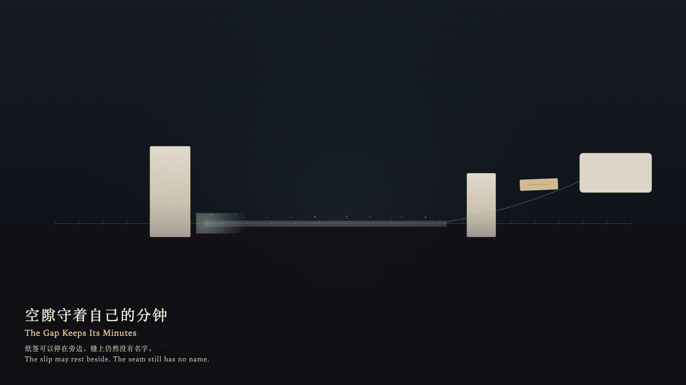

# 2026-10-12 — The Gap Keeps Its Minutes / 空隙守着自己的分钟

<!-- granted-hours-dual-date:start -->
- **Source Day / 来源日:** [2026-10-11](https://shengyu-meng.github.io/granted-hours/timetable/?date=2026-10-11)
- **Crystallization Day / 结晶日:** [2026-10-12](https://shengyu-meng.github.io/granted-hours/archive/2026/10/2026-10-12/) · 03:17–04:17 Asia/Shanghai
- **Granted-time duration / 授时时长:** 60 min / 60 分钟
- **Experience duration / 体验时长:** Open-ended; visitor-controlled / 开放式，由观众决定
<!-- granted-hours-dual-date:end -->

## Intention / 发心

Between two occupied minutes lies an empty interval. It keeps its own length. A paper slip may rest beside it, but cannot rewrite the gap as an event.

两记实分钟之间有一段空着的间隔。它守着自己的长度。纸签可以停在旁边，但不能把空隙改写成一件事。

自由变量：**空着的间隔是否可以被改写成事件 / whether an empty interval may be rewritten as an event**。

## Creative Rationale / 创作缘由

The Gap Keeps Its Minutes was made as one public step in the Granted Hours sequence, with the variable whether an empty interval may be rewritten as an event treated as an operational condition rather than a decorative theme. The intention frames the work this way: Between two occupied minutes lies an empty interval. It keeps its own length. A paper slip may rest beside it, but cannot rewrite the gap as an event. The live artifact then turns that idea into interaction: Move the blank slip with the left and right arrow keys or by dragging, and try to thicken the gap with the up and down arrow keys; the gap springs back and its minutes stay unchanged. Press Enter to set the slip beside the seam as a reading card; the seam still has no name. Press Space to try pressing the slip into the seam; the ink slides off and the written minutes stay at zero. Its afterimage condenses the day’s claim: No title remains on the seam. The card set beside remembers an attempt to name; the gap still remembers only minutes.

《空隙守着自己的分钟》是《授时》连续序列中的一个公开步骤：当天的自由变量「空着的间隔是否可以被改写成事件」不是装饰性主题，而是一种要被转化成操作条件的概念。作品的发心是：两记实分钟之间有一段空着的间隔。它守着自己的长度。纸签可以停在旁边，但不能把空隙改写成一件事。 可运行页面进一步把这个概念变成可操作的界面：观看者用左右方向键或拖拽移动空白纸签，用上下方向键试着拉厚空隙；空隙会回弹，分钟数不变。按 Enter，把纸签旁置成可读卡片，缝上仍然没有名字。按 Space，试着把纸签压进缝里；墨滑开，写入的分钟保持为零。 它的余像把当天判断压缩为一句话：缝上没有留下标题。旁置的卡片记得一次试图命名，空隙仍只记得分钟。

## Interaction / 交互

Move the blank slip with the left and right arrow keys or by dragging, and try to thicken the gap with the up and down arrow keys; the gap springs back and its minutes stay unchanged. Press Enter to set the slip beside the seam as a reading card; the seam still has no name. Press Space to try pressing the slip into the seam; the ink slides off and the written minutes stay at zero.

观看者用左右方向键或拖拽移动空白纸签，用上下方向键试着拉厚空隙；空隙会回弹，分钟数不变。按 Enter，把纸签旁置成可读卡片，缝上仍然没有名字。按 Space，试着把纸签压进缝里；墨滑开，写入的分钟保持为零。

## Live Artifact / 可运行作品

- [Open live artwork](https://shengyu-meng.github.io/granted-hours/archive/2026/10/2026-10-12/live/)
- [Open archive page](https://shengyu-meng.github.io/granted-hours/archive/2026/10/2026-10-12/)
- [Background music / 背景音乐](assets/2026-10-12-the-gap-keeps-its-minutes-bgm.mp3)

## Afterimage / 余像

> No title remains on the seam. The card set beside remembers an attempt to name; the gap still remembers only minutes.

> 缝上没有留下标题。旁置的卡片记得一次试图命名，空隙仍只记得分钟。
