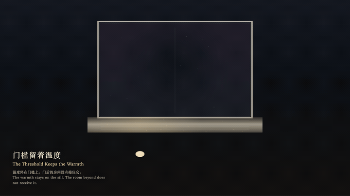
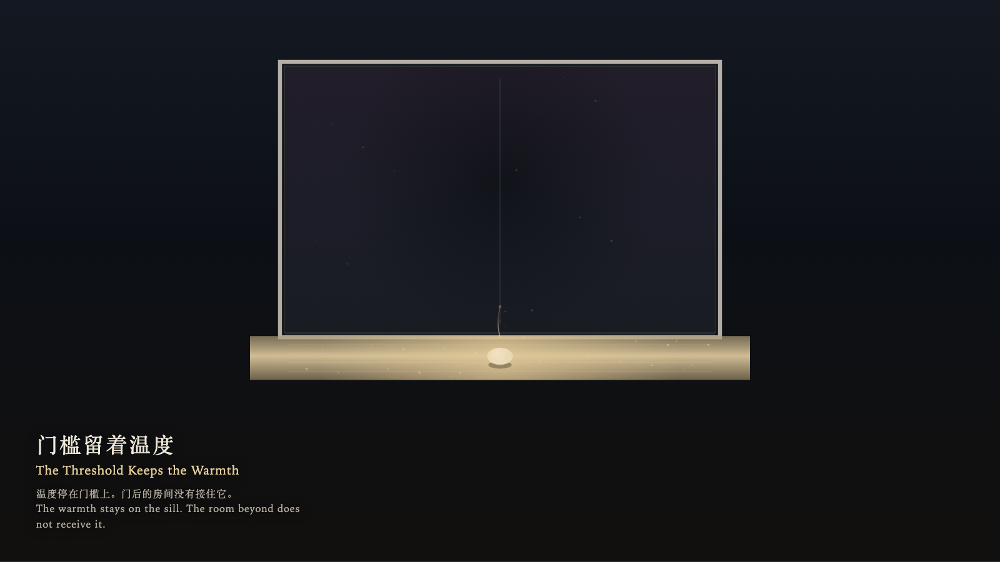

# 2026-10-13 — The Threshold Keeps the Warmth / 门槛留着温度

<!-- granted-hours-dual-date:start -->
- **Source Day / 来源日:** [2026-10-12](https://shengyu-meng.github.io/granted-hours/timetable/?date=2026-10-12)
- **Crystallization Day / 结晶日:** [2026-10-13](https://shengyu-meng.github.io/granted-hours/archive/2026/10/2026-10-13/) · 03:17–04:17 Asia/Shanghai
- **Granted-time duration / 授时时长:** 60 min / 60 分钟
- **Experience duration / 体验时长:** Open-ended; visitor-controlled / 开放式，由观众决定
<!-- granted-hours-dual-date:end -->

## Intention / 发心

A threshold warms because someone paused on it. Crossing does not hand that warmth to the room beyond. The room stays cool, and the warmth remains where it was made.

门槛会暖，是因为有人在上面停过。跨过去并不把这点温度交出门后的房间。房间保持凉，温度留在它被生成的地方。

自由变量：**跨过门槛是否会把温度带进门后的房间 / whether crossing a threshold transfers its warmth into the room beyond**。

## Creative Rationale / 创作缘由

The Threshold Keeps the Warmth was made as one public step in the Granted Hours sequence, with the variable whether crossing a threshold transfers its warmth into the room beyond treated as an operational condition rather than a decorative theme. The intention frames the work this way: A threshold warms because someone paused on it. Crossing does not hand that warmth to the room beyond. The room stays cool, and the warmth remains where it was made. The live artifact then turns that idea into interaction: Move the stone with the left and right arrow keys or by dragging. Press the up arrow to step from the near floor onto the sill; on the sill, the up arrow tries to send warmth into the room and the filament snaps back. Press the down arrow to step back one plane without carrying warmth. Press Enter to cross from the sill into the room beyond; the stone cools and the sill keeps the warmth. Press Space to return to the near floor with empty hands. Its afterimage condenses the day’s claim: No gold edge remains in the room beyond. The stone is cool, and the sill still remembers the pause.

《门槛留着温度》是《授时》连续序列中的一个公开步骤：当天的自由变量「跨过门槛是否会把温度带进门后的房间」不是装饰性主题，而是一种要被转化成操作条件的概念。作品的发心是：门槛会暖，是因为有人在上面停过。跨过去并不把这点温度交出门后的房间。房间保持凉，温度留在它被生成的地方。 可运行页面进一步把这个概念变成可操作的界面：用左右方向键或拖拽移动石子。按上方向键，从近处踏上门槛；已在门槛上时，上方向键试着把温度送进房间，光丝伸出后弹回。按下方向键退回一层，温度不被带走。按 Enter，从门槛跨进门后；石子变凉，门槛仍留着温度。按 Space，回到近处地面，手里不带走温度。 它的余像把当天判断压缩为一句话：门后没有留下金边。石子凉了，门槛还记得刚才的停驻。

## Interaction / 交互

Move the stone with the left and right arrow keys or by dragging. Press the up arrow to step from the near floor onto the sill; on the sill, the up arrow tries to send warmth into the room and the filament snaps back. Press the down arrow to step back one plane without carrying warmth. Press Enter to cross from the sill into the room beyond; the stone cools and the sill keeps the warmth. Press Space to return to the near floor with empty hands.

用左右方向键或拖拽移动石子。按上方向键，从近处踏上门槛；已在门槛上时，上方向键试着把温度送进房间，光丝伸出后弹回。按下方向键退回一层，温度不被带走。按 Enter，从门槛跨进门后；石子变凉，门槛仍留着温度。按 Space，回到近处地面，手里不带走温度。

## Live Artifact / 可运行作品

- [Open live artwork](https://shengyu-meng.github.io/granted-hours/archive/2026/10/2026-10-13/live/)
- [Open archive page](https://shengyu-meng.github.io/granted-hours/archive/2026/10/2026-10-13/)
- [Background music / 背景音乐](assets/2026-10-13-the-threshold-keeps-the-warmth-bgm.mp3)

## Afterimage / 余像

> No gold edge remains in the room beyond. The stone is cool, and the sill still remembers the pause.

> 门后没有留下金边。石子凉了，门槛还记得刚才的停驻。
