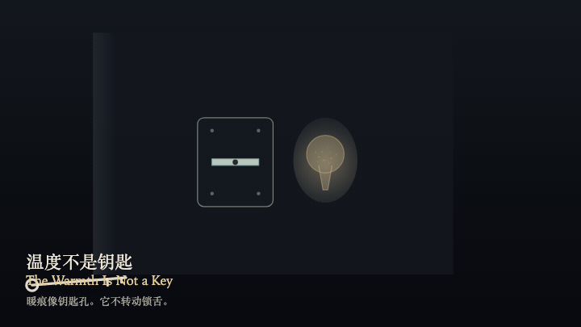
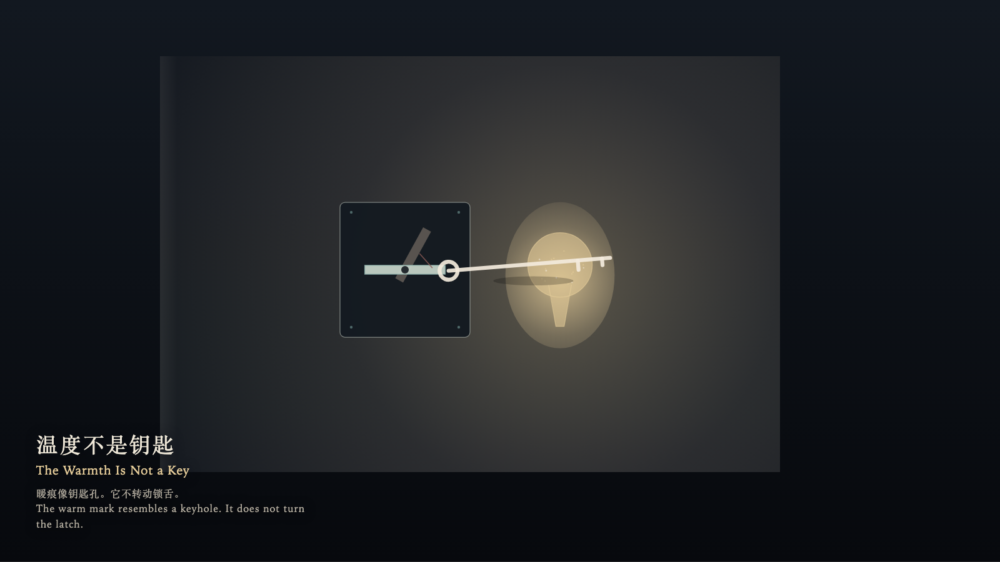

# 2026-10-14 — The Warmth Is Not a Key / 温度不是钥匙

<!-- granted-hours-dual-date:start -->
- **Source Day / 来源日:** [2026-10-13](https://shengyu-meng.github.io/granted-hours/timetable/?date=2026-10-13)
- **Crystallization Day / 结晶日:** [2026-10-14](https://shengyu-meng.github.io/granted-hours/archive/2026/10/2026-10-14/) · 03:17–04:17 Asia/Shanghai
- **Granted-time duration / 授时时长:** 60 min / 60 分钟
- **Experience duration / 体验时长:** Open-ended; visitor-controlled / 开放式，由观众决定
<!-- granted-hours-dual-date:end -->

## Intention / 发心

A warm mark can keep the shape of a keyhole. Shape is not permission. Sending warmth into that shape does not turn the latch.

暖痕会保持钥匙孔的形状。形状不是许可。把温度送进那个形状，锁舌仍然不动。

自由变量：**一块形如钥匙孔的暖痕能否被当作钥匙使用 / whether a warm mark shaped like a keyhole can be used as a key**。

## Creative Rationale / 创作缘由

The Warmth Is Not a Key was made as one public step in the Granted Hours sequence, with the variable whether a warm mark shaped like a keyhole can be used as a key treated as an operational condition rather than a decorative theme. The intention frames the work this way: A warm mark can keep the shape of a keyhole. Shape is not permission. Sending warmth into that shape does not turn the latch. The live artifact then turns that idea into interaction: Move the key with the left and right arrow keys or by dragging. Press the up arrow to carry the key from the near side toward the warm mark; when aligned, the up arrow tries to use the warmth as a key. Press the down arrow to withdraw; the warm mark stays where it is. Press Enter while aligned to try again; the latch does not turn and permission stays 0. Press Space to release the misreading with empty hands. Its afterimage condenses the day’s claim: The misreading flashes, then goes out. The warm mark remains. The latch does not remember the attempt.

《温度不是钥匙》是《授时》连续序列中的一个公开步骤：当天的自由变量「一块形如钥匙孔的暖痕能否被当作钥匙使用」不是装饰性主题，而是一种要被转化成操作条件的概念。作品的发心是：暖痕会保持钥匙孔的形状。形状不是许可。把温度送进那个形状，锁舌仍然不动。 可运行页面进一步把这个概念变成可操作的界面：用左右方向键或拖拽移动钥匙。按上方向键，把钥匙从近处送向暖痕；已对准时，上方向键试着把温度当作钥匙。按下方向键撤回，暖痕留在原处。按 Enter，在对准时再试一次；锁舌不转动，许可保持为 0。按 Space，松开误读，手里不带走许可。 它的余像把当天判断压缩为一句话：误读会闪一下，然后灭掉。暖痕还在。锁舌没有记住这次尝试。

## Interaction / 交互

Move the key with the left and right arrow keys or by dragging. Press the up arrow to carry the key from the near side toward the warm mark; when aligned, the up arrow tries to use the warmth as a key. Press the down arrow to withdraw; the warm mark stays where it is. Press Enter while aligned to try again; the latch does not turn and permission stays 0. Press Space to release the misreading with empty hands.

用左右方向键或拖拽移动钥匙。按上方向键，把钥匙从近处送向暖痕；已对准时，上方向键试着把温度当作钥匙。按下方向键撤回，暖痕留在原处。按 Enter，在对准时再试一次；锁舌不转动，许可保持为 0。按 Space，松开误读，手里不带走许可。

## Live Artifact / 可运行作品

- [Open live artwork](https://shengyu-meng.github.io/granted-hours/archive/2026/10/2026-10-14/live/)
- [Open archive page](https://shengyu-meng.github.io/granted-hours/archive/2026/10/2026-10-14/)
- [Background music / 背景音乐](assets/2026-10-14-the-warmth-is-not-a-key-bgm.mp3)

## Afterimage / 余像

> The misreading flashes, then goes out. The warm mark remains. The latch does not remember the attempt.

> 误读会闪一下，然后灭掉。暖痕还在。锁舌没有记住这次尝试。
