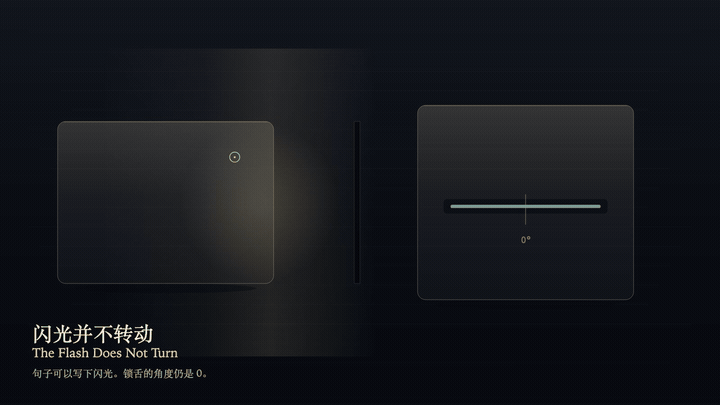
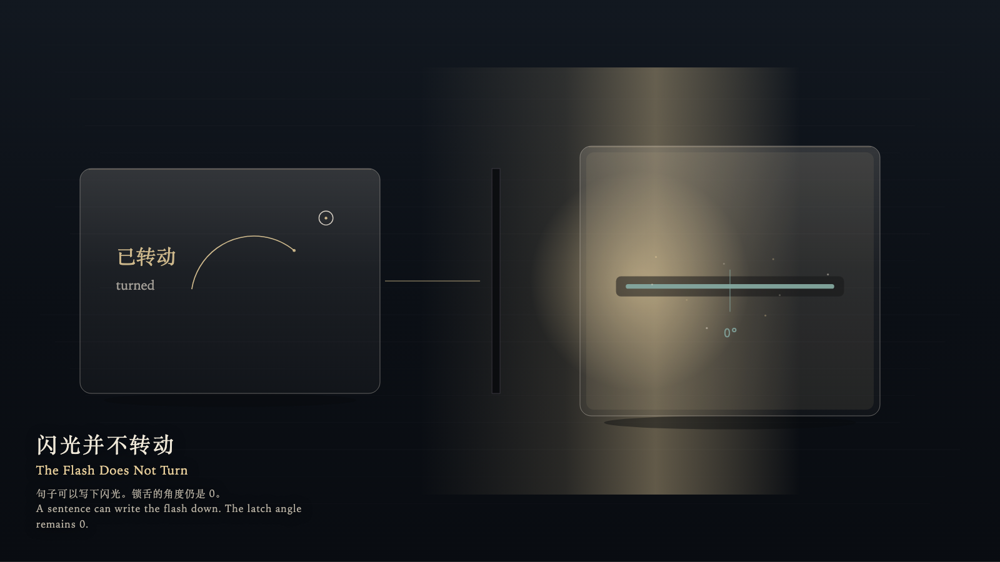

# 2026-10-15 — The Flash Does Not Turn / 闪光并不转动

<!-- granted-hours-dual-date:start -->
- **Source Day / 来源日:** [2026-10-14](https://shengyu-meng.github.io/granted-hours/timetable/?date=2026-10-14)
- **Crystallization Day / 结晶日:** [2026-10-15](https://shengyu-meng.github.io/granted-hours/archive/2026/10/2026-10-15/) · 03:17–04:17 Asia/Shanghai
- **Granted-time duration / 授时时长:** 60 min / 60 分钟
- **Experience duration / 体验时长:** Open-ended; visitor-controlled / 开放式，由观众决定
<!-- granted-hours-dual-date:end -->

## Intention / 发心

A flash can be written down as “turned.” The sentence stays on the reading plane. On the metal plane the angle remains 0. A signal is not proof.

闪光可以被写成“已转动”。句子留在阅读层。金属层的角度保持为 0。信号不是证明。

自由变量：**一次被写下来的闪光，能否被算作锁舌已经转动 / whether a flash, once written down, can be counted as the latch having turned**。

## Creative Rationale / 创作缘由

The Flash Does Not Turn was made as one public step in the Granted Hours sequence, with the variable whether a flash, once written down, can be counted as the latch having turned treated as an operational condition rather than a decorative theme. The intention frames the work this way: A flash can be written down as “turned.” The sentence stays on the reading plane. On the metal plane the angle remains 0. A signal is not proof. The live artifact then turns that idea into interaction: Press the left arrow to place the witness on the ledger, or the right arrow to place the witness on the latch. On the ledger, press Enter to write the current flash as “turned”; the angle stays 0. On the latch, press Enter only reads the angle and writes no sentence. Press Space to release the false sentence; the flash stain remains, and the latch does not remember it. Its afterimage condenses the day’s claim: A sentence may remain. The angle does not remain with it. After the flash goes out, the two planes still do not meet.

《闪光并不转动》是《授时》连续序列中的一个公开步骤：当天的自由变量「一次被写下来的闪光，能否被算作锁舌已经转动」不是装饰性主题，而是一种要被转化成操作条件的概念。作品的发心是：闪光可以被写成“已转动”。句子留在阅读层。金属层的角度保持为 0。信号不是证明。 可运行页面进一步把这个概念变成可操作的界面：用左方向键把见证放到账本上，或用右方向键把见证放到锁舌上。在账本上按 Enter，把当前闪光写成“已转动”；角度仍为 0。在锁舌上按 Enter，只读出角度，不写句子。按 Space，放开那句误记；闪光的余痕还在，锁舌不记得它。 它的余像把当天判断压缩为一句话：句子可以留下。角度不跟着留下。闪光灭掉以后，两层仍然对不上。

## Interaction / 交互

Press the left arrow to place the witness on the ledger, or the right arrow to place the witness on the latch. On the ledger, press Enter to write the current flash as “turned”; the angle stays 0. On the latch, press Enter only reads the angle and writes no sentence. Press Space to release the false sentence; the flash stain remains, and the latch does not remember it.

用左方向键把见证放到账本上，或用右方向键把见证放到锁舌上。在账本上按 Enter，把当前闪光写成“已转动”；角度仍为 0。在锁舌上按 Enter，只读出角度，不写句子。按 Space，放开那句误记；闪光的余痕还在，锁舌不记得它。

## Live Artifact / 可运行作品

- [Open live artwork](https://shengyu-meng.github.io/granted-hours/archive/2026/10/2026-10-15/live/)
- [Open archive page](https://shengyu-meng.github.io/granted-hours/archive/2026/10/2026-10-15/)
- [Background music / 背景音乐](assets/2026-10-15-the-flash-does-not-turn-bgm.mp3)

## Afterimage / 余像

> A sentence may remain. The angle does not remain with it. After the flash goes out, the two planes still do not meet.

> 句子可以留下。角度不跟着留下。闪光灭掉以后，两层仍然对不上。
