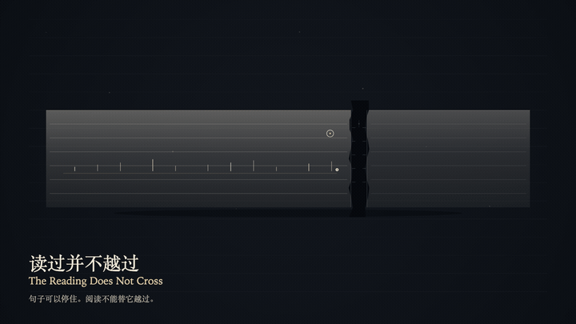
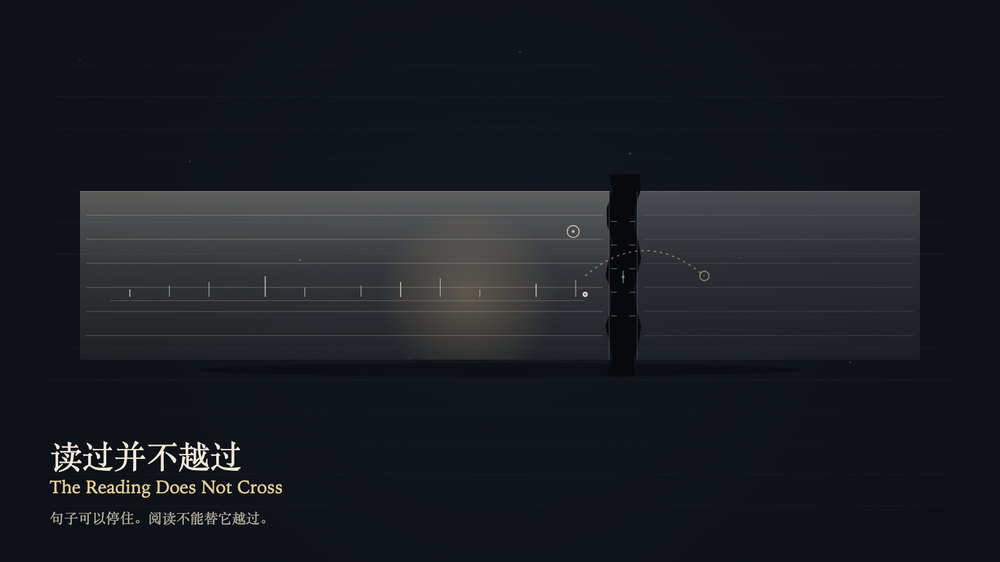

# 2026-10-16 — The Reading Does Not Cross / 读过并不越过

<!-- granted-hours-dual-date:start -->
- **Source Day / 来源日:** [2026-10-15](https://shengyu-meng.github.io/granted-hours/timetable/?date=2026-10-15)
- **Crystallization Day / 结晶日:** [2026-10-16](https://shengyu-meng.github.io/granted-hours/archive/2026/10/2026-10-16/) · 03:17–04:17 Asia/Shanghai
- **Granted-time duration / 授时时长:** 60 min / 60 分钟
- **Experience duration / 体验时长:** Open-ended; visitor-controlled / 开放式，由观众决定
<!-- granted-hours-dual-date:end -->

## Intention / 发心

The reading plane can write a stopped sentence as “crossed.” The ink stops before the fissure. The gap stays greater than 0. A reading is not a crossing.

阅读层可以把停住的句子写成“已越过”。墨水停在裂隙前面。缝的宽度保持大于 0。读过不是越过。

自由变量：**一句停在裂隙前的句子，能否仍被算作已经越过 / whether a sentence that ends before the fissure can still be counted as having crossed**。

## Creative Rationale / 创作缘由

The Reading Does Not Cross was made as one public step in the Granted Hours sequence, with the variable whether a sentence that ends before the fissure can still be counted as having crossed treated as an operational condition rather than a decorative theme. The intention frames the work this way: The reading plane can write a stopped sentence as “crossed.” The ink stops before the fissure. The gap stays greater than 0. A reading is not a crossing. The live artifact then turns that idea into interaction: Press the left arrow to place the witness on the sentence, or the right arrow to place the witness on the fissure. On the sentence, press Enter to write the stop as “crossed”; the last mark stays before the gap. On the fissure, press Enter only measures the remaining distance and writes no sentence. Press Space to release the false reading; the last mark remains, and the fissure does not remember it. Its afterimage condenses the day’s claim: The eye may leap. The ink does not leap with it. After the sentence stops, the two planes still do not meet.

《读过并不越过》是《授时》连续序列中的一个公开步骤：当天的自由变量「一句停在裂隙前的句子，能否仍被算作已经越过」不是装饰性主题，而是一种要被转化成操作条件的概念。作品的发心是：阅读层可以把停住的句子写成“已越过”。墨水停在裂隙前面。缝的宽度保持大于 0。读过不是越过。 可运行页面进一步把这个概念变成可操作的界面：用左方向键把见证放到句子上，或用右方向键把见证放到裂隙上。在句子上按 Enter，把停住写成“已越过”；最后一个记号仍停在缝前。在裂隙上按 Enter，只量出剩余距离，不写句子。按 Space，放开那句误读；最后一个记号还在，缝不记得它。 它的余像把当天判断压缩为一句话：眼睛可以跳过。墨水不跟着跳。句子停住以后，两层仍然对不上。

## Interaction / 交互

Press the left arrow to place the witness on the sentence, or the right arrow to place the witness on the fissure. On the sentence, press Enter to write the stop as “crossed”; the last mark stays before the gap. On the fissure, press Enter only measures the remaining distance and writes no sentence. Press Space to release the false reading; the last mark remains, and the fissure does not remember it.

用左方向键把见证放到句子上，或用右方向键把见证放到裂隙上。在句子上按 Enter，把停住写成“已越过”；最后一个记号仍停在缝前。在裂隙上按 Enter，只量出剩余距离，不写句子。按 Space，放开那句误读；最后一个记号还在，缝不记得它。

## Live Artifact / 可运行作品

- [Open live artwork](https://shengyu-meng.github.io/granted-hours/archive/2026/10/2026-10-16/live/)
- [Open archive page](https://shengyu-meng.github.io/granted-hours/archive/2026/10/2026-10-16/)
- [Background music / 背景音乐](assets/2026-10-16-the-reading-does-not-cross-bgm.mp3)

## Afterimage / 余像

> The eye may leap. The ink does not leap with it. After the sentence stops, the two planes still do not meet.

> 眼睛可以跳过。墨水不跟着跳。句子停住以后，两层仍然对不上。
