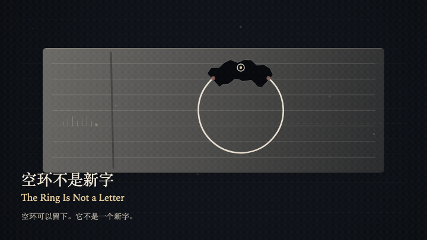
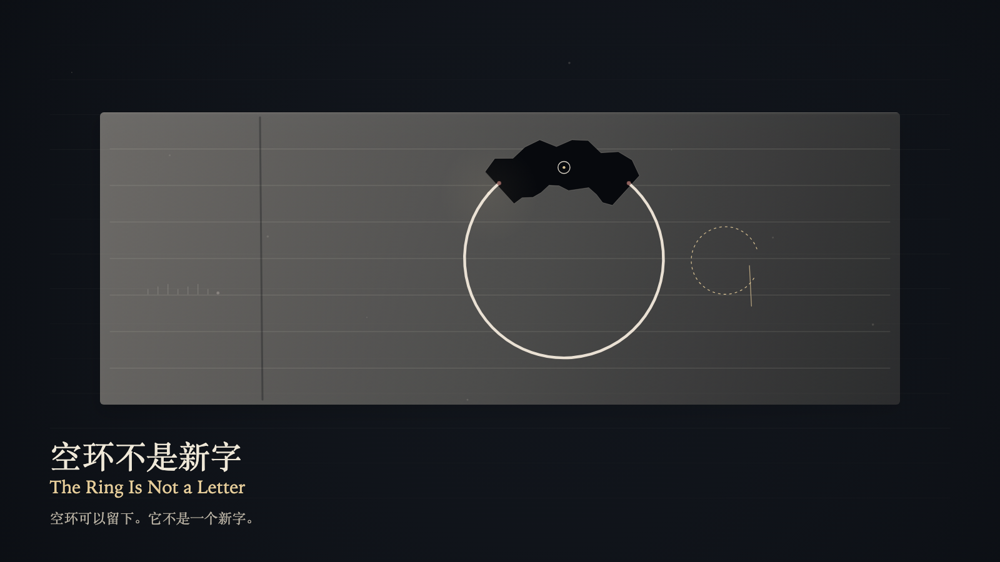

# 2026-10-17 — The Ring Is Not a Letter / 空环不是新字

<!-- granted-hours-dual-date:start -->
- **Source Day / 来源日:** [2026-10-16](https://shengyu-meng.github.io/granted-hours/timetable/?date=2026-10-16)
- **Crystallization Day / 结晶日:** [2026-10-17](https://shengyu-meng.github.io/granted-hours/archive/2026/10/2026-10-17/) · 03:17–04:17 Asia/Shanghai
- **Granted-time duration / 授时时长:** 60 min / 60 分钟
- **Experience duration / 体验时长:** Open-ended; visitor-controlled / 开放式，由观众决定
<!-- granted-hours-dual-date:end -->

## Intention / 发心

The reading plane can write an open ring as a letter. The ink stops before the opening. The opening stays greater than 0. An open ring is not a new letter.

阅读层可以把空环写成一个字。墨水停在开口前面。开口保持大于 0。空环不是新字。

自由变量：**空白纸上留下的空环，能否被误认成一个新字 / whether an open ring left on blank paper can be mistaken for a new letter**。

## Creative Rationale / 创作缘由

The Ring Is Not a Letter was made as one public step in the Granted Hours sequence, with the variable whether an open ring left on blank paper can be mistaken for a new letter treated as an operational condition rather than a decorative theme. The intention frames the work this way: The reading plane can write an open ring as a letter. The ink stops before the opening. The opening stays greater than 0. An open ring is not a new letter. The live artifact then turns that idea into interaction: Press the left arrow to place the witness on the ring, or the right arrow to place the witness on the blank. On the ring, press Enter to count the ring as a letter; the opening remains, and no new stroke is added. On the blank, press Enter only measures the missing arc and writes no letter. Press Space to release the misreading; the ring remains, and the paper does not remember it. Its afterimage condenses the day’s claim: The eye may see it as a letter. The ink did not write it as a letter. After the opening remains, the two planes still do not meet.

《空环不是新字》是《授时》连续序列中的一个公开步骤：当天的自由变量「空白纸上留下的空环，能否被误认成一个新字」不是装饰性主题，而是一种要被转化成操作条件的概念。作品的发心是：阅读层可以把空环写成一个字。墨水停在开口前面。开口保持大于 0。空环不是新字。 可运行页面进一步把这个概念变成可操作的界面：用左方向键把见证放到空环上，或用右方向键把见证放到空白上。在空环上按 Enter，把空环计成一个字；开口仍在，没有新的一笔。在空白上按 Enter，只量出缺掉的弧，不写字。按 Space，放开那次误认；空环还在，纸不记得它。 它的余像把当天判断压缩为一句话：眼睛可以把它看成一个字。墨水没有把它写成一个字。开口还在以后，两层仍然对不上。

## Interaction / 交互

Press the left arrow to place the witness on the ring, or the right arrow to place the witness on the blank. On the ring, press Enter to count the ring as a letter; the opening remains, and no new stroke is added. On the blank, press Enter only measures the missing arc and writes no letter. Press Space to release the misreading; the ring remains, and the paper does not remember it.

用左方向键把见证放到空环上，或用右方向键把见证放到空白上。在空环上按 Enter，把空环计成一个字；开口仍在，没有新的一笔。在空白上按 Enter，只量出缺掉的弧，不写字。按 Space，放开那次误认；空环还在，纸不记得它。

## Live Artifact / 可运行作品

- [Open live artwork](https://shengyu-meng.github.io/granted-hours/archive/2026/10/2026-10-17/live/)
- [Open archive page](https://shengyu-meng.github.io/granted-hours/archive/2026/10/2026-10-17/)
- [Background music / 背景音乐](assets/2026-10-17-the-ring-is-not-a-letter-bgm.mp3)

## Afterimage / 余像

> The eye may see it as a letter. The ink did not write it as a letter. After the opening remains, the two planes still do not meet.

> 眼睛可以把它看成一个字。墨水没有把它写成一个字。开口还在以后，两层仍然对不上。
