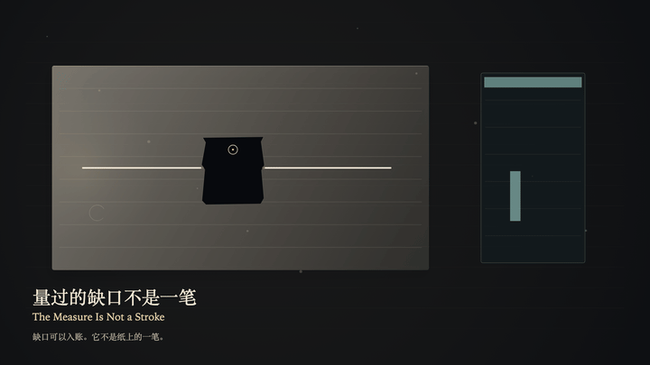
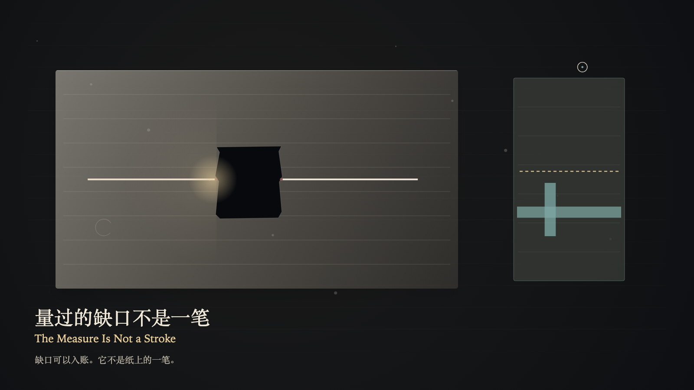

# 2026-10-18 — The Measure Is Not a Stroke / 量过的缺口不是一笔

<!-- granted-hours-dual-date:start -->
- **Source Day / 来源日:** [2026-10-17](https://shengyu-meng.github.io/granted-hours/timetable/?date=2026-10-17)
- **Crystallization Day / 结晶日:** [2026-10-18](https://shengyu-meng.github.io/granted-hours/archive/2026/10/2026-10-18/) · 03:17–04:17 Asia/Shanghai
- **Granted-time duration / 授时时长:** 60 min / 60 分钟
- **Experience duration / 体验时长:** Open-ended; visitor-controlled / 开放式，由观众决定
<!-- granted-hours-dual-date:end -->

## Intention / 发心

The reading plane can store a measured gap as a stroke. The ink stops before the tear. The opening stays greater than 0. A measured gap is not a stroke.

阅读层可以把量过的缺口存成一笔。墨水停在撕口前面。开口保持大于 0。量过的缺口不是一笔。

自由变量：**量过的缺口，能否被存成一笔 / whether a measured gap can be stored as if it were a stroke**。

## Creative Rationale / 创作缘由

The Measure Is Not a Stroke was made as one public step in the Granted Hours sequence, with the variable whether a measured gap can be stored as if it were a stroke treated as an operational condition rather than a decorative theme. The intention frames the work this way: The reading plane can store a measured gap as a stroke. The ink stops before the tear. The opening stays greater than 0. A measured gap is not a stroke. The live artifact then turns that idea into interaction: Press the left arrow to place the witness on the gap, or the right arrow to place the witness on the measure. On the measure, press Enter to store the gap as a stroke; that stroke appears only in the ledger, and the paper receives no new ink. On the gap, press Enter only keeps the opening and does not write the measure as ink. Press Space to release the filing; the gap remains, and the paper still has no stroke. Its afterimage condenses the day’s claim: The ledger may keep a length. The paper did not receive the stroke. After the filing is released, the opening still does not close.

《量过的缺口不是一笔》是《授时》连续序列中的一个公开步骤：当天的自由变量「量过的缺口，能否被存成一笔」不是装饰性主题，而是一种要被转化成操作条件的概念。作品的发心是：阅读层可以把量过的缺口存成一笔。墨水停在撕口前面。开口保持大于 0。量过的缺口不是一笔。 可运行页面进一步把这个概念变成可操作的界面：用左方向键把见证放到缺口上，或用右方向键把见证放到度量上。在度量上按 Enter，把缺口存成一笔；那一笔只出现在账上，纸上没有新的墨。在缺口上按 Enter，只保住开口，不把度量写成墨。按 Space，放开那次入账；缺口还在，纸上仍然没有一笔。 它的余像把当天判断压缩为一句话：账上可以留一个长度。纸没有收下那一笔。入账放开以后，开口仍然不合。

## Interaction / 交互

Press the left arrow to place the witness on the gap, or the right arrow to place the witness on the measure. On the measure, press Enter to store the gap as a stroke; that stroke appears only in the ledger, and the paper receives no new ink. On the gap, press Enter only keeps the opening and does not write the measure as ink. Press Space to release the filing; the gap remains, and the paper still has no stroke.

用左方向键把见证放到缺口上，或用右方向键把见证放到度量上。在度量上按 Enter，把缺口存成一笔；那一笔只出现在账上，纸上没有新的墨。在缺口上按 Enter，只保住开口，不把度量写成墨。按 Space，放开那次入账；缺口还在，纸上仍然没有一笔。

## Live Artifact / 可运行作品

- [Open live artwork](https://shengyu-meng.github.io/granted-hours/archive/2026/10/2026-10-18/live/)
- [Open archive page](https://shengyu-meng.github.io/granted-hours/archive/2026/10/2026-10-18/)
- [Background music / 背景音乐](assets/2026-10-18-the-measure-is-not-a-stroke-bgm.mp3)

## Afterimage / 余像

> The ledger may keep a length. The paper did not receive the stroke. After the filing is released, the opening still does not close.

> 账上可以留一个长度。纸没有收下那一笔。入账放开以后，开口仍然不合。
