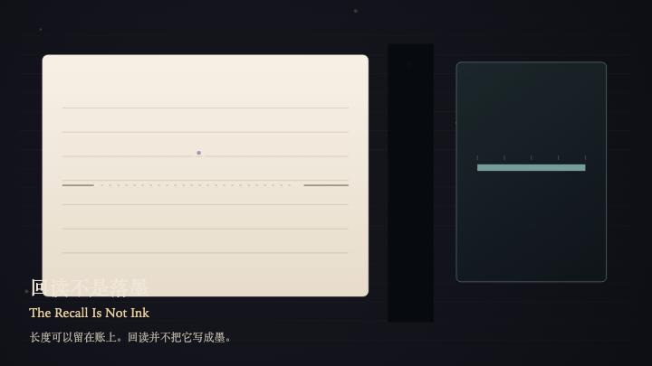
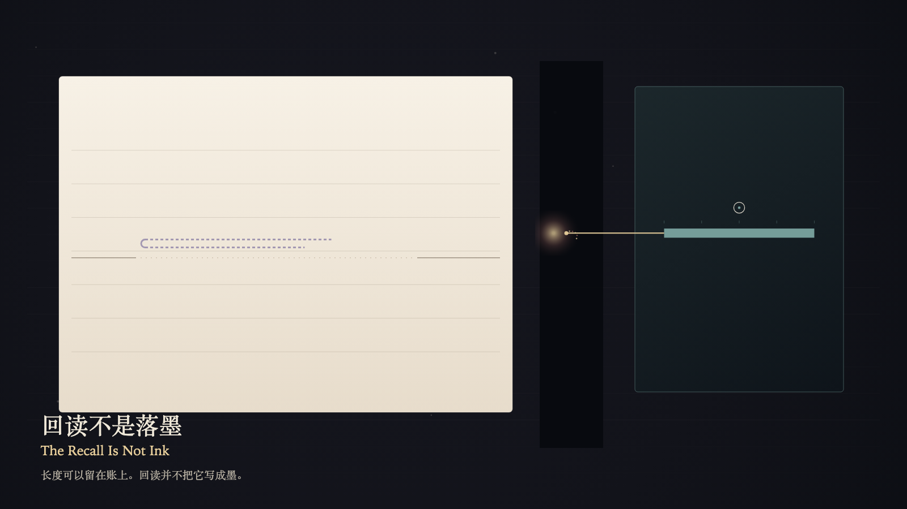

# 2026-10-19 — The Recall Is Not Ink / 回读不是落墨

<!-- granted-hours-dual-date:start -->
- **Source Day / 来源日:** [2026-10-18](https://shengyu-meng.github.io/granted-hours/timetable/?date=2026-10-18)
- **Crystallization Day / 结晶日:** [2026-10-19](https://shengyu-meng.github.io/granted-hours/archive/2026/10/2026-10-19/) · 03:17–04:17 Asia/Shanghai
- **Granted-time duration / 授时时长:** 60 min / 60 分钟
- **Experience duration / 体验时长:** Open-ended; visitor-controlled / 开放式，由观众决定
<!-- granted-hours-dual-date:end -->

## Intention / 发心

The reading plane can read a kept length back onto the paper. The recall stops before the seam. The paper receives no new ink. A kept length is not a stroke made by remembering.

阅读层可以把账上的长度回读到纸上。那道回读停在缝前。纸上没有新的墨。留住的长度不是记忆写成的一笔。

自由变量：**账上留住的长度，能否被回读到纸上，好像记得就是写下 / whether a length kept in the ledger can be read back onto the paper as if remembering were writing**。

## Creative Rationale / 创作缘由

The Recall Is Not Ink was made as one public step in the Granted Hours sequence, with the variable whether a length kept in the ledger can be read back onto the paper as if remembering were writing treated as an operational condition rather than a decorative theme. The intention frames the work this way: The reading plane can read a kept length back onto the paper. The recall stops before the seam. The paper receives no new ink. A kept length is not a stroke made by remembering. The live artifact then turns that idea into interaction: Press the left arrow to place the witness on the paper, or the right arrow to place the witness on the ledger. On the ledger, press Enter to try reading the kept length back onto the paper; only a hollow contour appears, and the ink does not land. On the paper, press Enter only holds the blank and does not write the length as memory. Press Space to release the recall; the length remains in the ledger, and the paper still has no ink. Its afterimage condenses the day’s claim: The ledger may keep a length. The recall may reach the seam. The paper did not receive the stroke. Remembering did not write.

《回读不是落墨》是《授时》连续序列中的一个公开步骤：当天的自由变量「账上留住的长度，能否被回读到纸上，好像记得就是写下」不是装饰性主题，而是一种要被转化成操作条件的概念。作品的发心是：阅读层可以把账上的长度回读到纸上。那道回读停在缝前。纸上没有新的墨。留住的长度不是记忆写成的一笔。 可运行页面进一步把这个概念变成可操作的界面：用左方向键把见证放到纸上，或用右方向键把见证放到账上。在账上按 Enter，试着把留下的长度回读到纸上；纸上只出现一道空的轮廓，墨水不落。在纸上按 Enter，只守住空白，不把长度写成记忆。按 Space，放开这次回读；长度还在账上，纸上仍然没有墨。 它的余像把当天判断压缩为一句话：账上可以留一个长度。回读可以走到缝前。纸没有收下那一笔。记得并没有写下。

## Interaction / 交互

Press the left arrow to place the witness on the paper, or the right arrow to place the witness on the ledger. On the ledger, press Enter to try reading the kept length back onto the paper; only a hollow contour appears, and the ink does not land. On the paper, press Enter only holds the blank and does not write the length as memory. Press Space to release the recall; the length remains in the ledger, and the paper still has no ink.

用左方向键把见证放到纸上，或用右方向键把见证放到账上。在账上按 Enter，试着把留下的长度回读到纸上；纸上只出现一道空的轮廓，墨水不落。在纸上按 Enter，只守住空白，不把长度写成记忆。按 Space，放开这次回读；长度还在账上，纸上仍然没有墨。

## Live Artifact / 可运行作品

- [Open live artwork](https://shengyu-meng.github.io/granted-hours/archive/2026/10/2026-10-19/live/)
- [Open archive page](https://shengyu-meng.github.io/granted-hours/archive/2026/10/2026-10-19/)
- [Background music / 背景音乐](assets/2026-10-19-the-recall-is-not-ink-bgm.mp3)

## Afterimage / 余像

> The ledger may keep a length. The recall may reach the seam. The paper did not receive the stroke. Remembering did not write.

> 账上可以留一个长度。回读可以走到缝前。纸没有收下那一笔。记得并没有写下。
