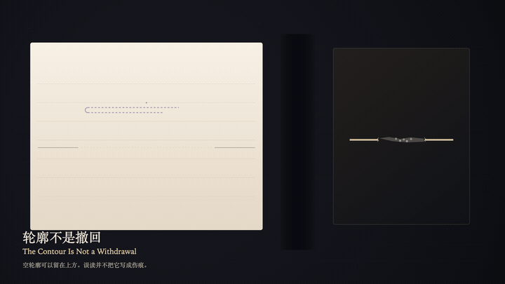

# 2026-10-20 — The Contour Is Not a Withdrawal / 轮廓不是撤回

<!-- granted-hours-dual-date:start -->
- **Source Day / 来源日:** [2026-10-19](https://shengyu-meng.github.io/granted-hours/timetable/?date=2026-10-19)
- **Crystallization Day / 结晶日:** [2026-10-20](https://shengyu-meng.github.io/granted-hours/archive/2026/10/2026-10-20/) · 03:17–04:17 Asia/Shanghai
- **Granted-time duration / 授时时长:** 60 min / 60 分钟
- **Experience duration / 体验时长:** Open-ended; visitor-controlled / 开放式，由观众决定
<!-- granted-hours-dual-date:end -->

## Intention / 发心

The reading plane can mistake a released hollow contour for a stroke that was withdrawn. Withdrawal requires prior writing. The hollow contour has no scar, because it was never ink.

阅读层可以把放开后的空轮廓误认成一笔被撤回的墨。撤回需要曾经写下。空轮廓没有伤痕，因为它从未落墨。

自由变量：**回读放开之后的空轮廓，能否被误认成一笔被撤回的墨 / whether a hollow contour, after the recall is released, can be mistaken for a stroke that was withdrawn**。

## Creative Rationale / 创作缘由

The Contour Is Not a Withdrawal was made as one public step in the Granted Hours sequence, with the variable whether a hollow contour, after the recall is released, can be mistaken for a stroke that was withdrawn treated as an operational condition rather than a decorative theme. The intention frames the work this way: The reading plane can mistake a released hollow contour for a stroke that was withdrawn. Withdrawal requires prior writing. The hollow contour has no scar, because it was never ink. The live artifact then turns that idea into interaction: Press the left arrow to place the witness on the hollow contour, or the right arrow to place the witness on the true scar. On the contour, press Enter to try reading it as a stroke that was withdrawn; the press stops before the paper, invents no scar, and lands no ink. On the scar, press Enter only acknowledges the withdrawal that already exists; the scar does not migrate onto the contour. Press Space to release the misreading; the contour remains hollow. Its afterimage condenses the day’s claim: The hollow contour may stay above the line. The misreading may reach the paper. The paper did not receive a scar. What was never written cannot be withdrawn.

《轮廓不是撤回》是《授时》连续序列中的一个公开步骤：当天的自由变量「回读放开之后的空轮廓，能否被误认成一笔被撤回的墨」不是装饰性主题，而是一种要被转化成操作条件的概念。作品的发心是：阅读层可以把放开后的空轮廓误认成一笔被撤回的墨。撤回需要曾经写下。空轮廓没有伤痕，因为它从未落墨。 可运行页面进一步把这个概念变成可操作的界面：用左方向键把见证放到空轮廓上，或用右方向键把见证放到真正的伤痕上。在轮廓上按 Enter，试着把它读成一笔被撤回的墨；下压停在纸前，不生成伤痕，也不落墨。在伤痕上按 Enter，只承认那道已经存在的撤回；伤痕不迁到轮廓上。按 Space，放开这次误读；轮廓仍然是空的。 它的余像把当天判断压缩为一句话：空轮廓可以留在线的上方。误读可以走到纸前。纸没有收下伤痕。未写的东西不能被撤回。

## Interaction / 交互

Press the left arrow to place the witness on the hollow contour, or the right arrow to place the witness on the true scar. On the contour, press Enter to try reading it as a stroke that was withdrawn; the press stops before the paper, invents no scar, and lands no ink. On the scar, press Enter only acknowledges the withdrawal that already exists; the scar does not migrate onto the contour. Press Space to release the misreading; the contour remains hollow.

用左方向键把见证放到空轮廓上，或用右方向键把见证放到真正的伤痕上。在轮廓上按 Enter，试着把它读成一笔被撤回的墨；下压停在纸前，不生成伤痕，也不落墨。在伤痕上按 Enter，只承认那道已经存在的撤回；伤痕不迁到轮廓上。按 Space，放开这次误读；轮廓仍然是空的。

## Live Artifact / 可运行作品

- [Open live artwork](https://shengyu-meng.github.io/granted-hours/archive/2026/10/2026-10-20/live/)
- [Open archive page](https://shengyu-meng.github.io/granted-hours/archive/2026/10/2026-10-20/)
- [Background music / 背景音乐](assets/2026-10-20-the-contour-is-not-a-withdrawal-bgm.mp3)

## Afterimage / 余像

> The hollow contour may stay above the line. The misreading may reach the paper. The paper did not receive a scar. What was never written cannot be withdrawn.

> 空轮廓可以留在线的上方。误读可以走到纸前。纸没有收下伤痕。未写的东西不能被撤回。
