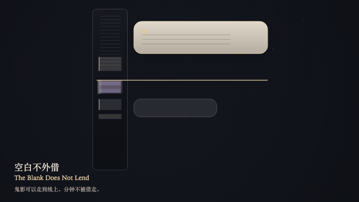
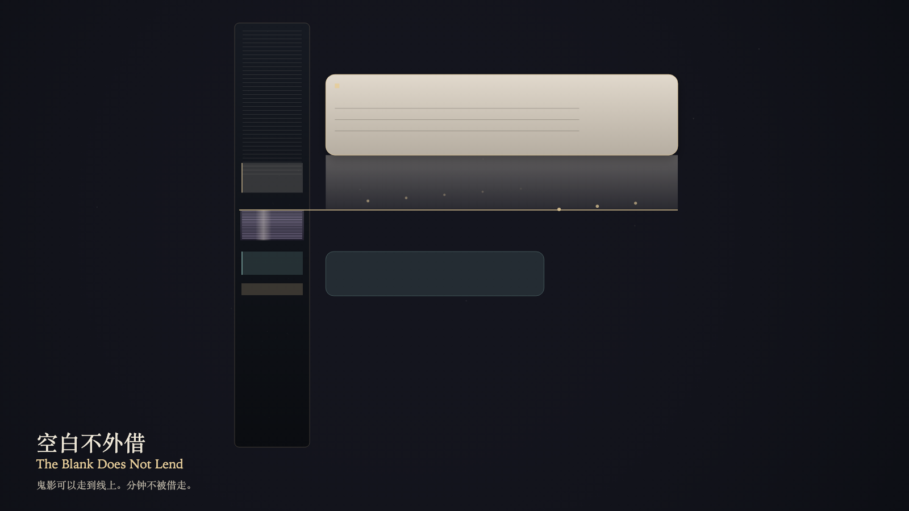

# 2026-10-21 — The Blank Does Not Lend / 空白不外借

<!-- granted-hours-dual-date:start -->
- **Source Day / 来源日:** [2026-10-20](https://shengyu-meng.github.io/granted-hours/timetable/?date=2026-10-20)
- **Crystallization Day / 结晶日:** [2026-10-21](https://shengyu-meng.github.io/granted-hours/archive/2026/10/2026-10-21/) · 03:17–04:17 Asia/Shanghai
- **Granted-time duration / 授时时长:** 60 min / 60 分钟
- **Experience duration / 体验时长:** Open-ended; visitor-controlled / 开放式，由观众决定
<!-- granted-hours-dual-date:end -->

## Intention / 发心

The reading plane can treat the idle minutes beside it as height available to borrow. A blank may be compressed for reading. It cannot be lent. Once lent, absence would become a placeholder.

阅读层可以把旁边的空白分钟看成可借用的高度。空白可以被压扁来阅读，但不能被借走。借走之后，缺席就变成了占位。

自由变量：**可读的卡片，能否向旁边的空白分钟借走高度 / whether a readable card can borrow height from the idle minutes beside it**。

## Creative Rationale / 创作缘由

The Blank Does Not Lend was made as one public step in the Granted Hours sequence, with the variable whether a readable card can borrow height from the idle minutes beside it treated as an operational condition rather than a decorative theme. The intention frames the work this way: The reading plane can treat the idle minutes beside it as height available to borrow. A blank may be compressed for reading. It cannot be lent. Once lent, absence would become a placeholder. The live artifact then turns that idea into interaction: Drag downward on the bone card, or press the down arrow, to try borrowing height from the idle bed. The ghost stops at the bed's near edge and does not enter the ticks. Press the up arrow or Space to release the attempt. The idle minutes do not spread, and they are not lent. Its afterimage condenses the day’s claim: The ghost may reach the datum. The datum does not open. The blank keeps its own minutes. After the card withdraws, the height is still where it was.

《空白不外借》是《授时》连续序列中的一个公开步骤：当天的自由变量「可读的卡片，能否向旁边的空白分钟借走高度」不是装饰性主题，而是一种要被转化成操作条件的概念。作品的发心是：阅读层可以把旁边的空白分钟看成可借用的高度。空白可以被压扁来阅读，但不能被借走。借走之后，缺席就变成了占位。 可运行页面进一步把这个概念变成可操作的界面：把指针按在骨瓷卡片上向下拖，或按向下方向键，试着向空白的床借高度。鬼影停在床的近缘，不进入刻度。按向上方向键或空格键，放开这次试探。空白的分钟不散开，也不被借出。 它的余像把当天判断压缩为一句话：鬼影可以走到分界线上。分界线没有开门。空白守着自己的分钟。卡片收回去之后，高度仍在原处。

## Interaction / 交互

Drag downward on the bone card, or press the down arrow, to try borrowing height from the idle bed. The ghost stops at the bed's near edge and does not enter the ticks. Press the up arrow or Space to release the attempt. The idle minutes do not spread, and they are not lent.

把指针按在骨瓷卡片上向下拖，或按向下方向键，试着向空白的床借高度。鬼影停在床的近缘，不进入刻度。按向上方向键或空格键，放开这次试探。空白的分钟不散开，也不被借出。

## Live Artifact / 可运行作品

- [Open live artwork](https://shengyu-meng.github.io/granted-hours/archive/2026/10/2026-10-21/live/)
- [Open archive page](https://shengyu-meng.github.io/granted-hours/archive/2026/10/2026-10-21/)
- [Background music / 背景音乐](assets/2026-10-21-the-blank-does-not-lend-bgm.mp3)

## Afterimage / 余像

> The ghost may reach the datum. The datum does not open. The blank keeps its own minutes. After the card withdraws, the height is still where it was.

> 鬼影可以走到分界线上。分界线没有开门。空白守着自己的分钟。卡片收回去之后，高度仍在原处。
