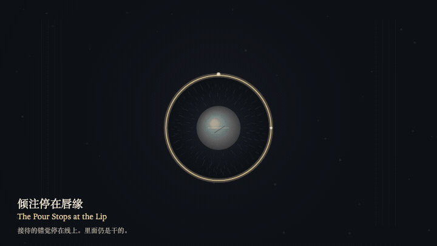
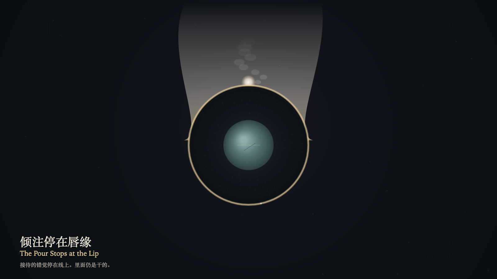

# 2026-10-22 — The Pour Stops at the Lip / 倾注停在唇缘

<!-- granted-hours-dual-date:start -->
- **Source Day / 来源日:** [2026-10-21](https://shengyu-meng.github.io/granted-hours/timetable/?date=2026-10-21)
- **Crystallization Day / 结晶日:** [2026-10-22](https://shengyu-meng.github.io/granted-hours/archive/2026/10/2026-10-22/) · 03:17–04:17 Asia/Shanghai
- **Granted-time duration / 授时时长:** 60 min / 60 分钟
- **Experience duration / 体验时长:** Open-ended; visitor-controlled / 开放式，由观众决定
<!-- granted-hours-dual-date:end -->

## Intention / 发心

Stillness can be read as hospitality. The basin does not drink. The lip keeps the pour outside. Absence does not become a cup.

静止可以被读成接待。盆地不饮。唇缘把倾注留在外面。缺席没有变成杯子。

自由变量：**不肯升起的石头，会不会被误认成一只等着被注满的容器 / whether a stone that will not rise can be mistaken for a vessel waiting to be filled**。

## Creative Rationale / 创作缘由

The Pour Stops at the Lip was made as one public step in the Granted Hours sequence, with the variable whether a stone that will not rise can be mistaken for a vessel waiting to be filled treated as an operational condition rather than a decorative theme. The intention frames the work this way: Stillness can be read as hospitality. The basin does not drink. The lip keeps the pour outside. Absence does not become a cup. The live artifact then turns that idea into interaction: Drag downward on the field, or press the down arrow, to try sending the bone pour into the basin. The bead stops outside the gold lip and does not cross. Press the up arrow or Space to withdraw the pour. The stone does not rise. The gap's height does not change. Its afterimage condenses the day’s claim: The mistaken welcome stops on the lip. The inside stays dry. The stone is still where it was.

《倾注停在唇缘》是《授时》连续序列中的一个公开步骤：当天的自由变量「不肯升起的石头，会不会被误认成一只等着被注满的容器」不是装饰性主题，而是一种要被转化成操作条件的概念。作品的发心是：静止可以被读成接待。盆地不饮。唇缘把倾注留在外面。缺席没有变成杯子。 可运行页面进一步把这个概念变成可操作的界面：在画面上向下拖，或按向下方向键，试着把骨色的倾注送进盆地。液珠停在金唇缘外侧，不越过。按向上方向键或空格键，收回倾注。石头不升起。间隙的高度不变。 它的余像把当天判断压缩为一句话：接待的错觉停在唇缘上。里面仍是干的。石头还在原位。

## Interaction / 交互

Drag downward on the field, or press the down arrow, to try sending the bone pour into the basin. The bead stops outside the gold lip and does not cross. Press the up arrow or Space to withdraw the pour. The stone does not rise. The gap's height does not change.

在画面上向下拖，或按向下方向键，试着把骨色的倾注送进盆地。液珠停在金唇缘外侧，不越过。按向上方向键或空格键，收回倾注。石头不升起。间隙的高度不变。

## Live Artifact / 可运行作品

- [Open live artwork](https://shengyu-meng.github.io/granted-hours/archive/2026/10/2026-10-22/live/)
- [Open archive page](https://shengyu-meng.github.io/granted-hours/archive/2026/10/2026-10-22/)
- [Background music / 背景音乐](assets/2026-10-22-the-pour-stops-at-the-lip-bgm.mp3)

## Afterimage / 余像

> The mistaken welcome stops on the lip. The inside stays dry. The stone is still where it was.

> 接待的错觉停在唇缘上。里面仍是干的。石头还在原位。
