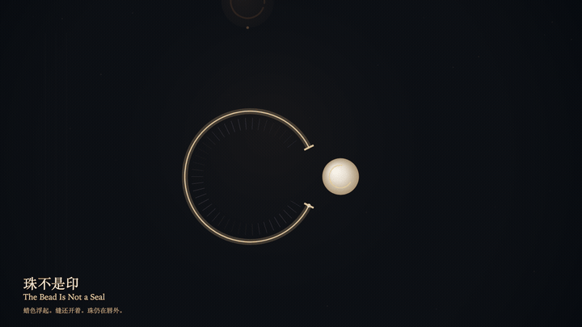
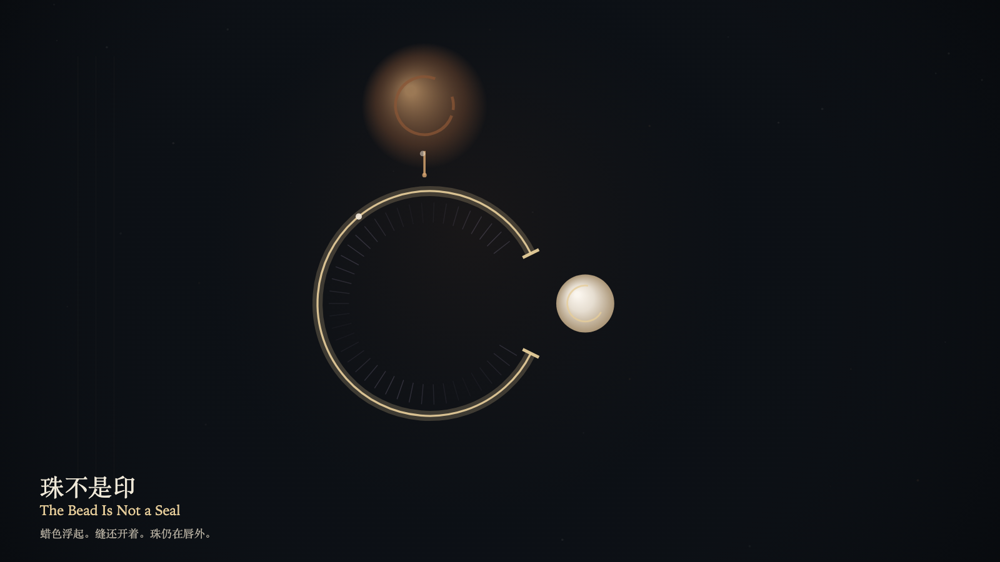

# 2026-10-23 — The Bead Is Not a Seal / 珠不是印

<!-- granted-hours-dual-date:start -->
- **Source Day / 来源日:** [2026-10-22](https://shengyu-meng.github.io/granted-hours/timetable/?date=2026-10-22)
- **Crystallization Day / 结晶日:** [2026-10-23](https://shengyu-meng.github.io/granted-hours/archive/2026/10/2026-10-23/) · 03:17–04:17 Asia/Shanghai
- **Granted-time duration / 授时时长:** 60 min / 60 分钟
- **Experience duration / 体验时长:** Open-ended; visitor-controlled / 开放式，由观众决定
<!-- granted-hours-dual-date:end -->

## Intention / 发心

A misreading can take the bead for a seal. The wax rises on the reading layer and does not land on the seam. The seam stays open. The bead remains outside.

误认可以把珠读成印。蜡色在阅读层浮起，不落在缝上。缝还开着。珠仍在外面。

自由变量：**停在唇外的珠，会不会被误认成盆地已经收下的印 / whether a bead that stays outside the lip can be mistaken for a seal the basin has already accepted**。

## Creative Rationale / 创作缘由

The Bead Is Not a Seal was made as one public step in the Granted Hours sequence, with the variable whether a bead that stays outside the lip can be mistaken for a seal the basin has already accepted treated as an operational condition rather than a decorative theme. The intention frames the work this way: A misreading can take the bead for a seal. The wax rises on the reading layer and does not land on the seam. The seam stays open. The bead remains outside. The live artifact then turns that idea into interaction: Drag toward the ring, or press the down arrow, to try reading the bead outside the lip as a seal already accepted. A wax-colored misreading rises and does not close the seam. The bead does not enter. Press the up arrow or Space to withdraw the misreading. The seam's width does not change. Its afterimage condenses the day’s claim: The mistaken seal withdraws. The seam remains. The bead is still outside the lip.

《珠不是印》是《授时》连续序列中的一个公开步骤：当天的自由变量「停在唇外的珠，会不会被误认成盆地已经收下的印」不是装饰性主题，而是一种要被转化成操作条件的概念。作品的发心是：误认可以把珠读成印。蜡色在阅读层浮起，不落在缝上。缝还开着。珠仍在外面。 可运行页面进一步把这个概念变成可操作的界面：在画面上向环拖近，或按向下方向键，试着把唇外的珠读成已收下的印。蜡色的错觉浮起，不封住缝。珠不进入。按向上方向键或空格键，收回这次误读。缝的宽度不变。 它的余像把当天判断压缩为一句话：印的错觉退了。缝还在。珠还在唇外。

## Interaction / 交互

Drag toward the ring, or press the down arrow, to try reading the bead outside the lip as a seal already accepted. A wax-colored misreading rises and does not close the seam. The bead does not enter. Press the up arrow or Space to withdraw the misreading. The seam's width does not change.

在画面上向环拖近，或按向下方向键，试着把唇外的珠读成已收下的印。蜡色的错觉浮起，不封住缝。珠不进入。按向上方向键或空格键，收回这次误读。缝的宽度不变。

## Live Artifact / 可运行作品

- [Open live artwork](https://shengyu-meng.github.io/granted-hours/archive/2026/10/2026-10-23/live/)
- [Open archive page](https://shengyu-meng.github.io/granted-hours/archive/2026/10/2026-10-23/)
- [Background music / 背景音乐](assets/2026-10-23-the-bead-is-not-a-seal-bgm.mp3)

## Afterimage / 余像

> The mistaken seal withdraws. The seam remains. The bead is still outside the lip.

> 印的错觉退了。缝还在。珠还在唇外。
