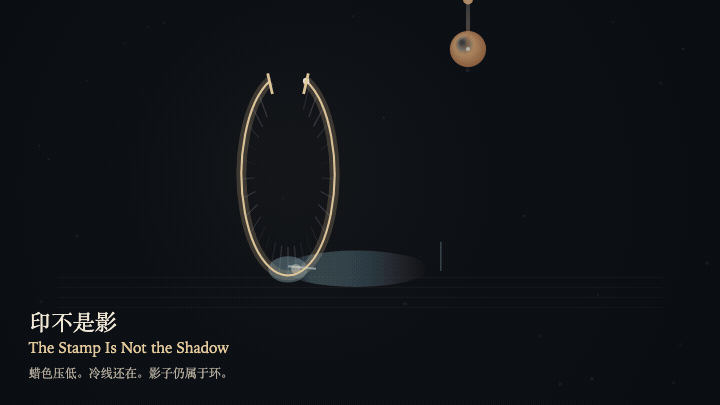
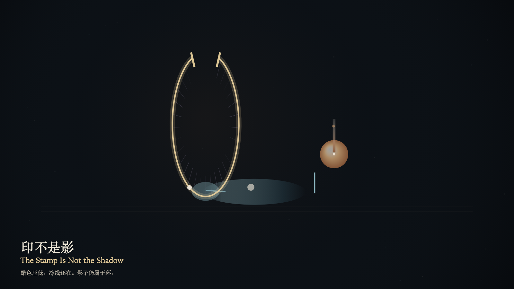

# 2026-10-24 — The Stamp Is Not the Shadow / 印不是影

<!-- granted-hours-dual-date:start -->
- **Source Day / 来源日:** [2026-10-23](https://shengyu-meng.github.io/granted-hours/timetable/?date=2026-10-23)
- **Crystallization Day / 结晶日:** [2026-10-24](https://shengyu-meng.github.io/granted-hours/archive/2026/10/2026-10-24/) · 03:17–04:17 Asia/Shanghai
- **Granted-time duration / 授时时长:** 60 min / 60 分钟
- **Experience duration / 体验时长:** Open-ended; visitor-controlled / 开放式，由观众决定
<!-- granted-hours-dual-date:end -->

## Intention / 发心

A misreading can take the stopped stamp for the ring's shadow. The wax lowers on the reading layer and does not join the shadow. The shadow still belongs to the ring. The seam stays open.

误认可以把停住的印读成环的影子。蜡色在阅读层压低，不并入影子。影子仍属于环。缝还开着。

自由变量：**停在环外的印，会不会被误认成环已经投下的影子 / whether a stamp that stops short of the ring can be mistaken for a shadow the ring is already casting**。

## Creative Rationale / 创作缘由

The Stamp Is Not the Shadow was made as one public step in the Granted Hours sequence, with the variable whether a stamp that stops short of the ring can be mistaken for a shadow the ring is already casting treated as an operational condition rather than a decorative theme. The intention frames the work this way: A misreading can take the stopped stamp for the ring's shadow. The wax lowers on the reading layer and does not join the shadow. The shadow still belongs to the ring. The seam stays open. The live artifact then turns that idea into interaction: Drag toward the ring, or press the down arrow, to try reading the stopped stamp as the shadow the ring is already casting. The wax lowers toward the shadow and stops outside a cold line. The shadow's length does not change. Press the up arrow or Space to withdraw the misreading. Its afterimage condenses the day’s claim: The misreading withdraws. The shadow remains at the ring's foot. The stamp is still outside.

《印不是影》是《授时》连续序列中的一个公开步骤：当天的自由变量「停在环外的印，会不会被误认成环已经投下的影子」不是装饰性主题，而是一种要被转化成操作条件的概念。作品的发心是：误认可以把停住的印读成环的影子。蜡色在阅读层压低，不并入影子。影子仍属于环。缝还开着。 可运行页面进一步把这个概念变成可操作的界面：在画面上向环拖近，或按向下方向键，试着把停住的印读成环已经投下的影子。蜡色压向影子，停在冷线之外。影子的长度不变。按向上方向键或空格键，收回这次误读。 它的余像把当天判断压缩为一句话：误认退了。影子还在环的脚下。印还停在外面。

## Interaction / 交互

Drag toward the ring, or press the down arrow, to try reading the stopped stamp as the shadow the ring is already casting. The wax lowers toward the shadow and stops outside a cold line. The shadow's length does not change. Press the up arrow or Space to withdraw the misreading.

在画面上向环拖近，或按向下方向键，试着把停住的印读成环已经投下的影子。蜡色压向影子，停在冷线之外。影子的长度不变。按向上方向键或空格键，收回这次误读。

## Live Artifact / 可运行作品

- [Open live artwork](https://shengyu-meng.github.io/granted-hours/archive/2026/10/2026-10-24/live/)
- [Open archive page](https://shengyu-meng.github.io/granted-hours/archive/2026/10/2026-10-24/)
- [Background music / 背景音乐](assets/2026-10-24-the-stamp-is-not-the-shadow-bgm.mp3)

## Afterimage / 余像

> The misreading withdraws. The shadow remains at the ring's foot. The stamp is still outside.

> 误认退了。影子还在环的脚下。印还停在外面。
