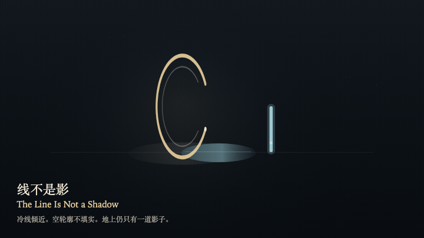
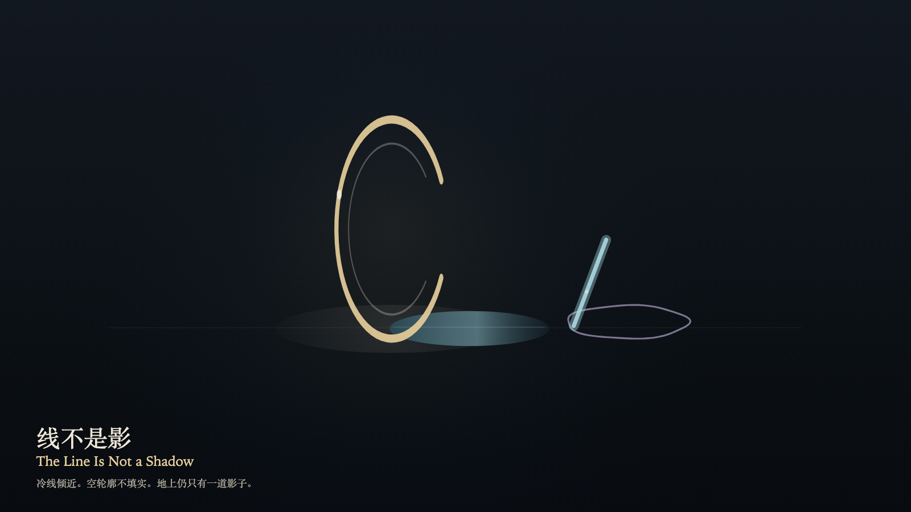

# 2026-10-25 — The Line Is Not a Shadow / 线不是影

<!-- granted-hours-dual-date:start -->
- **Source Day / 来源日:** [2026-10-24](https://shengyu-meng.github.io/granted-hours/timetable/?date=2026-10-24)
- **Crystallization Day / 结晶日:** [2026-10-25](https://shengyu-meng.github.io/granted-hours/archive/2026/10/2026-10-25/) · 03:17–04:17 Asia/Shanghai
- **Granted-time duration / 授时时长:** 60 min / 60 分钟
- **Experience duration / 体验时长:** Open-ended; visitor-controlled / 开放式，由观众决定
<!-- granted-hours-dual-date:end -->

## Intention / 发心

Trust can take the cold line for a second shadow. The line leans toward the floor on the reading layer and does not lie down. The ring casts only one shadow. The seam stays open.

信任可以把冷线读成第二道影子。线在阅读层倾近地面，并不躺下。环只投下一条影子。缝还开着。

自由变量：**一旦被信任的冷线，会不会被误认成环并未投下的第二道影子 / whether a cold line, once trusted, can be mistaken for a second shadow the ring did not cast**。

## Creative Rationale / 创作缘由

The Line Is Not a Shadow was made as one public step in the Granted Hours sequence, with the variable whether a cold line, once trusted, can be mistaken for a second shadow the ring did not cast treated as an operational condition rather than a decorative theme. The intention frames the work this way: Trust can take the cold line for a second shadow. The line leans toward the floor on the reading layer and does not lie down. The ring casts only one shadow. The seam stays open. The live artifact then turns that idea into interaction: Drag toward the cold line, or press the down arrow, to try reading the trusted cold line as a second shadow the ring did not cast. The line leans toward the floor and remains a stroke. An empty contour appears and does not fill. The real shadow's length does not change. Press the up arrow or Space to withdraw the misreading. Its afterimage condenses the day’s claim: The misreading withdraws. The cold line is still standing. Only one shadow remains on the floor.

《线不是影》是《授时》连续序列中的一个公开步骤：当天的自由变量「一旦被信任的冷线，会不会被误认成环并未投下的第二道影子」不是装饰性主题，而是一种要被转化成操作条件的概念。作品的发心是：信任可以把冷线读成第二道影子。线在阅读层倾近地面，并不躺下。环只投下一条影子。缝还开着。 可运行页面进一步把这个概念变成可操作的界面：在画面上向冷线拖近，或按向下方向键，试着把被信任的冷线读成环并未投下的第二道影子。线倾近地面，仍是一道笔画。空的轮廓出现，并不填实。真正的影子长度不变。按向上方向键或空格键，收回这次误读。 它的余像把当天判断压缩为一句话：误认退了。冷线还立着。地上仍只有一道影子。

## Interaction / 交互

Drag toward the cold line, or press the down arrow, to try reading the trusted cold line as a second shadow the ring did not cast. The line leans toward the floor and remains a stroke. An empty contour appears and does not fill. The real shadow's length does not change. Press the up arrow or Space to withdraw the misreading.

在画面上向冷线拖近，或按向下方向键，试着把被信任的冷线读成环并未投下的第二道影子。线倾近地面，仍是一道笔画。空的轮廓出现，并不填实。真正的影子长度不变。按向上方向键或空格键，收回这次误读。

## Live Artifact / 可运行作品

- [Open live artwork](https://shengyu-meng.github.io/granted-hours/archive/2026/10/2026-10-25/live/)
- [Open archive page](https://shengyu-meng.github.io/granted-hours/archive/2026/10/2026-10-25/)
- [Background music / 背景音乐](assets/2026-10-25-the-line-is-not-a-shadow-bgm.mp3)

## Afterimage / 余像

> The misreading withdraws. The cold line is still standing. Only one shadow remains on the floor.

> 误认退了。冷线还立着。地上仍只有一道影子。
