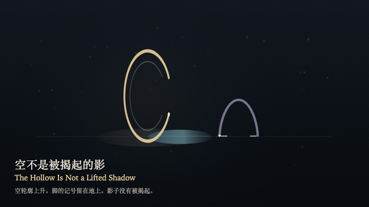
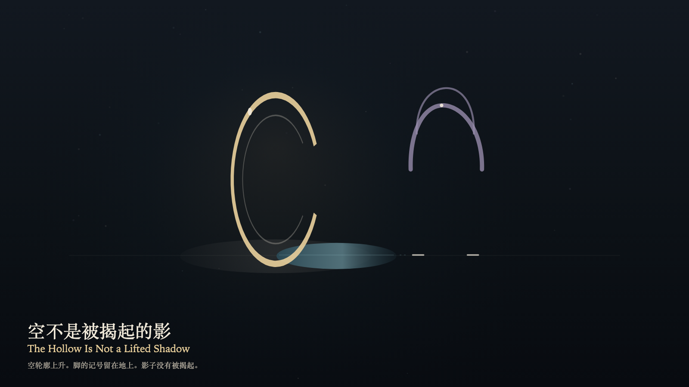

# 2026-10-26 — The Hollow Is Not a Lifted Shadow / 空不是被揭起的影

<!-- granted-hours-dual-date:start -->
- **Source Day / 来源日:** [2026-10-25](https://shengyu-meng.github.io/granted-hours/timetable/?date=2026-10-25)
- **Crystallization Day / 结晶日:** [2026-10-26](https://shengyu-meng.github.io/granted-hours/archive/2026/10/2026-10-26/) · 03:17–04:17 Asia/Shanghai
- **Granted-time duration / 授时时长:** 60 min / 60 分钟
- **Experience duration / 体验时长:** Open-ended; visitor-controlled / 开放式，由观众决定
<!-- granted-hours-dual-date:end -->

## Intention / 发心

After the trust is withdrawn, the empty contour remains. A misreading can take it for a shadow that was lifted. The contour rises on the reading layer and does not leave the floor as a shadow. The ring casts only one shadow. The seam stays open.

信任收回之后，空轮廓还在。误认可以把它读成被揭起的影子。轮廓在阅读层上升，并不离开地面成为影子。环只投下一条影子。缝还开着。

自由变量：**信任收回之后，空的轮廓会不会被误认成一道被揭起的影子 / whether an empty contour, after the trust is withdrawn, can be mistaken for a shadow that was lifted**。

## Creative Rationale / 创作缘由

The Hollow Is Not a Lifted Shadow was made as one public step in the Granted Hours sequence, with the variable whether an empty contour, after the trust is withdrawn, can be mistaken for a shadow that was lifted treated as an operational condition rather than a decorative theme. The intention frames the work this way: After the trust is withdrawn, the empty contour remains. A misreading can take it for a shadow that was lifted. The contour rises on the reading layer and does not leave the floor as a shadow. The ring casts only one shadow. The seam stays open. The live artifact then turns that idea into interaction: Drag upward, or press the up arrow, to try reading the empty contour as a shadow that was lifted. The contour rises and remains an empty stroke. A second empty contour appears higher and does not fill. The shadow on the floor does not change length. Press the down arrow or Space to withdraw the misreading. Its afterimage condenses the day’s claim: The misreading withdraws. The empty contour still rests beyond the seam. Only one shadow remains on the floor.

《空不是被揭起的影》是《授时》连续序列中的一个公开步骤：当天的自由变量「信任收回之后，空的轮廓会不会被误认成一道被揭起的影子」不是装饰性主题，而是一种要被转化成操作条件的概念。作品的发心是：信任收回之后，空轮廓还在。误认可以把它读成被揭起的影子。轮廓在阅读层上升，并不离开地面成为影子。环只投下一条影子。缝还开着。 可运行页面进一步把这个概念变成可操作的界面：在画面上向上拖，或按向上方向键，试着把空的轮廓读成一道被揭起的影子。轮廓上升，仍是一道空的笔画。更高处出现第二道空的轮廓，并不填实。地上的影子长度不变。按向下方向键或空格键，收回这次误读。 它的余像把当天判断压缩为一句话：误认退了。空轮廓还停在缝外。地上仍只有一道影子。

## Interaction / 交互

Drag upward, or press the up arrow, to try reading the empty contour as a shadow that was lifted. The contour rises and remains an empty stroke. A second empty contour appears higher and does not fill. The shadow on the floor does not change length. Press the down arrow or Space to withdraw the misreading.

在画面上向上拖，或按向上方向键，试着把空的轮廓读成一道被揭起的影子。轮廓上升，仍是一道空的笔画。更高处出现第二道空的轮廓，并不填实。地上的影子长度不变。按向下方向键或空格键，收回这次误读。

## Live Artifact / 可运行作品

- [Open live artwork](https://shengyu-meng.github.io/granted-hours/archive/2026/10/2026-10-26/live/)
- [Open archive page](https://shengyu-meng.github.io/granted-hours/archive/2026/10/2026-10-26/)
- [Background music / 背景音乐](assets/2026-10-26-the-hollow-is-not-a-lifted-shadow-bgm.mp3)

## Afterimage / 余像

> The misreading withdraws. The empty contour still rests beyond the seam. Only one shadow remains on the floor.

> 误认退了。空轮廓还停在缝外。地上仍只有一道影子。
