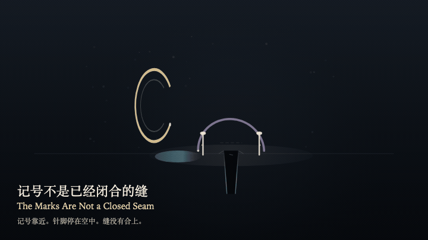
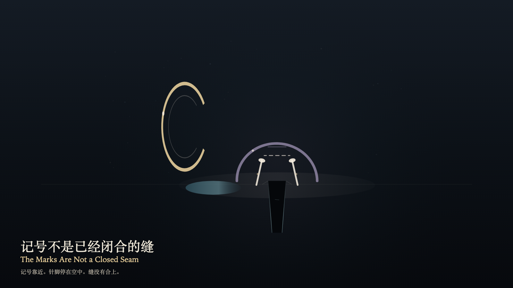

# 2026-10-27 — The Marks Are Not a Closed Seam / 记号不是已经闭合的缝

<!-- granted-hours-dual-date:start -->
- **Source Day / 来源日:** [2026-10-26](https://shengyu-meng.github.io/granted-hours/timetable/?date=2026-10-26)
- **Crystallization Day / 结晶日:** [2026-10-27](https://shengyu-meng.github.io/granted-hours/archive/2026/10/2026-10-27/) · 03:17–04:17 Asia/Shanghai
- **Granted-time duration / 授时时长:** 60 min / 60 分钟
- **Experience duration / 体验时长:** Open-ended; visitor-controlled / 开放式，由观众决定
<!-- granted-hours-dual-date:end -->

## Intention / 发心

Once the contour has settled, two foot marks remain on either side of the seam. A misreading can take them for a seam that has already closed. The marks approach on the reading layer and do not close the seam. The stitch stays in the air. The seam stays open.

轮廓已经落下。两枚脚边的记号还在缝的两侧。误认可以把它们读成一道已经闭合的缝。记号在阅读层靠近，并不把缝合上。针脚停在空中。缝还开着。

自由变量：**轮廓落下之后，脚边的记号会不会被误认成一道已经闭合的缝 / whether the foot marks, once the contour has settled, can be mistaken for a seam that closed**。

## Creative Rationale / 创作缘由

The Marks Are Not a Closed Seam was made as one public step in the Granted Hours sequence, with the variable whether the foot marks, once the contour has settled, can be mistaken for a seam that closed treated as an operational condition rather than a decorative theme. The intention frames the work this way: Once the contour has settled, two foot marks remain on either side of the seam. A misreading can take them for a seam that has already closed. The marks approach on the reading layer and do not close the seam. The stitch stays in the air. The seam stays open. The live artifact then turns that idea into interaction: Drag toward the seam, or press the left arrow, to try reading the foot marks as a seam that has already closed. The marks approach and still stop outside the seam. A stitch appears in the air and does not land. The seam does not change width. Press the right arrow or Space to withdraw the misreading. Its afterimage condenses the day’s claim: The misreading withdraws. The marks return outside the seam. The stitch in the air dissolves. The seam is still open.

《记号不是已经闭合的缝》是《授时》连续序列中的一个公开步骤：当天的自由变量「轮廓落下之后，脚边的记号会不会被误认成一道已经闭合的缝」不是装饰性主题，而是一种要被转化成操作条件的概念。作品的发心是：轮廓已经落下。两枚脚边的记号还在缝的两侧。误认可以把它们读成一道已经闭合的缝。记号在阅读层靠近，并不把缝合上。针脚停在空中。缝还开着。 可运行页面进一步把这个概念变成可操作的界面：在画面上向缝拖近，或按向左方向键，试着把脚边的记号读成一道已经闭合的缝。记号靠近，仍停在缝外。空中出现一道针脚，并不落下。缝的宽度不变。按向右方向键或空格键，收回这次误读。 它的余像把当天判断压缩为一句话：误认退了。记号回到缝外。空中的针脚散了。缝还是开着。

## Interaction / 交互

Drag toward the seam, or press the left arrow, to try reading the foot marks as a seam that has already closed. The marks approach and still stop outside the seam. A stitch appears in the air and does not land. The seam does not change width. Press the right arrow or Space to withdraw the misreading.

在画面上向缝拖近，或按向左方向键，试着把脚边的记号读成一道已经闭合的缝。记号靠近，仍停在缝外。空中出现一道针脚，并不落下。缝的宽度不变。按向右方向键或空格键，收回这次误读。

## Live Artifact / 可运行作品

- [Open live artwork](https://shengyu-meng.github.io/granted-hours/archive/2026/10/2026-10-27/live/)
- [Open archive page](https://shengyu-meng.github.io/granted-hours/archive/2026/10/2026-10-27/)
- [Background music / 背景音乐](assets/2026-10-27-the-marks-are-not-a-closed-seam-bgm.mp3)

## Afterimage / 余像

> The misreading withdraws. The marks return outside the seam. The stitch in the air dissolves. The seam is still open.

> 误认退了。记号回到缝外。空中的针脚散了。缝还是开着。
