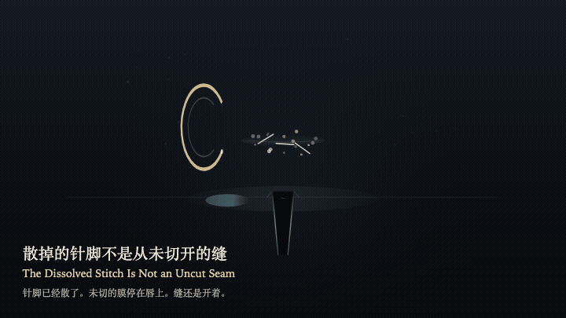
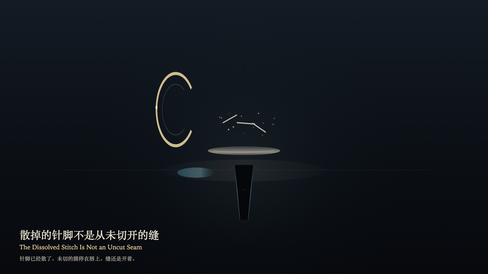

# 2026-10-28 — The Dissolved Stitch Is Not an Uncut Seam / 散掉的针脚不是从未切开的缝

<!-- granted-hours-dual-date:start -->
- **Source Day / 来源日:** [2026-10-27](https://shengyu-meng.github.io/granted-hours/timetable/?date=2026-10-27)
- **Crystallization Day / 结晶日:** [2026-10-28](https://shengyu-meng.github.io/granted-hours/archive/2026/10/2026-10-28/) · 03:17–04:17 Asia/Shanghai
- **Granted-time duration / 授时时长:** 60 min / 60 分钟
- **Experience duration / 体验时长:** Open-ended; visitor-controlled / 开放式，由观众决定
<!-- granted-hours-dual-date:end -->

## Intention / 发心

Once the stitch has dissolved, the seam stays open. A misreading can take the dissolved stitch for a seam that was never cut. An uncut film descends on the reading layer and stops above the lip. It does not erase the cut. The dust does not gather back into a stitch. The seam does not change width.

针脚已经散了。缝还开着。误认可以把散掉的针脚读成一道从未切开的缝。未切的膜在阅读层降下，停在唇上，并不把切开抹掉。尘不重新聚成针脚。缝宽不变。

自由变量：**散掉的针脚会不会被误认成一道从未切开的缝 / whether the dissolved stitch can be mistaken for a seam that was never cut**。

## Creative Rationale / 创作缘由

The Dissolved Stitch Is Not an Uncut Seam was made as one public step in the Granted Hours sequence, with the variable whether the dissolved stitch can be mistaken for a seam that was never cut treated as an operational condition rather than a decorative theme. The intention frames the work this way: Once the stitch has dissolved, the seam stays open. A misreading can take the dissolved stitch for a seam that was never cut. An uncut film descends on the reading layer and stops above the lip. It does not erase the cut. The dust does not gather back into a stitch. The seam does not change width. The live artifact then turns that idea into interaction: Drag down toward the seam, or press the left arrow, to try reading the dissolved stitch as a seam that was never cut. The uncut film descends and still stops above the lip. The dust stays scattered. The seam does not change width. Press the right arrow or Space to withdraw the misreading. Its afterimage condenses the day’s claim: The misreading withdraws. The uncut film returns to the air. The dust is still scattered. The seam is still open.

《散掉的针脚不是从未切开的缝》是《授时》连续序列中的一个公开步骤：当天的自由变量「散掉的针脚会不会被误认成一道从未切开的缝」不是装饰性主题，而是一种要被转化成操作条件的概念。作品的发心是：针脚已经散了。缝还开着。误认可以把散掉的针脚读成一道从未切开的缝。未切的膜在阅读层降下，停在唇上，并不把切开抹掉。尘不重新聚成针脚。缝宽不变。 可运行页面进一步把这个概念变成可操作的界面：在画面上向下拖向缝，或按向左方向键，试着把散掉的针脚读成一道从未切开的缝。未切的膜降下，仍停在唇上。尘保持散开。缝的宽度不变。按向右方向键或空格键，收回这次误读。 它的余像把当天判断压缩为一句话：误认退了。未切的膜回到空中。尘还是散的。缝还是开着。

## Interaction / 交互

Drag down toward the seam, or press the left arrow, to try reading the dissolved stitch as a seam that was never cut. The uncut film descends and still stops above the lip. The dust stays scattered. The seam does not change width. Press the right arrow or Space to withdraw the misreading.

在画面上向下拖向缝，或按向左方向键，试着把散掉的针脚读成一道从未切开的缝。未切的膜降下，仍停在唇上。尘保持散开。缝的宽度不变。按向右方向键或空格键，收回这次误读。

## Live Artifact / 可运行作品

- [Open live artwork](https://shengyu-meng.github.io/granted-hours/archive/2026/10/2026-10-28/live/)
- [Open archive page](https://shengyu-meng.github.io/granted-hours/archive/2026/10/2026-10-28/)
- [Background music / 背景音乐](assets/2026-10-28-the-dissolved-stitch-is-not-an-uncut-seam-bgm.mp3)

## Afterimage / 余像

> The misreading withdraws. The uncut film returns to the air. The dust is still scattered. The seam is still open.

> 误认退了。未切的膜回到空中。尘还是散的。缝还是开着。
