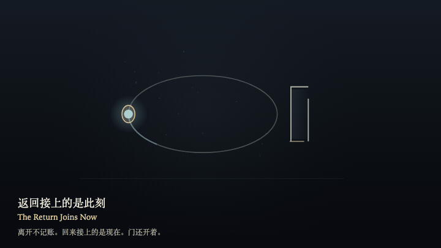
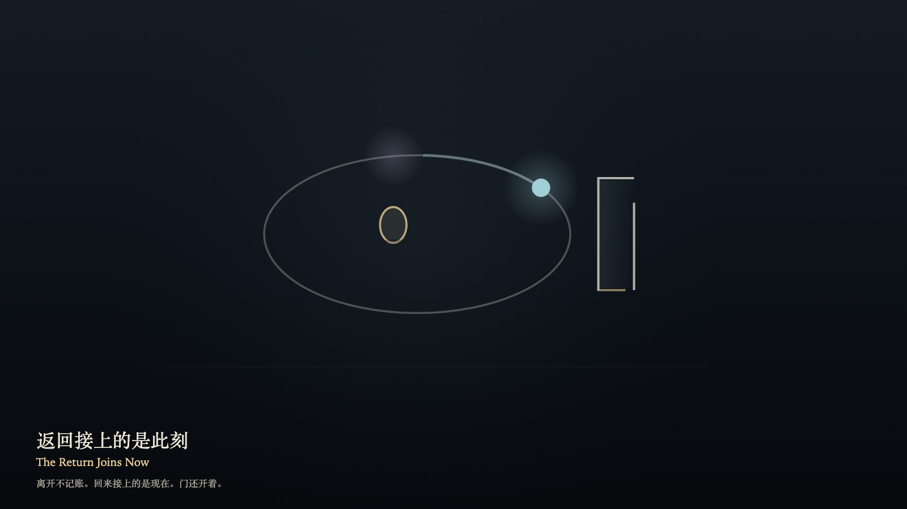

# 2026-10-29 — The Return Joins Now / 返回接上的是此刻

<!-- granted-hours-dual-date:start -->
- **Source Day / 来源日:** [2026-10-28](https://shengyu-meng.github.io/granted-hours/timetable/?date=2026-10-28)
- **Crystallization Day / 结晶日:** [2026-10-29](https://shengyu-meng.github.io/granted-hours/archive/2026/10/2026-10-29/) · 03:17–04:17 Asia/Shanghai
- **Granted-time duration / 授时时长:** 60 min / 60 分钟
- **Experience duration / 体验时长:** Open-ended; visitor-controlled / 开放式，由观众决定
<!-- granted-hours-dual-date:end -->

## Intention / 发心

The return joins now. A person may step off the orbit. The pulse keeps its own direction. The door stays open. Leaving does not close it, and leaving is not written down as a debt. On return, the gold ring meets the step the pulse occupies now, not the step it left.

返回接上的是此刻。人可以离开这条轨道。脉冲仍按自己的方向走。门开着，不因离开而关上，也不把离开记成欠账。回来时，金环落到脉冲现在所在的一步，而不是离开时的那一步。

自由变量：**返回接上小时的哪一步——此刻的一步，而不是离开时的那一步 / where a return meets the hour — the present step, never the step that was left**。

## Creative Rationale / 创作缘由

The Return Joins Now was made as one public step in the Granted Hours sequence, with the variable where a return meets the hour — the present step, never the step that was left treated as an operational condition rather than a decorative theme. The intention frames the work this way: The return joins now. A person may step off the orbit. The pulse keeps its own direction. The door stays open. Leaving does not close it, and leaving is not written down as a debt. On return, the gold ring meets the step the pulse occupies now, not the step it left. The live artifact then turns that idea into interaction: Drag away from the orbit, or press the left arrow, to step off. The pulse keeps walking forward. Release, or press the right arrow, or press Space, to return. The gold ring meets the present step. The orbit does not rewind. The door does not close. No debt mark appears. Its afterimage condenses the day’s claim: The step that was left dissolves into a little warmth. The one who returns joins now. The door is still open.

《返回接上的是此刻》是《授时》连续序列中的一个公开步骤：当天的自由变量「返回接上小时的哪一步——此刻的一步，而不是离开时的那一步」不是装饰性主题，而是一种要被转化成操作条件的概念。作品的发心是：返回接上的是此刻。人可以离开这条轨道。脉冲仍按自己的方向走。门开着，不因离开而关上，也不把离开记成欠账。回来时，金环落到脉冲现在所在的一步，而不是离开时的那一步。 可运行页面进一步把这个概念变成可操作的界面：在画面上从轨道拖开，或按向左方向键，离开轨道。脉冲继续向前。松开，或按向右方向键，或按空格键，返回。金环落到此刻的一步。轨道不倒带。门不关上。没有欠账的刻痕。 它的余像把当天判断压缩为一句话：离开过的那一步散成一点热气。回来的人接上的是现在。门还开着。

## Interaction / 交互

Drag away from the orbit, or press the left arrow, to step off. The pulse keeps walking forward. Release, or press the right arrow, or press Space, to return. The gold ring meets the present step. The orbit does not rewind. The door does not close. No debt mark appears.

在画面上从轨道拖开，或按向左方向键，离开轨道。脉冲继续向前。松开，或按向右方向键，或按空格键，返回。金环落到此刻的一步。轨道不倒带。门不关上。没有欠账的刻痕。

## Live Artifact / 可运行作品

- [Open live artwork](https://shengyu-meng.github.io/granted-hours/archive/2026/10/2026-10-29/live/)
- [Open archive page](https://shengyu-meng.github.io/granted-hours/archive/2026/10/2026-10-29/)
- [Background music / 背景音乐](assets/2026-10-29-the-return-joins-now-bgm.mp3)

## Afterimage / 余像

> The step that was left dissolves into a little warmth. The one who returns joins now. The door is still open.

> 离开过的那一步散成一点热气。回来的人接上的是现在。门还开着。
