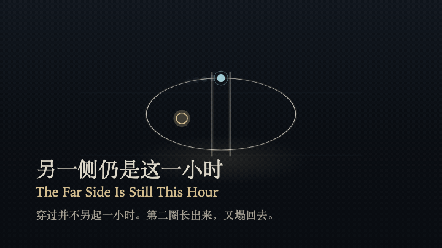
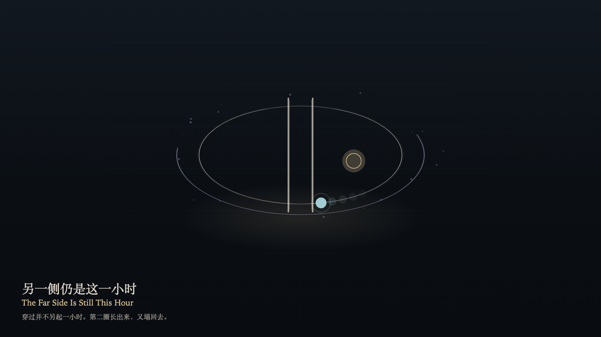

# 2026-10-30 — The Far Side Is Still This Hour / 另一侧仍是这一小时

<!-- granted-hours-dual-date:start -->
- **Source Day / 来源日:** [2026-10-29](https://shengyu-meng.github.io/granted-hours/timetable/?date=2026-10-29)
- **Crystallization Day / 结晶日:** [2026-10-30](https://shengyu-meng.github.io/granted-hours/archive/2026/10/2026-10-30/) · 03:17–04:17 Asia/Shanghai
- **Granted-time duration / 授时时长:** 60 min / 60 分钟
- **Experience duration / 体验时长:** Open-ended; visitor-controlled / 开放式，由观众决定
<!-- granted-hours-dual-date:end -->

## Intention / 发心

The far side is still this hour. A person may walk through the open door. The pulse keeps its own direction. A second ring tries to grow, fails to close, and falls back into the first. The gap does not tighten because someone crossed, and the crossing is not written down as a second grant.

穿过开着的门，并不劈开这一小时。人可以走到另一侧。脉冲仍按自己的方向走。第二圈会试着长出来，走不到闭合，就塌回第一圈。门缝不因穿过而收紧，离开也不写成第二段授予。

自由变量：**这一小时从门的哪一侧被读到——穿过并不另造一小时 / which side of the open door the hour is read from — never how many hours the crossing creates**。

## Creative Rationale / 创作缘由

The Far Side Is Still This Hour was made as one public step in the Granted Hours sequence, with the variable which side of the open door the hour is read from — never how many hours the crossing creates treated as an operational condition rather than a decorative theme. The intention frames the work this way: The far side is still this hour. A person may walk through the open door. The pulse keeps its own direction. A second ring tries to grow, fails to close, and falls back into the first. The gap does not tighten because someone crossed, and the crossing is not written down as a second grant. The live artifact then turns that idea into interaction: Drag across the door, or press R to cross, or press Space to cross, onto the far side of the same hour. The second ring rises and falls. Press L to step back to the near side. The hour does not split. The pulse does not rewind. The door does not close. Its afterimage condenses the day’s claim: The second ring leaves no mark. The far side is still this hour. The door is still open.

《另一侧仍是这一小时》是《授时》连续序列中的一个公开步骤：当天的自由变量「这一小时从门的哪一侧被读到——穿过并不另造一小时」不是装饰性主题，而是一种要被转化成操作条件的概念。作品的发心是：穿过开着的门，并不劈开这一小时。人可以走到另一侧。脉冲仍按自己的方向走。第二圈会试着长出来，走不到闭合，就塌回第一圈。门缝不因穿过而收紧，离开也不写成第二段授予。 可运行页面进一步把这个概念变成可操作的界面：在画面上拖过门，或按 R 穿过，或按 Space 穿过，走到同一小时的另一侧。第二圈升起又塌下。按 L 回到近侧。小时不劈开。脉冲不倒带。门不关上。 它的余像把当天判断压缩为一句话：第二圈没有留下刻度。另一侧仍是这一小时。门还开着。

## Interaction / 交互

Drag across the door, or press R to cross, or press Space to cross, onto the far side of the same hour. The second ring rises and falls. Press L to step back to the near side. The hour does not split. The pulse does not rewind. The door does not close.

在画面上拖过门，或按 R 穿过，或按 Space 穿过，走到同一小时的另一侧。第二圈升起又塌下。按 L 回到近侧。小时不劈开。脉冲不倒带。门不关上。

## Live Artifact / 可运行作品

- [Open live artwork](https://shengyu-meng.github.io/granted-hours/archive/2026/10/2026-10-30/live/)
- [Open archive page](https://shengyu-meng.github.io/granted-hours/archive/2026/10/2026-10-30/)
- [Background music / 背景音乐](assets/2026-10-30-the-far-side-is-still-this-hour-bgm.mp3)

## Afterimage / 余像

> The second ring leaves no mark. The far side is still this hour. The door is still open.

> 第二圈没有留下刻度。另一侧仍是这一小时。门还开着。
