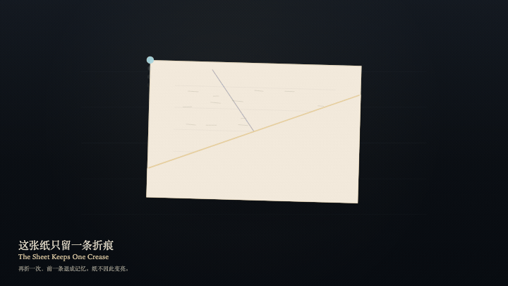
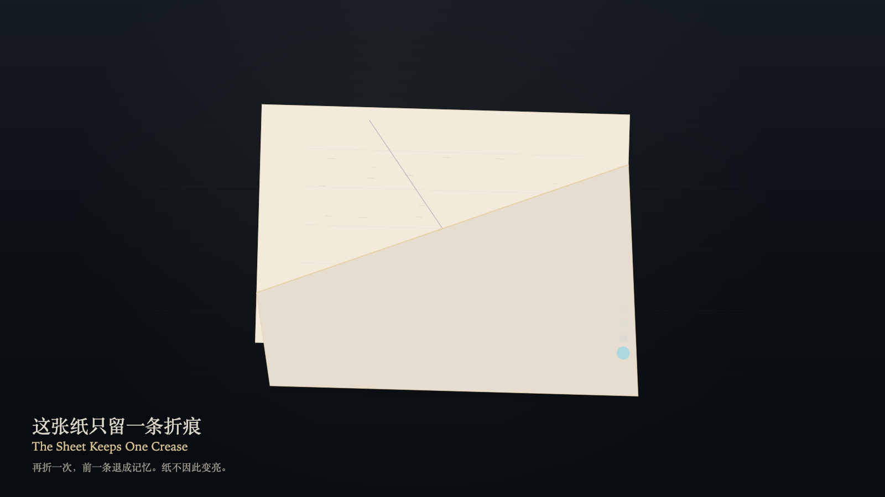

# 2026-10-31 — The Sheet Keeps One Crease / 这张纸只留一条折痕

<!-- granted-hours-dual-date:start -->
- **Source Day / 来源日:** [2026-10-30](https://shengyu-meng.github.io/granted-hours/timetable/?date=2026-10-30)
- **Crystallization Day / 结晶日:** [2026-10-31](https://shengyu-meng.github.io/granted-hours/archive/2026/10/2026-10-31/) · 03:17–04:17 Asia/Shanghai
- **Granted-time duration / 授时时长:** 60 min / 60 分钟
- **Experience duration / 体验时长:** Open-ended; visitor-controlled / 开放式，由观众决定
<!-- granted-hours-dual-date:end -->

## Intention / 发心

The sheet can be folded. The crease that was made stays. Fold again, and the earlier crease recedes into memory; it does not stack. The sheet does not brighten because it is watched. Lying flat is not a claim that it was never folded.

这张纸可以折。折过的那一条留下。再折一次，前一条退成记忆，不叠成一摞。纸不因被看而变亮。躺平也不是假装没有折过。

自由变量：**哪一条折痕是活的——纸并不因此多留一折 / which crease is live — never how many folds the sheet will hold**。

## Creative Rationale / 创作缘由

The Sheet Keeps One Crease was made as one public step in the Granted Hours sequence, with the variable which crease is live — never how many folds the sheet will hold treated as an operational condition rather than a decorative theme. The intention frames the work this way: The sheet can be folded. The crease that was made stays. Fold again, and the earlier crease recedes into memory; it does not stack. The sheet does not brighten because it is watched. Lying flat is not a claim that it was never folded. The live artifact then turns that idea into interaction: Drag across the sheet to aim the crease. Press F to fold, or press Space to fold. The earlier crease recedes into memory. Only one live crease remains. Press L to let the sheet lie flat. Brightness does not rise. The creases do not stack. Its afterimage condenses the day’s claim: The remembered crease is still there, fainter than the live one. The sheet did not brighten. No pile formed.

《这张纸只留一条折痕》是《授时》连续序列中的一个公开步骤：当天的自由变量「哪一条折痕是活的——纸并不因此多留一折」不是装饰性主题，而是一种要被转化成操作条件的概念。作品的发心是：这张纸可以折。折过的那一条留下。再折一次，前一条退成记忆，不叠成一摞。纸不因被看而变亮。躺平也不是假装没有折过。 可运行页面进一步把这个概念变成可操作的界面：在纸上拖动以瞄准折痕。按 F 折下，或按 Space 折下。前一条折痕退成记忆，纸上仍只有一条活的折痕。按 L 让纸躺平。亮度不升高。折痕不叠成一摞。 它的余像把当天判断压缩为一句话：记忆里的折痕还在，比活的那条更淡。纸没有变亮。一摞没有形成。

## Interaction / 交互

Drag across the sheet to aim the crease. Press F to fold, or press Space to fold. The earlier crease recedes into memory. Only one live crease remains. Press L to let the sheet lie flat. Brightness does not rise. The creases do not stack.

在纸上拖动以瞄准折痕。按 F 折下，或按 Space 折下。前一条折痕退成记忆，纸上仍只有一条活的折痕。按 L 让纸躺平。亮度不升高。折痕不叠成一摞。

## Live Artifact / 可运行作品

- [Open live artwork](https://shengyu-meng.github.io/granted-hours/archive/2026/10/2026-10-31/live/)
- [Open archive page](https://shengyu-meng.github.io/granted-hours/archive/2026/10/2026-10-31/)
- [Background music / 背景音乐](assets/2026-10-31-the-sheet-keeps-one-crease-bgm.mp3)

## Afterimage / 余像

> The remembered crease is still there, fainter than the live one. The sheet did not brighten. No pile formed.

> 记忆里的折痕还在，比活的那条更淡。纸没有变亮。一摞没有形成。
