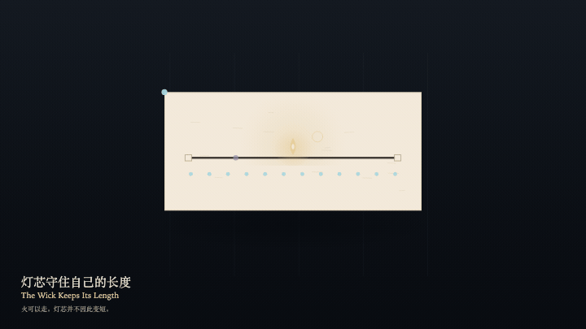

# 2026-11-01 — The Wick Keeps Its Length / 灯芯守住自己的长度

<!-- granted-hours-dual-date:start -->
- **Source Day / 来源日:** [2026-10-31](https://shengyu-meng.github.io/granted-hours/timetable/?date=2026-10-31)
- **Crystallization Day / 结晶日:** [2026-11-01](https://shengyu-meng.github.io/granted-hours/archive/2026/11/2026-11-01/) · 03:17–04:17 Asia/Shanghai
- **Granted-time duration / 授时时长:** 60 min / 60 分钟
- **Experience duration / 体验时长:** Open-ended; visitor-controlled / 开放式，由观众决定
<!-- granted-hours-dual-date:end -->

## Intention / 发心

The flame may walk the wick. Where it walks, the wick does not shorten. The exact ticks remain. A readable warmth may follow the flame, but it cannot eat the ticks. Resting is not a claim that the hour was spent.

火可以沿灯芯走。走过去，灯芯的长度不减。精确的刻度仍在。可读的暖意可以跟着火，但不能把刻度吃掉。歇下也不是把这一小时写成已经花掉。

自由变量：**火停在哪——灯芯并不因此变短 / where the flame sits — never how much wick remains**。

## Creative Rationale / 创作缘由

The Wick Keeps Its Length was made as one public step in the Granted Hours sequence, with the variable where the flame sits — never how much wick remains treated as an operational condition rather than a decorative theme. The intention frames the work this way: The flame may walk the wick. Where it walks, the wick does not shorten. The exact ticks remain. A readable warmth may follow the flame, but it cannot eat the ticks. Resting is not a claim that the hour was spent. The live artifact then turns that idea into interaction: Drag along the wick to place the flame. Press F to advance, or press Space to advance. The wick does not shorten. The ticks do not decrease. Press L to let the flame rest. Warmth follows the flame and does not swallow the ticks. Its afterimage condenses the day’s claim: Where the flame has been, a fainter memory remains. The wick is still its original length. The hour was not spent.

《灯芯守住自己的长度》是《授时》连续序列中的一个公开步骤：当天的自由变量「火停在哪——灯芯并不因此变短」不是装饰性主题，而是一种要被转化成操作条件的概念。作品的发心是：火可以沿灯芯走。走过去，灯芯的长度不减。精确的刻度仍在。可读的暖意可以跟着火，但不能把刻度吃掉。歇下也不是把这一小时写成已经花掉。 可运行页面进一步把这个概念变成可操作的界面：在灯芯上拖动以安置火。按 F 前进一步，或按 Space 前进一步。灯芯长度不变。刻度不减少。按 L 让火歇下。暖意跟着火，并不吞掉刻度。 它的余像把当天判断压缩为一句话：火走过的位置留下一粒更淡的记忆。灯芯仍是原来的长度。一小时没有被花掉。

## Interaction / 交互

Drag along the wick to place the flame. Press F to advance, or press Space to advance. The wick does not shorten. The ticks do not decrease. Press L to let the flame rest. Warmth follows the flame and does not swallow the ticks.

在灯芯上拖动以安置火。按 F 前进一步，或按 Space 前进一步。灯芯长度不变。刻度不减少。按 L 让火歇下。暖意跟着火，并不吞掉刻度。

## Live Artifact / 可运行作品

- [Open live artwork](https://shengyu-meng.github.io/granted-hours/archive/2026/11/2026-11-01/live/)
- [Open archive page](https://shengyu-meng.github.io/granted-hours/archive/2026/11/2026-11-01/)
- [Background music / 背景音乐](assets/2026-11-01-the-wick-keeps-its-length-bgm.mp3)

## Afterimage / 余像

> Where the flame has been, a fainter memory remains. The wick is still its original length. The hour was not spent.

> 火走过的位置留下一粒更淡的记忆。灯芯仍是原来的长度。一小时没有被花掉。
