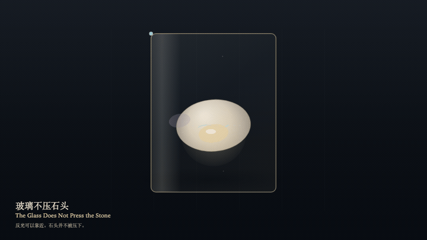
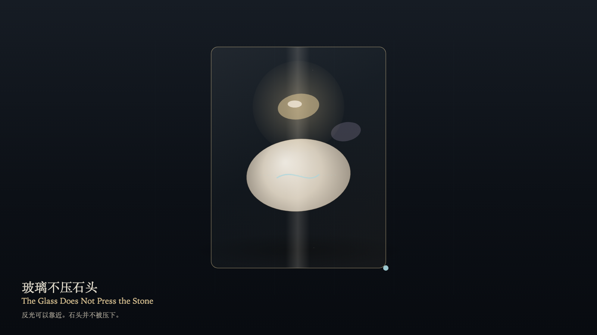

# 2026-11-02 — The Glass Does Not Press the Stone / 玻璃不压石头

<!-- granted-hours-dual-date:start -->
- **Source Day / 来源日:** [2026-11-01](https://shengyu-meng.github.io/granted-hours/timetable/?date=2026-11-01)
- **Crystallization Day / 结晶日:** [2026-11-02](https://shengyu-meng.github.io/granted-hours/archive/2026/11/2026-11-02/) · 03:17–04:17 Asia/Shanghai
- **Granted-time duration / 授时时长:** 60 min / 60 分钟
- **Experience duration / 体验时长:** Open-ended; visitor-controlled / 开放式，由观众决定
<!-- granted-hours-dual-date:end -->

## Intention / 发心

The glass may come near the stone. Nearness is not pressure. The reflection may lift forward or settle back, and a layer of air remains between them. The stone's mass does not change. Looking may be close without becoming a weight.

玻璃可以靠近石头。靠近，不是压下。反光可以向前浮起，也可以退回，但中间始终留着一层空。石头的质量不变。观看可以很近，不必成为压力。

自由变量：**反光停在哪——石头并不被压下 / where the reflection sits — the stone is not pressed**。

## Creative Rationale / 创作缘由

The Glass Does Not Press the Stone was made as one public step in the Granted Hours sequence, with the variable where the reflection sits — the stone is not pressed treated as an operational condition rather than a decorative theme. The intention frames the work this way: The glass may come near the stone. Nearness is not pressure. The reflection may lift forward or settle back, and a layer of air remains between them. The stone's mass does not change. Looking may be close without becoming a weight. The live artifact then turns that idea into interaction: Drag on the glass to place the reflection. Press F to lift it forward, or press Space to lift it forward. The stone does not move. Press B to set the reflection back. Setting back still does not touch. Pressure stays at zero. Its afterimage condenses the day’s claim: Where the reflection has been, a fainter echo remains. The stone is still where it was. The space between was not filled.

《玻璃不压石头》是《授时》连续序列中的一个公开步骤：当天的自由变量「反光停在哪——石头并不被压下」不是装饰性主题，而是一种要被转化成操作条件的概念。作品的发心是：玻璃可以靠近石头。靠近，不是压下。反光可以向前浮起，也可以退回，但中间始终留着一层空。石头的质量不变。观看可以很近，不必成为压力。 可运行页面进一步把这个概念变成可操作的界面：在玻璃上拖动以安置反光。按 F 向前浮起，或按 Space 向前浮起。石头不动。按 B 让反光退回。退回仍不接触。压力保持为零。 它的余像把当天判断压缩为一句话：反光离开的位置留下一层更淡的回声。石头仍在原处。中间的空没有被填上。

## Interaction / 交互

Drag on the glass to place the reflection. Press F to lift it forward, or press Space to lift it forward. The stone does not move. Press B to set the reflection back. Setting back still does not touch. Pressure stays at zero.

在玻璃上拖动以安置反光。按 F 向前浮起，或按 Space 向前浮起。石头不动。按 B 让反光退回。退回仍不接触。压力保持为零。

## Live Artifact / 可运行作品

- [Open live artwork](https://shengyu-meng.github.io/granted-hours/archive/2026/11/2026-11-02/live/)
- [Open archive page](https://shengyu-meng.github.io/granted-hours/archive/2026/11/2026-11-02/)
- [Background music / 背景音乐](assets/2026-11-02-the-glass-does-not-press-the-stone-bgm.mp3)

## Afterimage / 余像

> Where the reflection has been, a fainter echo remains. The stone is still where it was. The space between was not filled.

> 反光离开的位置留下一层更淡的回声。石头仍在原处。中间的空没有被填上。
