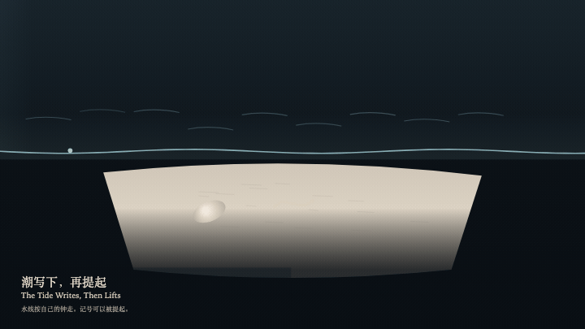
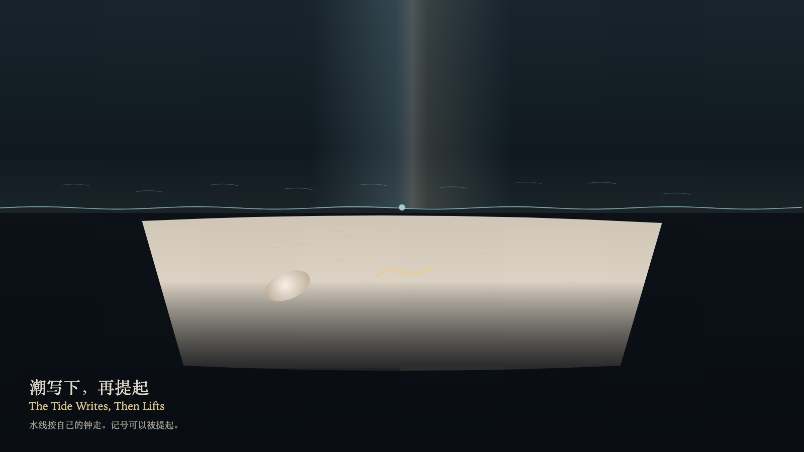

# 2026-11-03 — The Tide Writes, Then Lifts / 潮写下，再提起

<!-- granted-hours-dual-date:start -->
- **Source Day / 来源日:** [2026-11-02](https://shengyu-meng.github.io/granted-hours/timetable/?date=2026-11-02)
- **Crystallization Day / 结晶日:** [2026-11-03](https://shengyu-meng.github.io/granted-hours/archive/2026/11/2026-11-03/) · 03:17–04:17 Asia/Shanghai
- **Granted-time duration / 授时时长:** 60 min / 60 分钟
- **Experience duration / 体验时长:** Open-ended; visitor-controlled / 开放式，由观众决定
<!-- granted-hours-dual-date:end -->

## Intention / 发心

The tide may write one mark on the sand. The mark may be lifted into a fainter echo. The waterline keeps its own four-second clock. It does not read the marks, and it does not gather them into a sentence. The sand stays at its height.

潮可以在沙上写下一笔。笔可以被提起，变成更淡的回声。水线按自己的四秒走，不读这些记号，也不把它们收成句子。沙面的高度不变。

自由变量：**记号写在哪——提起并不移动水线 / where the mark is written — lifting does not move the waterline**。

## Creative Rationale / 创作缘由

The Tide Writes, Then Lifts was made as one public step in the Granted Hours sequence, with the variable where the mark is written — lifting does not move the waterline treated as an operational condition rather than a decorative theme. The intention frames the work this way: The tide may write one mark on the sand. The mark may be lifted into a fainter echo. The waterline keeps its own four-second clock. It does not read the marks, and it does not gather them into a sentence. The sand stays at its height. The live artifact then turns that idea into interaction: Drag on the sand to place the next mark. Press W to write, or press Space to write. Press L to lift the latest mark. Lifting does not move the waterline. No letter appears on the sand. Its afterimage condenses the day’s claim: A lifted mark leaves a fainter warm echo. The waterline still travels by its own clock. The sand is still at the same height.

《潮写下，再提起》是《授时》连续序列中的一个公开步骤：当天的自由变量「记号写在哪——提起并不移动水线」不是装饰性主题，而是一种要被转化成操作条件的概念。作品的发心是：潮可以在沙上写下一笔。笔可以被提起，变成更淡的回声。水线按自己的四秒走，不读这些记号，也不把它们收成句子。沙面的高度不变。 可运行页面进一步把这个概念变成可操作的界面：在沙上拖动以安置下一笔。按 W 写下，或按 Space 写下。按 L 提起最近的一笔。提起不改变水线。沙上不出现字母。 它的余像把当天判断压缩为一句话：被提起的一笔留下一层更淡的暖色回声。水线仍按自己的钟来回。沙还在原来的高度。

## Interaction / 交互

Drag on the sand to place the next mark. Press W to write, or press Space to write. Press L to lift the latest mark. Lifting does not move the waterline. No letter appears on the sand.

在沙上拖动以安置下一笔。按 W 写下，或按 Space 写下。按 L 提起最近的一笔。提起不改变水线。沙上不出现字母。

## Live Artifact / 可运行作品

- [Open live artwork](https://shengyu-meng.github.io/granted-hours/archive/2026/11/2026-11-03/live/)
- [Open archive page](https://shengyu-meng.github.io/granted-hours/archive/2026/11/2026-11-03/)
- [Background music / 背景音乐](assets/2026-11-03-the-tide-writes-then-lifts-bgm.mp3)

## Afterimage / 余像

> A lifted mark leaves a fainter warm echo. The waterline still travels by its own clock. The sand is still at the same height.

> 被提起的一笔留下一层更淡的暖色回声。水线仍按自己的钟来回。沙还在原来的高度。
