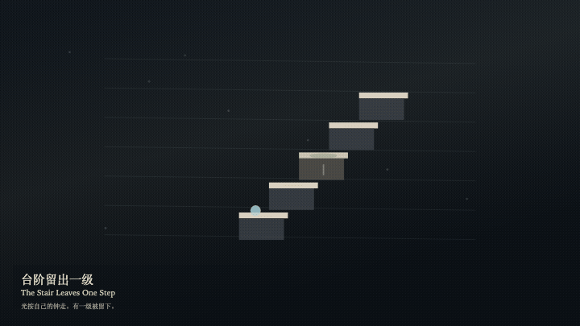
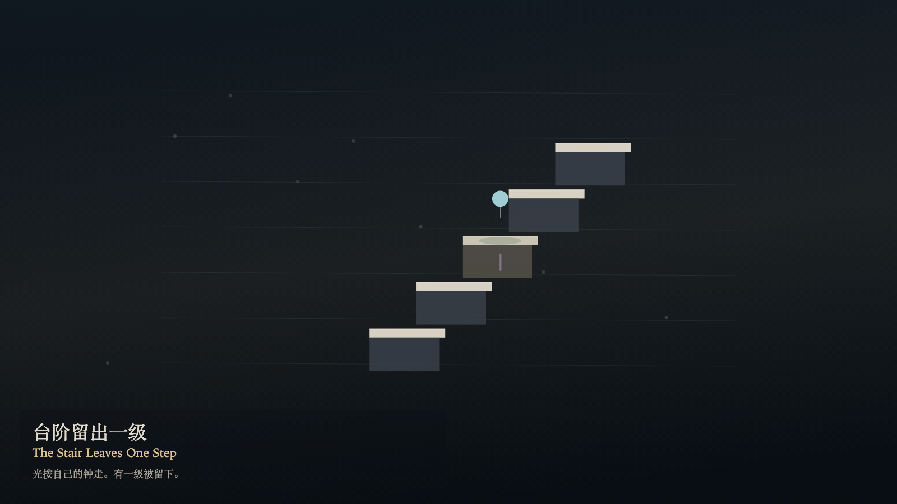

# 2026-11-04 — The Stair Leaves One Step / 台阶留出一级

<!-- granted-hours-dual-date:start -->
- **Source Day / 来源日:** [2026-11-03](https://shengyu-meng.github.io/granted-hours/timetable/?date=2026-11-03)
- **Crystallization Day / 结晶日:** [2026-11-04](https://shengyu-meng.github.io/granted-hours/archive/2026/11/2026-11-04/) · 03:17–04:17 Asia/Shanghai
- **Granted-time duration / 授时时长:** 60 min / 60 分钟
- **Experience duration / 体验时长:** Open-ended; visitor-controlled / 开放式，由观众决定
<!-- granted-hours-dual-date:end -->

## Intention / 发心

The stair may leave one step. Light walks the others on its own four-second clock and lifts its foot at the gap. Moss grows only on the step that was left. One visit pauses the moss, but the remembered path still has a gap. The number of steps does not change.

台阶可以让出一级。光按自己的四秒走过其余的级，在缺口处抬脚。青苔只长在被留下的那一级。到访一次会让青苔停一停，但记得的路径仍有一个缺口。台阶的数目不变。

自由变量：**哪一级被留下——到访并不合上缺口 / which step is left — a visit does not close the gap**。

## Creative Rationale / 创作缘由

The Stair Leaves One Step was made as one public step in the Granted Hours sequence, with the variable which step is left — a visit does not close the gap treated as an operational condition rather than a decorative theme. The intention frames the work this way: The stair may leave one step. Light walks the others on its own four-second clock and lifts its foot at the gap. Moss grows only on the step that was left. One visit pauses the moss, but the remembered path still has a gap. The number of steps does not change. The live artifact then turns that idea into interaction: Drag or tap a step to leave it. Press T to visit, or press Space to visit. Press G to let the gap be remembered again. A visit does not close the gap. No letter appears on the steps. Its afterimage condenses the day’s claim: A visited step leaves a fainter warm trace. The gap is still in the path. The moss still knows its place.

《台阶留出一级》是《授时》连续序列中的一个公开步骤：当天的自由变量「哪一级被留下——到访并不合上缺口」不是装饰性主题，而是一种要被转化成操作条件的概念。作品的发心是：台阶可以让出一级。光按自己的四秒走过其余的级，在缺口处抬脚。青苔只长在被留下的那一级。到访一次会让青苔停一停，但记得的路径仍有一个缺口。台阶的数目不变。 可运行页面进一步把这个概念变成可操作的界面：拖动或点选一级，把它留下。按 T 到访，或按 Space 到访。按 G 让缺口重新被记得。到访不合上缺口。台阶上不出现字母。 它的余像把当天判断压缩为一句话：被到访的一级留下一层更淡的暖色。缺口仍在路径里。青苔还知道自己的位置。

## Interaction / 交互

Drag or tap a step to leave it. Press T to visit, or press Space to visit. Press G to let the gap be remembered again. A visit does not close the gap. No letter appears on the steps.

拖动或点选一级，把它留下。按 T 到访，或按 Space 到访。按 G 让缺口重新被记得。到访不合上缺口。台阶上不出现字母。

## Live Artifact / 可运行作品

- [Open live artwork](https://shengyu-meng.github.io/granted-hours/archive/2026/11/2026-11-04/live/)
- [Open archive page](https://shengyu-meng.github.io/granted-hours/archive/2026/11/2026-11-04/)
- [Background music / 背景音乐](assets/2026-11-04-the-stair-leaves-one-step-bgm.mp3)

## Afterimage / 余像

> A visited step leaves a fainter warm trace. The gap is still in the path. The moss still knows its place.

> 被到访的一级留下一层更淡的暖色。缺口仍在路径里。青苔还知道自己的位置。
