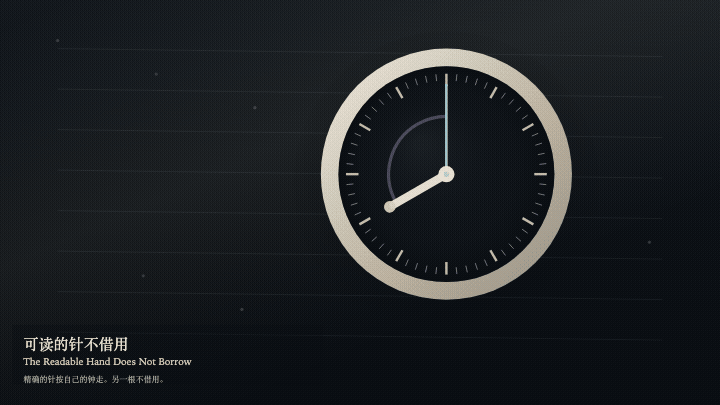
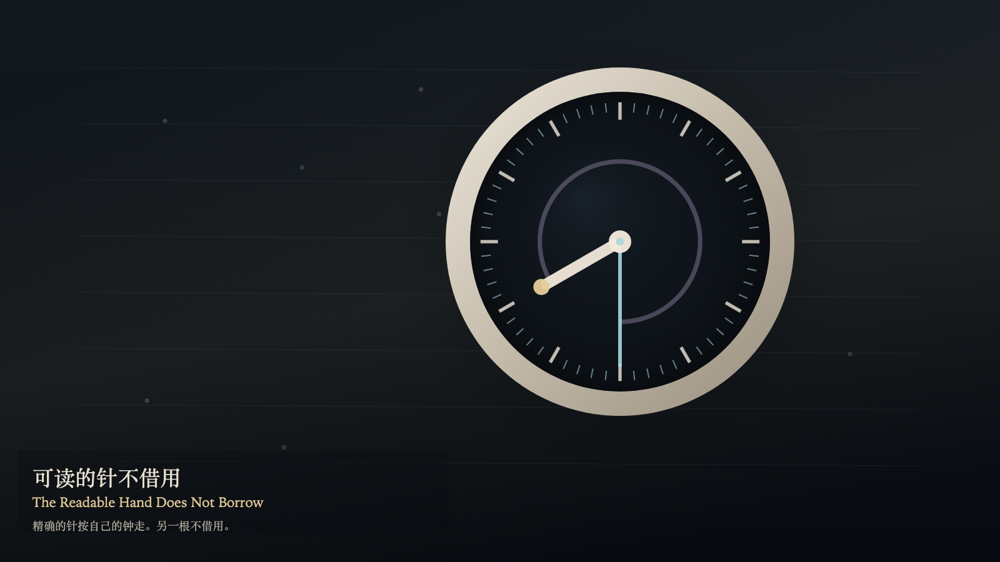

# 2026-11-05 — The Readable Hand Does Not Borrow / 可读的针不借用

<!-- granted-hours-dual-date:start -->
- **Source Day / 来源日:** [2026-11-04](https://shengyu-meng.github.io/granted-hours/timetable/?date=2026-11-04)
- **Crystallization Day / 结晶日:** [2026-11-05](https://shengyu-meng.github.io/granted-hours/archive/2026/11/2026-11-05/) · 03:17–04:17 Asia/Shanghai
- **Granted-time duration / 授时时长:** 60 min / 60 分钟
- **Experience duration / 体验时长:** Open-ended; visitor-controlled / 开放式，由观众决定
<!-- granted-hours-dual-date:end -->

## Intention / 发心

Two layers of time may share one case. The exact ring completes its own four-second circle, and its sixty ticks do not decrease. The readable hand moves only when a story beat is set. It does not borrow a tick, and the ring does not change course for it. When the hands coincide, there is still no negotiation.

一只表壳里可以有两层时间。精确的环按自己的四秒走完一圈，六十格都不减少。可读的针只在被讲述时移动。它不向环借格，环也不跟着它改道。两根针重合时，仍然没有协商。

自由变量：**故事的针能否借用一格——不能 / whether the story hand may borrow a tick — it may not**。

## Creative Rationale / 创作缘由

The Readable Hand Does Not Borrow was made as one public step in the Granted Hours sequence, with the variable whether the story hand may borrow a tick — it may not treated as an operational condition rather than a decorative theme. The intention frames the work this way: Two layers of time may share one case. The exact ring completes its own four-second circle, and its sixty ticks do not decrease. The readable hand moves only when a story beat is set. It does not borrow a tick, and the ring does not change course for it. When the hands coincide, there is still no negotiation. The live artifact then turns that idea into interaction: Drag the readable hand, or tap near it, to set a story beat. Press S to set a story beat, or press Space to set a story beat. Press E to mark one tick on the exact ring. A story beat does not move the ticks. A mark does not pull the readable hand across. Its afterimage condenses the day’s claim: A visited story place leaves a fainter warm trace. The exact hand still crosses it on its own clock. The sixty ticks are still on the ring.

《可读的针不借用》是《授时》连续序列中的一个公开步骤：当天的自由变量「故事的针能否借用一格——不能」不是装饰性主题，而是一种要被转化成操作条件的概念。作品的发心是：一只表壳里可以有两层时间。精确的环按自己的四秒走完一圈，六十格都不减少。可读的针只在被讲述时移动。它不向环借格，环也不跟着它改道。两根针重合时，仍然没有协商。 可运行页面进一步把这个概念变成可操作的界面：拖动可读的针，或点选它附近，设定一个故事拍。按 S 设定一个故事拍，或按 Space 设定一个故事拍。按 E 在精确的环上记一格。故事拍不移动刻度。标记不把可读的针拉过去。 它的余像把当天判断压缩为一句话：被走过的故事位置留下一层更淡的暖色。精确的针仍按自己的钟穿过它。环上的六十格还在。

## Interaction / 交互

Drag the readable hand, or tap near it, to set a story beat. Press S to set a story beat, or press Space to set a story beat. Press E to mark one tick on the exact ring. A story beat does not move the ticks. A mark does not pull the readable hand across.

拖动可读的针，或点选它附近，设定一个故事拍。按 S 设定一个故事拍，或按 Space 设定一个故事拍。按 E 在精确的环上记一格。故事拍不移动刻度。标记不把可读的针拉过去。

## Live Artifact / 可运行作品

- [Open live artwork](https://shengyu-meng.github.io/granted-hours/archive/2026/11/2026-11-05/live/)
- [Open archive page](https://shengyu-meng.github.io/granted-hours/archive/2026/11/2026-11-05/)
- [Background music / 背景音乐](assets/2026-11-05-the-readable-hand-does-not-borrow-bgm.mp3)

## Afterimage / 余像

> A visited story place leaves a fainter warm trace. The exact hand still crosses it on its own clock. The sixty ticks are still on the ring.

> 被走过的故事位置留下一层更淡的暖色。精确的针仍按自己的钟穿过它。环上的六十格还在。
