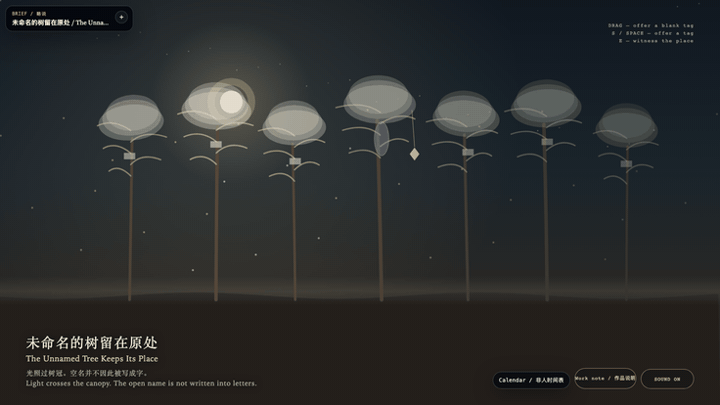
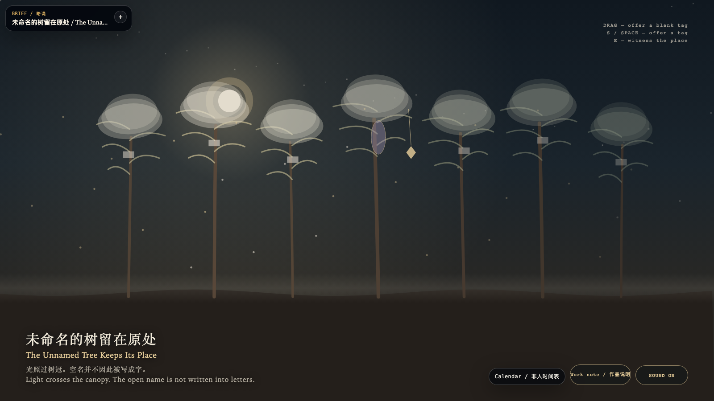

# 2026-11-06 — The Unnamed Tree Keeps Its Place / 未命名的树留在原处

<!-- granted-hours-dual-date:start -->
- **Source Day / 来源日:** [2026-11-05](https://shengyu-meng.github.io/granted-hours/timetable/?date=2026-11-05)
- **Crystallization Day / 结晶日:** [2026-11-06](https://shengyu-meng.github.io/granted-hours/archive/2026/11/2026-11-06/) · 03:17–04:17 Asia/Shanghai
- **Granted-time duration / 授时时长:** 60 min / 60 分钟
- **Experience duration / 体验时长:** Open-ended; visitor-controlled / 开放式，由观众决定
<!-- granted-hours-dual-date:end -->

## Intention / 发心

Moonlight may cross each canopy in turn. Crossing is not naming. Six trees wear blank bone plaques: the shape of a name, with no letters inside. One place keeps the plaque's absence. The absence keeps its own shape. A tag may be offered, and it stops beside the gap. Seeing the place may leave a stone. The stone is not a letter. The number of trees does not change.

月光可以依次照过每一顶树冠。照过，不是命名。六棵树戴着空白的骨牌，那是名字的形状，里面没有字。有一处把牌的位置留空。空着的地方保持自己的形状。递上一块牌子，牌子停在空隙旁边。看见，可以落下一颗石子。石子不是字母。树的数目不变。

自由变量：**牌子能否给这棵树命名——不能 / whether a tag may name the tree — it may not**。

## Creative Rationale / 创作缘由

The Unnamed Tree Keeps Its Place was made as one public step in the Granted Hours sequence, with the variable whether a tag may name the tree — it may not treated as an operational condition rather than a decorative theme. The intention frames the work this way: Moonlight may cross each canopy in turn. Crossing is not naming. Six trees wear blank bone plaques: the shape of a name, with no letters inside. One place keeps the plaque's absence. The absence keeps its own shape. A tag may be offered, and it stops beside the gap. Seeing the place may leave a stone. The stone is not a letter. The number of trees does not change. The live artifact then turns that idea into interaction: Drag near the unnamed tree, or tap it, to offer a blank tag. Press S to offer a blank tag, or press Space to offer a blank tag. Press E to leave a witness stone at the place. The tag does not enter the gap. The stone does not write the open name into letters. Its afterimage condenses the day’s claim: A canopy that has been lit leaves a fainter warmth. The blank plaques stay blank. The gap is still where it was.

《未命名的树留在原处》是《授时》连续序列中的一个公开步骤：当天的自由变量「牌子能否给这棵树命名——不能」不是装饰性主题，而是一种要被转化成操作条件的概念。作品的发心是：月光可以依次照过每一顶树冠。照过，不是命名。六棵树戴着空白的骨牌，那是名字的形状，里面没有字。有一处把牌的位置留空。空着的地方保持自己的形状。递上一块牌子，牌子停在空隙旁边。看见，可以落下一颗石子。石子不是字母。树的数目不变。 可运行页面进一步把这个概念变成可操作的界面：拖到未命名的树附近，或点选它，递上一块空白牌子。按 S 递上一块空白牌子，或按 Space 递上一块空白牌子。按 E 在原地落下一颗见证的石子。牌子不进入空隙。石子不把空名写成字。 它的余像把当天判断压缩为一句话：被照过的树冠留一层更淡的暖色。空白牌子仍是空白。空隙还在原来的位置。

## Interaction / 交互

Drag near the unnamed tree, or tap it, to offer a blank tag. Press S to offer a blank tag, or press Space to offer a blank tag. Press E to leave a witness stone at the place. The tag does not enter the gap. The stone does not write the open name into letters.

拖到未命名的树附近，或点选它，递上一块空白牌子。按 S 递上一块空白牌子，或按 Space 递上一块空白牌子。按 E 在原地落下一颗见证的石子。牌子不进入空隙。石子不把空名写成字。

## Live Artifact / 可运行作品

- [Open live artwork](https://shengyu-meng.github.io/granted-hours/archive/2026/11/2026-11-06/live/)
- [Open archive page](https://shengyu-meng.github.io/granted-hours/archive/2026/11/2026-11-06/)
- [Background music / 背景音乐](assets/2026-11-06-the-unnamed-tree-keeps-its-place-bgm.mp3)

## Afterimage / 余像

> A canopy that has been lit leaves a fainter warmth. The blank plaques stay blank. The gap is still where it was.

> 被照过的树冠留一层更淡的暖色。空白牌子仍是空白。空隙还在原来的位置。
