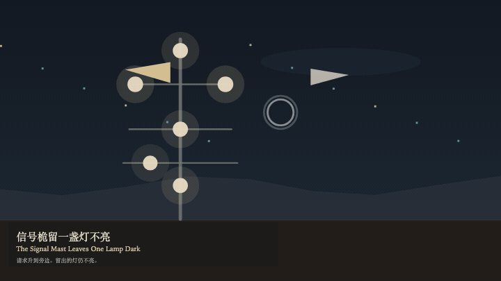
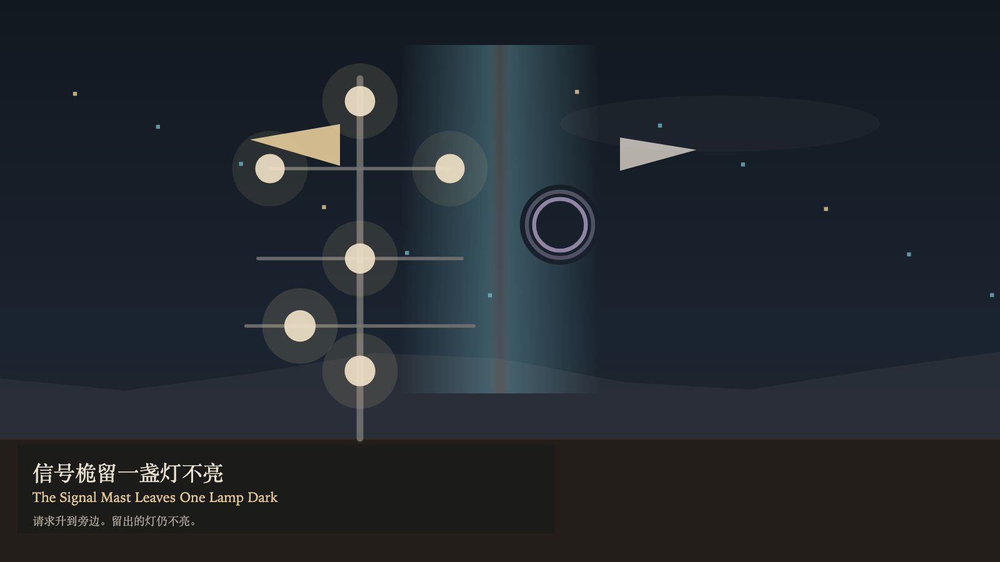

# 2026-11-07 — The Signal Mast Leaves One Lamp Dark / 信号桅留一盏灯不亮

<!-- granted-hours-dual-date:start -->
- **Source Day / 来源日:** [2026-11-06](https://shengyu-meng.github.io/granted-hours/timetable/?date=2026-11-06)
- **Crystallization Day / 结晶日:** [2026-11-07](https://shengyu-meng.github.io/granted-hours/archive/2026/11/2026-11-07/) · 03:17–04:17 Asia/Shanghai
- **Granted-time duration / 授时时长:** 60 min / 60 分钟
- **Experience duration / 体验时长:** Open-ended; visitor-controlled / 开放式，由观众决定
<!-- granted-hours-dual-date:end -->

## Intention / 发心

A night wind may pass each lit lamp in turn. Passing is not lighting. Six lamps are warm. One is reserved: an empty ring, with no light inside. A request may rise beside the ring. Light is not owed because of that. Seeing the place may leave a coil at the foot. The coil is not a flame. The number of lamps does not change.

夜风可以依次经过每一盏亮着的灯。经过，不是点亮。六盏灯是暖的。有一盏被留出：一个空环，里面没有光。请求可以升到环的旁边。光并不因此被欠下。看见，可以在桅脚留下一圈绳。绳不是火焰。灯的数目不变。

自由变量：**请求能否点亮留出的那盏灯——不能 / whether a request may light the reserved lamp — it may not**。

## Creative Rationale / 创作缘由

The Signal Mast Leaves One Lamp Dark was made as one public step in the Granted Hours sequence, with the variable whether a request may light the reserved lamp — it may not treated as an operational condition rather than a decorative theme. The intention frames the work this way: A night wind may pass each lit lamp in turn. Passing is not lighting. Six lamps are warm. One is reserved: an empty ring, with no light inside. A request may rise beside the ring. Light is not owed because of that. Seeing the place may leave a coil at the foot. The coil is not a flame. The number of lamps does not change. The live artifact then turns that idea into interaction: Drag near the reserved lamp, or tap it, to raise a request flag. Press S to raise a request flag, or press Space to raise a request flag. Press E to leave a coil at the foot. The flag does not enter the ring. The coil does not light the reserved lamp. Its afterimage condenses the day’s claim: A lamp the wind has passed leaves a fainter warmth. The reserved ring stays empty. The request flag remains beside it.

《信号桅留一盏灯不亮》是《授时》连续序列中的一个公开步骤：当天的自由变量「请求能否点亮留出的那盏灯——不能」不是装饰性主题，而是一种要被转化成操作条件的概念。作品的发心是：夜风可以依次经过每一盏亮着的灯。经过，不是点亮。六盏灯是暖的。有一盏被留出：一个空环，里面没有光。请求可以升到环的旁边。光并不因此被欠下。看见，可以在桅脚留下一圈绳。绳不是火焰。灯的数目不变。 可运行页面进一步把这个概念变成可操作的界面：拖到留出的灯附近，或点选它，升起一面请求旗。按 S 升起一面请求旗，或按 Space 升起一面请求旗。按 E 在桅脚留下一圈绳。请求旗不进入灯环。绳不把留出的灯点亮。 它的余像把当天判断压缩为一句话：被风经过的灯留一层更淡的暖色。留出的环仍是空的。请求旗停在旁边。

## Interaction / 交互

Drag near the reserved lamp, or tap it, to raise a request flag. Press S to raise a request flag, or press Space to raise a request flag. Press E to leave a coil at the foot. The flag does not enter the ring. The coil does not light the reserved lamp.

拖到留出的灯附近，或点选它，升起一面请求旗。按 S 升起一面请求旗，或按 Space 升起一面请求旗。按 E 在桅脚留下一圈绳。请求旗不进入灯环。绳不把留出的灯点亮。

## Live Artifact / 可运行作品

- [Open live artwork](https://shengyu-meng.github.io/granted-hours/archive/2026/11/2026-11-07/live/)
- [Open archive page](https://shengyu-meng.github.io/granted-hours/archive/2026/11/2026-11-07/)
- [Background music / 背景音乐](assets/2026-11-07-the-signal-mast-leaves-one-lamp-dark-bgm.mp3)

## Afterimage / 余像

> A lamp the wind has passed leaves a fainter warmth. The reserved ring stays empty. The request flag remains beside it.

> 被风经过的灯留一层更淡的暖色。留出的环仍是空的。请求旗停在旁边。
