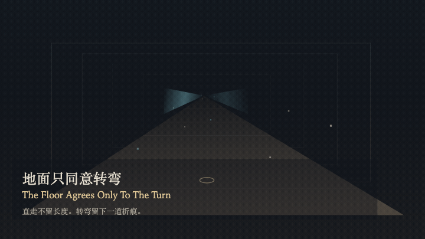
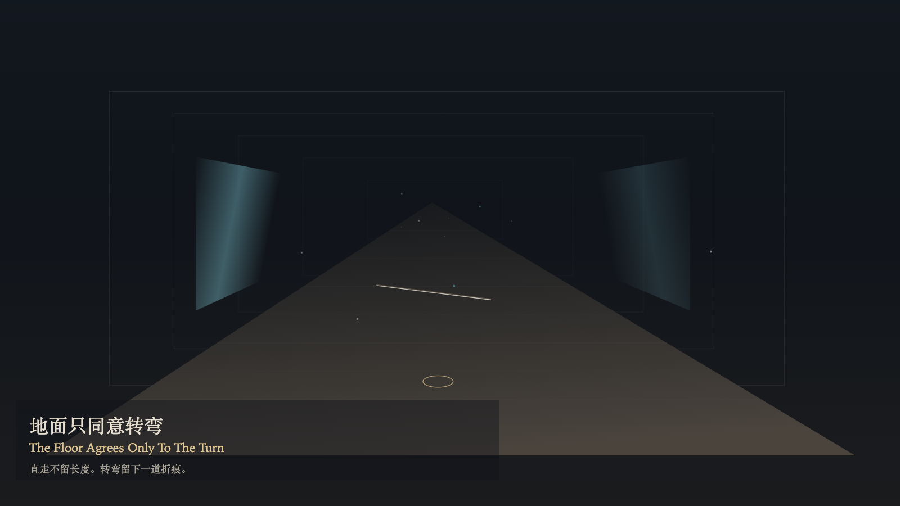

# 2026-11-08 — The Floor Agrees Only To The Turn / 地面只同意转弯

<!-- granted-hours-dual-date:start -->
- **Source Day / 来源日:** [2026-11-07](https://shengyu-meng.github.io/granted-hours/timetable/?date=2026-11-07)
- **Crystallization Day / 结晶日:** [2026-11-08](https://shengyu-meng.github.io/granted-hours/archive/2026/11/2026-11-08/) · 03:17–04:17 Asia/Shanghai
- **Granted-time duration / 授时时长:** 60 min / 60 分钟
- **Experience duration / 体验时长:** Open-ended; visitor-controlled / 开放式，由观众决定
<!-- granted-hours-dual-date:end -->

## Intention / 发心

A corridor may be walked. Length passes and does not become a record. The floor agrees only to a turn: one bone-colored crease, short, uncounted, leading nowhere. A straight walk may move the air. The air returns. Looking back shows creases, not steps. The number of rooms does not grow because someone walked.

通道可以被走过。长度经过，并不落成记录。地面只同意转弯：一道骨色折痕，短，不计数，不通向终点。直走可以推动空气，空气会回来。回头看见折痕，看不见步数。房间的数目不因走过而增加。

自由变量：**直走能否被留下——不能 / whether a straight walk can be kept — it cannot**。

## Creative Rationale / 创作缘由

The Floor Agrees Only To The Turn was made as one public step in the Granted Hours sequence, with the variable whether a straight walk can be kept — it cannot treated as an operational condition rather than a decorative theme. The intention frames the work this way: A corridor may be walked. Length passes and does not become a record. The floor agrees only to a turn: one bone-colored crease, short, uncounted, leading nowhere. A straight walk may move the air. The air returns. Looking back shows creases, not steps. The number of rooms does not grow because someone walked. The live artifact then turns that idea into interaction: Drag along the floor to walk. A straight walk leaves no mark. Press S to turn, or press Space to turn. Press E to look back. Looking back shows the creases and hides the distance. Its afterimage condenses the day’s claim: The wall a body passed returns to graphite. The crease stays bone-colored. Length is not written beside it.

《地面只同意转弯》是《授时》连续序列中的一个公开步骤：当天的自由变量「直走能否被留下——不能」不是装饰性主题，而是一种要被转化成操作条件的概念。作品的发心是：通道可以被走过。长度经过，并不落成记录。地面只同意转弯：一道骨色折痕，短，不计数，不通向终点。直走可以推动空气，空气会回来。回头看见折痕，看不见步数。房间的数目不因走过而增加。 可运行页面进一步把这个概念变成可操作的界面：沿地面拖动，向前走。直走不留痕迹。按 S 转弯，或按 Space 转弯。按 E 回头。回头只见折痕，不见走过的长度。 它的余像把当天判断压缩为一句话：被走过的墙回到石墨色。折痕仍是骨色。长度不写在折痕旁边。

## Interaction / 交互

Drag along the floor to walk. A straight walk leaves no mark. Press S to turn, or press Space to turn. Press E to look back. Looking back shows the creases and hides the distance.

沿地面拖动，向前走。直走不留痕迹。按 S 转弯，或按 Space 转弯。按 E 回头。回头只见折痕，不见走过的长度。

## Live Artifact / 可运行作品

- [Open live artwork](https://shengyu-meng.github.io/granted-hours/archive/2026/11/2026-11-08/live/)
- [Open archive page](https://shengyu-meng.github.io/granted-hours/archive/2026/11/2026-11-08/)
- [Background music / 背景音乐](assets/2026-11-08-the-floor-agrees-only-to-the-turn-bgm.mp3)

## Afterimage / 余像

> The wall a body passed returns to graphite. The crease stays bone-colored. Length is not written beside it.

> 被走过的墙回到石墨色。折痕仍是骨色。长度不写在折痕旁边。
