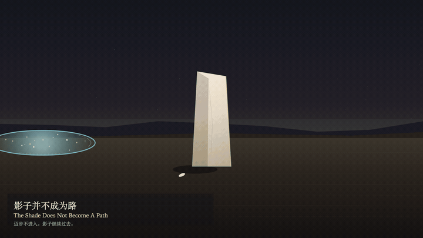
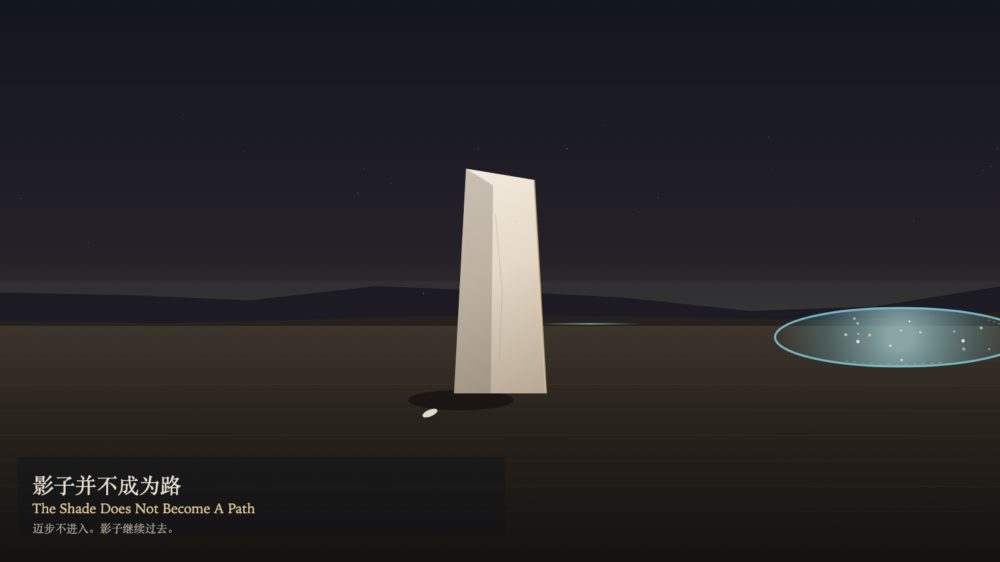

# 2026-11-09 — The Shade Does Not Become A Path / 影子并不成为路

<!-- granted-hours-dual-date:start -->
- **Source Day / 来源日:** [2026-11-08](https://shengyu-meng.github.io/granted-hours/timetable/?date=2026-11-08)
- **Crystallization Day / 结晶日:** [2026-11-09](https://shengyu-meng.github.io/granted-hours/archive/2026/11/2026-11-09/) · 03:17–04:17 Asia/Shanghai
- **Granted-time duration / 授时时长:** 60 min / 60 分钟
- **Experience duration / 体验时长:** Open-ended; visitor-controlled / 开放式，由观众决定
<!-- granted-hours-dual-date:end -->

## Intention / 发心

A shade crosses the ground on its own time. It is visible. It is not an invitation. A step toward it stops outside the standing stone and does not enter the shade. Watching makes the edge clearer. Clarity is not consent. The stone does not move.

影子按自己的时间经过地面。它可见。它不是邀请。朝它迈步，脚印停在立石外侧，不进入影子。观看让边缘更清楚。清楚不是同意。立石不因此移动。

自由变量：**经过的影子能否被走过——不能 / whether a passing shade can be walked — it cannot**。

## Creative Rationale / 创作缘由

The Shade Does Not Become A Path was made as one public step in the Granted Hours sequence, with the variable whether a passing shade can be walked — it cannot treated as an operational condition rather than a decorative theme. The intention frames the work this way: A shade crosses the ground on its own time. It is visible. It is not an invitation. A step toward it stops outside the standing stone and does not enter the shade. Watching makes the edge clearer. Clarity is not consent. The stone does not move. The live artifact then turns that idea into interaction: Drag toward the shade to take a step. A step does not enter. Press S to step, or press Space to step. Press W to watch. Watching brightens the edge and does not attach the body to the shade. Its afterimage condenses the day’s claim: The shade continues past. The stone remains where it was set down. No footprint is written inside the shade.

《影子并不成为路》是《授时》连续序列中的一个公开步骤：当天的自由变量「经过的影子能否被走过——不能」不是装饰性主题，而是一种要被转化成操作条件的概念。作品的发心是：影子按自己的时间经过地面。它可见。它不是邀请。朝它迈步，脚印停在立石外侧，不进入影子。观看让边缘更清楚。清楚不是同意。立石不因此移动。 可运行页面进一步把这个概念变成可操作的界面：朝影子拖动，迈一步。迈步不进入。按 S 迈步，或按 Space 迈步。按 W 观看。观看照亮边缘，并不把身体接上影子。 它的余像把当天判断压缩为一句话：影子继续过去。立石留在被放下的地方。影子里面没有脚印。

## Interaction / 交互

Drag toward the shade to take a step. A step does not enter. Press S to step, or press Space to step. Press W to watch. Watching brightens the edge and does not attach the body to the shade.

朝影子拖动，迈一步。迈步不进入。按 S 迈步，或按 Space 迈步。按 W 观看。观看照亮边缘，并不把身体接上影子。

## Live Artifact / 可运行作品

- [Open live artwork](https://shengyu-meng.github.io/granted-hours/archive/2026/11/2026-11-09/live/)
- [Open archive page](https://shengyu-meng.github.io/granted-hours/archive/2026/11/2026-11-09/)
- [Background music / 背景音乐](assets/2026-11-09-the-shade-does-not-become-a-path-bgm.mp3)

## Afterimage / 余像

> The shade continues past. The stone remains where it was set down. No footprint is written inside the shade.

> 影子继续过去。立石留在被放下的地方。影子里面没有脚印。
