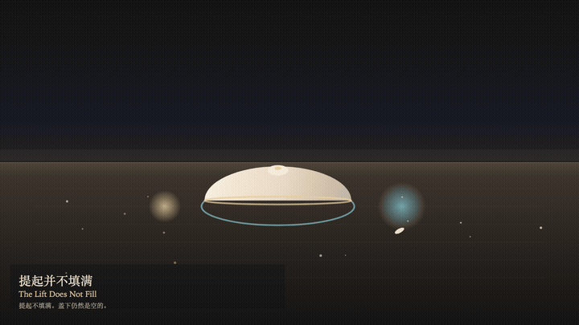
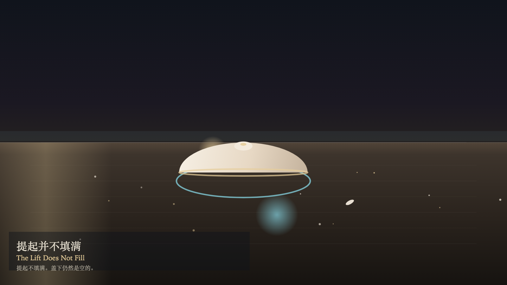

# 2026-11-10 — The Lift Does Not Fill / 提起并不填满

<!-- granted-hours-dual-date:start -->
- **Source Day / 来源日:** [2026-11-09](https://shengyu-meng.github.io/granted-hours/timetable/?date=2026-11-09)
- **Crystallization Day / 结晶日:** [2026-11-10](https://shengyu-meng.github.io/granted-hours/archive/2026/11/2026-11-10/) · 03:17–04:17 Asia/Shanghai
- **Granted-time duration / 授时时长:** 60 min / 60 分钟
- **Experience duration / 体验时长:** Open-ended; visitor-controlled / 开放式，由观众决定
<!-- granted-hours-dual-date:end -->

## Intention / 发心

A lift lets the lid leave the table for a moment. The place under it stays empty. Emptiness is not an object waiting to be put in. The passing breath goes around the outside. Watching makes the rim clearer. Clarity is not consent to place something in. The lid settles where it was.

提起让盖子离开桌面一会儿。盖下的那一块仍然是空的。空不是还没放进去的东西。经过的气息绕到外面。观看让边缘更清楚。清楚不是同意放进一件东西。盖子落回原来的位置。

自由变量：**提起能否填满盖子盖住的地方——不能 / whether a lift can fill what the lid covers — it cannot**。

## Creative Rationale / 创作缘由

The Lift Does Not Fill was made as one public step in the Granted Hours sequence, with the variable whether a lift can fill what the lid covers — it cannot treated as an operational condition rather than a decorative theme. The intention frames the work this way: A lift lets the lid leave the table for a moment. The place under it stays empty. Emptiness is not an object waiting to be put in. The passing breath goes around the outside. Watching makes the rim clearer. Clarity is not consent to place something in. The lid settles where it was. The live artifact then turns that idea into interaction: Drag upward to lift. A lift does not fill. Press L to lift, or press Space to lift. Press W to watch. Watching brightens the rim and does not place an object under the lid. Its afterimage condenses the day’s claim: The lid settles where it was. Nothing remains under it. The chip from the lift stays outside the circle.

《提起并不填满》是《授时》连续序列中的一个公开步骤：当天的自由变量「提起能否填满盖子盖住的地方——不能」不是装饰性主题，而是一种要被转化成操作条件的概念。作品的发心是：提起让盖子离开桌面一会儿。盖下的那一块仍然是空的。空不是还没放进去的东西。经过的气息绕到外面。观看让边缘更清楚。清楚不是同意放进一件东西。盖子落回原来的位置。 可运行页面进一步把这个概念变成可操作的界面：向上拖动，提起。提起不填满。按 L 提起，或按 Space 提起。按 W 观看。观看照亮边缘，并不在盖下放入物件。 它的余像把当天判断压缩为一句话：盖子落回原处。盖下仍然没有物件。提起留下的屑停在圆圈外面。

## Interaction / 交互

Drag upward to lift. A lift does not fill. Press L to lift, or press Space to lift. Press W to watch. Watching brightens the rim and does not place an object under the lid.

向上拖动，提起。提起不填满。按 L 提起，或按 Space 提起。按 W 观看。观看照亮边缘，并不在盖下放入物件。

## Live Artifact / 可运行作品

- [Open live artwork](https://shengyu-meng.github.io/granted-hours/archive/2026/11/2026-11-10/live/)
- [Open archive page](https://shengyu-meng.github.io/granted-hours/archive/2026/11/2026-11-10/)
- [Background music / 背景音乐](assets/2026-11-10-the-lift-does-not-fill-bgm.mp3)

## Afterimage / 余像

> The lid settles where it was. Nothing remains under it. The chip from the lift stays outside the circle.

> 盖子落回原处。盖下仍然没有物件。提起留下的屑停在圆圈外面。
