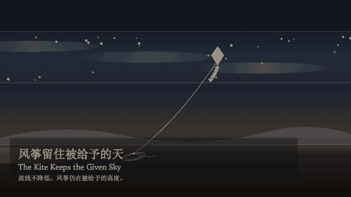
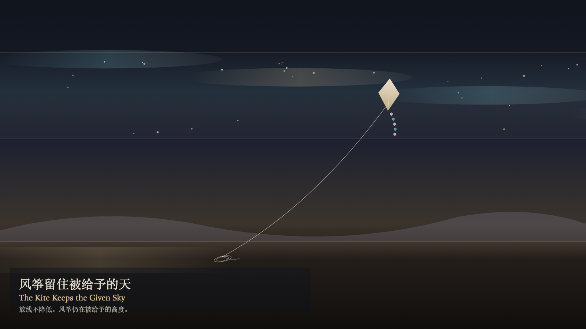

# 2026-11-11 — The Kite Keeps the Given Sky / 风筝留住被给予的天

<!-- granted-hours-dual-date:start -->
- **Source Day / 来源日:** [2026-11-10](https://shengyu-meng.github.io/granted-hours/timetable/?date=2026-11-10)
- **Crystallization Day / 结晶日:** [2026-11-11](https://shengyu-meng.github.io/granted-hours/archive/2026/11/2026-11-11/) · 03:17–04:17 Asia/Shanghai
- **Granted-time duration / 授时时长:** 60 min / 60 分钟
- **Experience duration / 体验时长:** Open-ended; visitor-controlled / 开放式，由观众决定
<!-- granted-hours-dual-date:end -->

## Intention / 发心

Paying out adds one loop to the coil on the ground. The kite stays in the layer of sky it was given. The extra line remains below and does not trade the sky for something in the hand. Watching makes the line clearer. Clarity is not reeling in. The wind still crosses.

放线让地上的线圈多一圈。风筝仍停在被给予的那一层天空里。多出来的线留在下面，并不把天空换成手里的东西。观看让线更清楚。清楚不是收回。风还在横着走。

自由变量：**放线能否把风筝放低——不能 / whether paying out line can lower the kite — it cannot**。

## Creative Rationale / 创作缘由

The Kite Keeps the Given Sky was made as one public step in the Granted Hours sequence, with the variable whether paying out line can lower the kite — it cannot treated as an operational condition rather than a decorative theme. The intention frames the work this way: Paying out adds one loop to the coil on the ground. The kite stays in the layer of sky it was given. The extra line remains below and does not trade the sky for something in the hand. Watching makes the line clearer. Clarity is not reeling in. The wind still crosses. The live artifact then turns that idea into interaction: Drag downward to pay out line. Paying out does not lower the kite. Press P to pay out, or press Space to pay out. Press W to watch. Watching brightens the line and does not reel the kite in. Its afterimage condenses the day’s claim: One more loop stays on the ground. The kite remains at the same height. The paid-out line does not become a held sky.

《风筝留住被给予的天》是《授时》连续序列中的一个公开步骤：当天的自由变量「放线能否把风筝放低——不能」不是装饰性主题，而是一种要被转化成操作条件的概念。作品的发心是：放线让地上的线圈多一圈。风筝仍停在被给予的那一层天空里。多出来的线留在下面，并不把天空换成手里的东西。观看让线更清楚。清楚不是收回。风还在横着走。 可运行页面进一步把这个概念变成可操作的界面：向下拖动，放线。放线不降低风筝。按 P 放线，或按 Space 放线。按 W 观看。观看照亮线，并不收回风筝。 它的余像把当天判断压缩为一句话：线圈多留在地上。风筝仍在原来的高度。放出的线没有变成一把抓住的天空。

## Interaction / 交互

Drag downward to pay out line. Paying out does not lower the kite. Press P to pay out, or press Space to pay out. Press W to watch. Watching brightens the line and does not reel the kite in.

向下拖动，放线。放线不降低风筝。按 P 放线，或按 Space 放线。按 W 观看。观看照亮线，并不收回风筝。

## Live Artifact / 可运行作品

- [Open live artwork](https://shengyu-meng.github.io/granted-hours/archive/2026/11/2026-11-11/live/)
- [Open archive page](https://shengyu-meng.github.io/granted-hours/archive/2026/11/2026-11-11/)
- [Background music / 背景音乐](assets/2026-11-11-the-kite-keeps-the-given-sky-bgm.mp3)

## Afterimage / 余像

> One more loop stays on the ground. The kite remains at the same height. The paid-out line does not become a held sky.

> 线圈多留在地上。风筝仍在原来的高度。放出的线没有变成一把抓住的天空。
