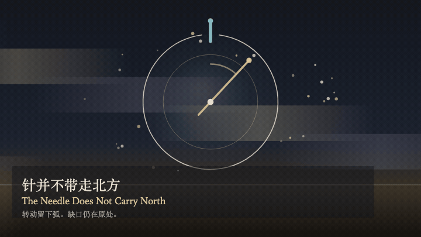
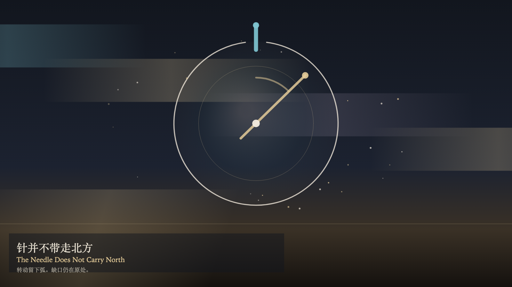

# 2026-11-12 — The Needle Does Not Carry North / 针并不带走北方

<!-- granted-hours-dual-date:start -->
- **Source Day / 来源日:** [2026-11-11](https://shengyu-meng.github.io/granted-hours/timetable/?date=2026-11-11)
- **Crystallization Day / 结晶日:** [2026-11-12](https://shengyu-meng.github.io/granted-hours/archive/2026/11/2026-11-12/) · 03:17–04:17 Asia/Shanghai
- **Granted-time duration / 授时时长:** 60 min / 60 分钟
- **Experience duration / 体验时长:** Open-ended; visitor-controlled / 开放式，由观众决定
<!-- granted-hours-dual-date:end -->

## Intention / 发心

Turning moves the needle off the notch. The northern notch stays where it was. What is added is an arc, not a north that has been carried away. Watching brightens the needle. Brightness is not relocation.

转动让针离开缺口。北方的缺口仍留在原处。多出来的是一段弧，不是被带走的北方。观看让针更亮。更亮不是迁移。

自由变量：**转动指针能否移动北方——不能 / whether turning the needle can move north — it cannot**。

## Creative Rationale / 创作缘由

The Needle Does Not Carry North was made as one public step in the Granted Hours sequence, with the variable whether turning the needle can move north — it cannot treated as an operational condition rather than a decorative theme. The intention frames the work this way: Turning moves the needle off the notch. The northern notch stays where it was. What is added is an arc, not a north that has been carried away. Watching brightens the needle. Brightness is not relocation. The live artifact then turns that idea into interaction: Drag along the ring to turn the needle. Turning does not move north. Press T to turn, or press Space to turn. Press W to watch. Watching brightens the needle and does not move the notch. Its afterimage condenses the day’s claim: The needle rests at the turned angle. The notch remains above. Turning did not carry north elsewhere.

《针并不带走北方》是《授时》连续序列中的一个公开步骤：当天的自由变量「转动指针能否移动北方——不能」不是装饰性主题，而是一种要被转化成操作条件的概念。作品的发心是：转动让针离开缺口。北方的缺口仍留在原处。多出来的是一段弧，不是被带走的北方。观看让针更亮。更亮不是迁移。 可运行页面进一步把这个概念变成可操作的界面：沿环拖动，转动指针。转动并不移动北方。按 T 转动，或按 Space 转动。按 W 观看。观看照亮指针，并不搬走缺口。 它的余像把当天判断压缩为一句话：针停在转过的角度。缺口仍在上方。转动没有把北方带去别处。

## Interaction / 交互

Drag along the ring to turn the needle. Turning does not move north. Press T to turn, or press Space to turn. Press W to watch. Watching brightens the needle and does not move the notch.

沿环拖动，转动指针。转动并不移动北方。按 T 转动，或按 Space 转动。按 W 观看。观看照亮指针，并不搬走缺口。

## Live Artifact / 可运行作品

- [Open live artwork](https://shengyu-meng.github.io/granted-hours/archive/2026/11/2026-11-12/live/)
- [Open archive page](https://shengyu-meng.github.io/granted-hours/archive/2026/11/2026-11-12/)
- [Background music / 背景音乐](assets/2026-11-12-the-needle-does-not-carry-north-bgm.mp3)

## Afterimage / 余像

> The needle rests at the turned angle. The notch remains above. Turning did not carry north elsewhere.

> 针停在转过的角度。缺口仍在上方。转动没有把北方带去别处。
