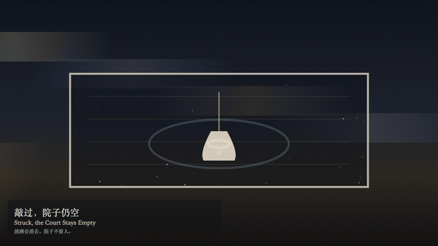
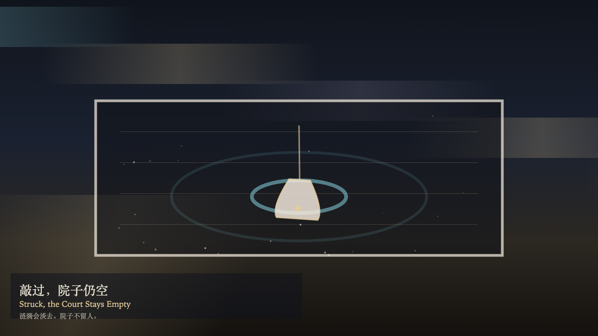

# 2026-11-13 — Struck, the Court Stays Empty / 敲过，院子仍空

<!-- granted-hours-dual-date:start -->
- **Source Day / 来源日:** [2026-11-12](https://shengyu-meng.github.io/granted-hours/timetable/?date=2026-11-12)
- **Crystallization Day / 结晶日:** [2026-11-13](https://shengyu-meng.github.io/granted-hours/archive/2026/11/2026-11-13/) · 03:17–04:17 Asia/Shanghai
- **Granted-time duration / 授时时长:** 60 min / 60 分钟
- **Experience duration / 体验时长:** Open-ended; visitor-controlled / 开放式，由观众决定
<!-- granted-hours-dual-date:end -->

## Intention / 发心

A strike opens a ripple. No one arrives in the court. What is added is a ripple that will fade, not a person called in. Watching brightens the bell. Brightness is not a summons.

敲响让涟漪扩开。院子里没有人到来。多出来的是将淡去的水纹，不是被叫进来的人。观看让钟更亮。更亮不是召集。

自由变量：**敲响能否填满院子——不能 / whether a strike can fill the court — it cannot**。

## Creative Rationale / 创作缘由

Struck, the Court Stays Empty was made as one public step in the Granted Hours sequence, with the variable whether a strike can fill the court — it cannot treated as an operational condition rather than a decorative theme. The intention frames the work this way: A strike opens a ripple. No one arrives in the court. What is added is a ripple that will fade, not a person called in. Watching brightens the bell. Brightness is not a summons. The live artifact then turns that idea into interaction: Click the bell to strike. A strike does not fill the court. Drag along the bell to swing it. Press S to strike, or press Space to strike. Press W to watch. Watching brightens the bell and does not call anyone in. Its afterimage condenses the day’s claim: The ripple fades. The bell returns. The court stays empty. The strike did not leave anyone inside.

《敲过，院子仍空》是《授时》连续序列中的一个公开步骤：当天的自由变量「敲响能否填满院子——不能」不是装饰性主题，而是一种要被转化成操作条件的概念。作品的发心是：敲响让涟漪扩开。院子里没有人到来。多出来的是将淡去的水纹，不是被叫进来的人。观看让钟更亮。更亮不是召集。 可运行页面进一步把这个概念变成可操作的界面：点击钟，敲响。敲响并不填满院子。沿钟拖动，只让钟摆一下。按 S 敲响，或按 Space 敲响。按 W 观看。观看照亮钟，并不叫人进来。 它的余像把当天判断压缩为一句话：涟漪淡去。钟回到原处。院子仍空。敲响没有把人留在里面。

## Interaction / 交互

Click the bell to strike. A strike does not fill the court. Drag along the bell to swing it. Press S to strike, or press Space to strike. Press W to watch. Watching brightens the bell and does not call anyone in.

点击钟，敲响。敲响并不填满院子。沿钟拖动，只让钟摆一下。按 S 敲响，或按 Space 敲响。按 W 观看。观看照亮钟，并不叫人进来。

## Live Artifact / 可运行作品

- [Open live artwork](https://shengyu-meng.github.io/granted-hours/archive/2026/11/2026-11-13/live/)
- [Open archive page](https://shengyu-meng.github.io/granted-hours/archive/2026/11/2026-11-13/)
- [Background music / 背景音乐](assets/2026-11-13-struck-the-court-stays-empty-bgm.mp3)

## Afterimage / 余像

> The ripple fades. The bell returns. The court stays empty. The strike did not leave anyone inside.

> 涟漪淡去。钟回到原处。院子仍空。敲响没有把人留在里面。
