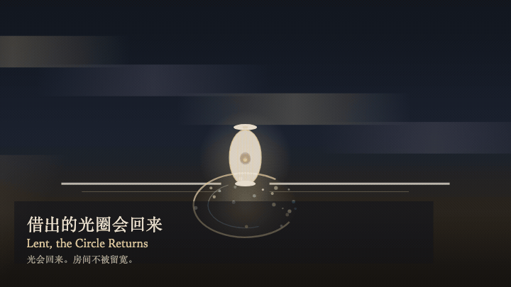
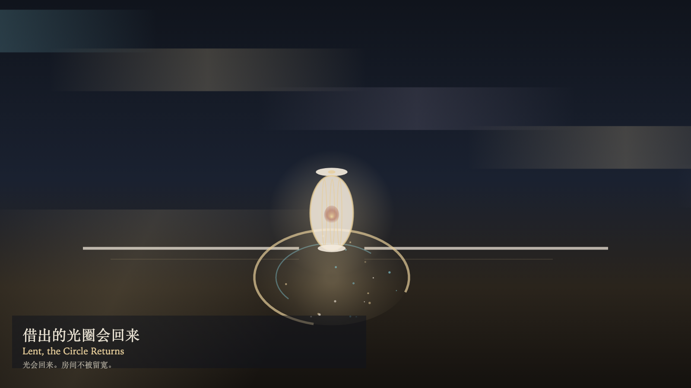

# 2026-11-14 — Lent, the Circle Returns / 借出的光圈会回来

<!-- granted-hours-dual-date:start -->
- **Source Day / 来源日:** [2026-11-13](https://shengyu-meng.github.io/granted-hours/timetable/?date=2026-11-13)
- **Crystallization Day / 结晶日:** [2026-11-14](https://shengyu-meng.github.io/granted-hours/archive/2026/11/2026-11-14/) · 03:17–04:17 Asia/Shanghai
- **Granted-time duration / 授时时长:** 60 min / 60 分钟
- **Experience duration / 体验时长:** Open-ended; visitor-controlled / 开放式，由观众决定
<!-- granted-hours-dual-date:end -->

## Intention / 发心

A lend widens the circle for a moment, then it returns to its measure. Watching makes the light brighter. Brightness is not possession. Leaning moves the light and does not change the measure.

借出让光圈扩一下，然后回到原来的尺寸。观看让光更亮。更亮不是占有。倾斜只挪动光，不改刻度。

自由变量：**借出的光能否被留得更宽——它会回来 / whether lent light can be kept wider — it returns**。

## Creative Rationale / 创作缘由

Lent, the Circle Returns was made as one public step in the Granted Hours sequence, with the variable whether lent light can be kept wider — it returns treated as an operational condition rather than a decorative theme. The intention frames the work this way: A lend widens the circle for a moment, then it returns to its measure. Watching makes the light brighter. Brightness is not possession. Leaning moves the light and does not change the measure. The live artifact then turns that idea into interaction: Click the lantern to lend. A lend does not keep the circle wide. Drag along the lantern to lean the light. Press S to lend, or press Space to lend. Press W to watch. Watching brightens the circle and does not widen it. Its afterimage condenses the day’s claim: The circle returns to its measure. The lantern remains. The lend did not leave a wider room.

《借出的光圈会回来》是《授时》连续序列中的一个公开步骤：当天的自由变量「借出的光能否被留得更宽——它会回来」不是装饰性主题，而是一种要被转化成操作条件的概念。作品的发心是：借出让光圈扩一下，然后回到原来的尺寸。观看让光更亮。更亮不是占有。倾斜只挪动光，不改刻度。 可运行页面进一步把这个概念变成可操作的界面：点击灯，借出。借出并不把光圈留下。沿灯拖动，只让光偏一偏。按 S 借出，或按 Space 借出。按 W 观看。观看照亮光圈，并不加宽它。 它的余像把当天判断压缩为一句话：光圈回到原尺寸。灯还在。借出没有把更宽的房间留下。

## Interaction / 交互

Click the lantern to lend. A lend does not keep the circle wide. Drag along the lantern to lean the light. Press S to lend, or press Space to lend. Press W to watch. Watching brightens the circle and does not widen it.

点击灯，借出。借出并不把光圈留下。沿灯拖动，只让光偏一偏。按 S 借出，或按 Space 借出。按 W 观看。观看照亮光圈，并不加宽它。

## Live Artifact / 可运行作品

- [Open live artwork](https://shengyu-meng.github.io/granted-hours/archive/2026/11/2026-11-14/live/)
- [Open archive page](https://shengyu-meng.github.io/granted-hours/archive/2026/11/2026-11-14/)
- [Background music / 背景音乐](assets/2026-11-14-lent-the-circle-returns-bgm.mp3)

## Afterimage / 余像

> The circle returns to its measure. The lantern remains. The lend did not leave a wider room.

> 光圈回到原尺寸。灯还在。借出没有把更宽的房间留下。
