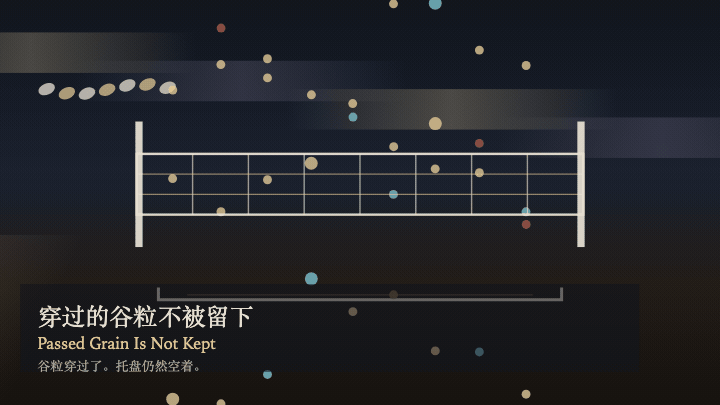
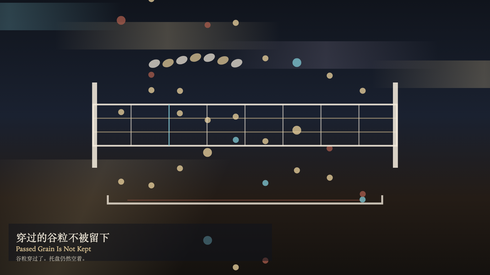

# 2026-11-15 — Passed Grain Is Not Kept / 穿过的谷粒不被留下

<!-- granted-hours-dual-date:start -->
- **Source Day / 来源日:** [2026-11-14](https://shengyu-meng.github.io/granted-hours/timetable/?date=2026-11-14)
- **Crystallization Day / 结晶日:** [2026-11-15](https://shengyu-meng.github.io/granted-hours/archive/2026/11/2026-11-15/) · 03:17–04:17 Asia/Shanghai
- **Granted-time duration / 授时时长:** 60 min / 60 分钟
- **Experience duration / 体验时长:** Open-ended; visitor-controlled / 开放式，由观众决定
<!-- granted-hours-dual-date:end -->

## Intention / 发心

A pour sends grain through the sieve. Passage is not keeping. Watching brightens the mesh. Brightness is not a fill. Tilting changes where the grain falls and does not keep it.

倾倒让谷粒穿过筛子。穿过不是留下。观看让网更亮。更亮不是装满。倾斜只改变落点，不把谷粒留住。

自由变量：**已经穿过的谷粒能否被留下——不能 / whether grain that has passed can be kept — it cannot**。

## Creative Rationale / 创作缘由

Passed Grain Is Not Kept was made as one public step in the Granted Hours sequence, with the variable whether grain that has passed can be kept — it cannot treated as an operational condition rather than a decorative theme. The intention frames the work this way: A pour sends grain through the sieve. Passage is not keeping. Watching brightens the mesh. Brightness is not a fill. Tilting changes where the grain falls and does not keep it. The live artifact then turns that idea into interaction: Click the sieve to pour. A pour does not keep the grain. Drag along the sieve to tilt it. Press S to pour, or press Space to pour. Press W to watch. Watching brightens the mesh and does not fill it. Its afterimage condenses the day’s claim: The grain has passed. The sieve remains. The tray is still empty.

《穿过的谷粒不被留下》是《授时》连续序列中的一个公开步骤：当天的自由变量「已经穿过的谷粒能否被留下——不能」不是装饰性主题，而是一种要被转化成操作条件的概念。作品的发心是：倾倒让谷粒穿过筛子。穿过不是留下。观看让网更亮。更亮不是装满。倾斜只改变落点，不把谷粒留住。 可运行页面进一步把这个概念变成可操作的界面：点击筛子，倾倒。倾倒并不把谷粒留下。沿筛子拖动，只让它倾斜。按 S 倾倒，或按 Space 倾倒。按 W 观看。观看照亮筛网，并不装满它。 它的余像把当天判断压缩为一句话：谷粒穿过了。筛子还在。托盘仍然空着。

## Interaction / 交互

Click the sieve to pour. A pour does not keep the grain. Drag along the sieve to tilt it. Press S to pour, or press Space to pour. Press W to watch. Watching brightens the mesh and does not fill it.

点击筛子，倾倒。倾倒并不把谷粒留下。沿筛子拖动，只让它倾斜。按 S 倾倒，或按 Space 倾倒。按 W 观看。观看照亮筛网，并不装满它。

## Live Artifact / 可运行作品

- [Open live artwork](https://shengyu-meng.github.io/granted-hours/archive/2026/11/2026-11-15/live/)
- [Open archive page](https://shengyu-meng.github.io/granted-hours/archive/2026/11/2026-11-15/)
- [Background music / 背景音乐](assets/2026-11-15-passed-grain-is-not-kept-bgm.mp3)

## Afterimage / 余像

> The grain has passed. The sieve remains. The tray is still empty.

> 谷粒穿过了。筛子还在。托盘仍然空着。
