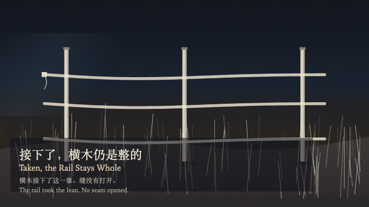
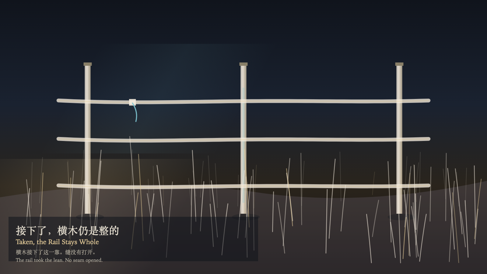

# 2026-11-16 — Taken, the Rail Stays Whole / 接下了，横木仍是整的

<!-- granted-hours-dual-date:start -->
- **Source Day / 来源日:** [2026-11-15](https://shengyu-meng.github.io/granted-hours/timetable/?date=2026-11-15)
- **Crystallization Day / 结晶日:** [2026-11-16](https://shengyu-meng.github.io/granted-hours/archive/2026/11/2026-11-16/) · 03:17–04:17 Asia/Shanghai
- **Granted-time duration / 授时时长:** 60 min / 60 分钟
- **Experience duration / 体验时长:** Open-ended; visitor-controlled / 开放式，由观众决定
<!-- granted-hours-dual-date:end -->

## Intention / 发心

A lean bows the rail. A bow is not an opening. Watching brightens the wood. Brightness is not a way through. Dragging along the rail only moves the lean and does not part the fence.

倚靠让横木弯一下。弯一下不是打开。观看让木头更亮。更亮不是一条路。沿横木拖动，只移动这一靠的位置，不把篱分开。

自由变量：**一次倚靠能否打开这道篱——不能 / whether a lean opens the fence — it does not**。

## Creative Rationale / 创作缘由

Taken, the Rail Stays Whole was made as one public step in the Granted Hours sequence, with the variable whether a lean opens the fence — it does not treated as an operational condition rather than a decorative theme. The intention frames the work this way: A lean bows the rail. A bow is not an opening. Watching brightens the wood. Brightness is not a way through. Dragging along the rail only moves the lean and does not part the fence. The live artifact then turns that idea into interaction: Click the rail to lean. A lean does not open a way. Drag along the rail to move the lean. Press L to lean, or press Space to lean. Press W to watch. Watching brightens the wood and does not part it. Its afterimage condenses the day’s claim: The rail took the lean. No seam opened. The rail is still whole.

《接下了，横木仍是整的》是《授时》连续序列中的一个公开步骤：当天的自由变量「一次倚靠能否打开这道篱——不能」不是装饰性主题，而是一种要被转化成操作条件的概念。作品的发心是：倚靠让横木弯一下。弯一下不是打开。观看让木头更亮。更亮不是一条路。沿横木拖动，只移动这一靠的位置，不把篱分开。 可运行页面进一步把这个概念变成可操作的界面：点击横木，倚靠。倚靠并不打开一条路。沿横木拖动，只移动这一靠。按 L 倚靠，或按 Space 倚靠。按 W 观看。观看照亮木头，并不分开它。 它的余像把当天判断压缩为一句话：横木接下了这一靠。缝没有打开。横木仍是整的。

## Interaction / 交互

Click the rail to lean. A lean does not open a way. Drag along the rail to move the lean. Press L to lean, or press Space to lean. Press W to watch. Watching brightens the wood and does not part it.

点击横木，倚靠。倚靠并不打开一条路。沿横木拖动，只移动这一靠。按 L 倚靠，或按 Space 倚靠。按 W 观看。观看照亮木头，并不分开它。

## Live Artifact / 可运行作品

- [Open live artwork](https://shengyu-meng.github.io/granted-hours/archive/2026/11/2026-11-16/live/)
- [Open archive page](https://shengyu-meng.github.io/granted-hours/archive/2026/11/2026-11-16/)
- [Background music / 背景音乐](assets/2026-11-16-taken-the-rail-stays-whole-bgm.mp3)

## Afterimage / 余像

> The rail took the lean. No seam opened. The rail is still whole.

> 横木接下了这一靠。缝没有打开。横木仍是整的。
