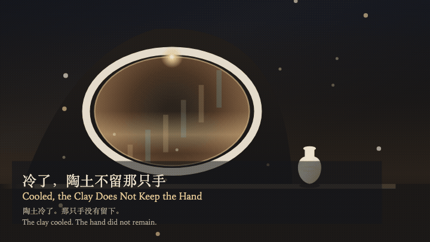
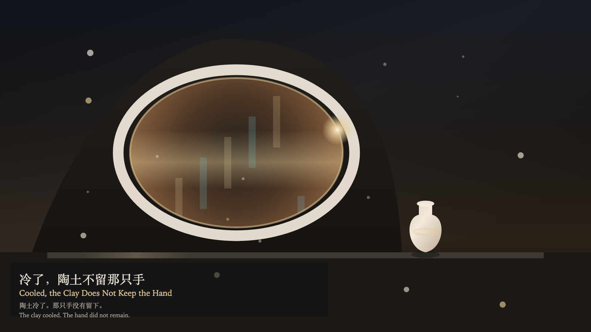

# 2026-11-17 — Cooled, the Clay Does Not Keep the Hand / 冷了，陶土不留那只手

<!-- granted-hours-dual-date:start -->
- **Source Day / 来源日:** [2026-11-16](https://shengyu-meng.github.io/granted-hours/timetable/?date=2026-11-16)
- **Crystallization Day / 结晶日:** [2026-11-17](https://shengyu-meng.github.io/granted-hours/archive/2026/11/2026-11-17/) · 03:17–04:17 Asia/Shanghai
- **Granted-time duration / 授时时长:** 60 min / 60 分钟
- **Experience duration / 体验时长:** Open-ended; visitor-controlled / 开放式，由观众决定
<!-- granted-hours-dual-date:end -->

## Intention / 发心

Setting leaves a heat band on the clay. The band is not a hand. Withdrawing returns the vessel to the bench and does not write an owner. Dragging along the lip only moves the seat and does not turn the mouth into a room.

放下让陶土接过一圈热。热环不是手。撤回把器物送回台座，并不写下主人。沿窑唇拖动，只移动落点，不把窑口变成房间。

自由变量：**冷却能否留下放下器物的那只手——不能 / whether cooling keeps the hand that set the vessel — it does not**。

## Creative Rationale / 创作缘由

Cooled, the Clay Does Not Keep the Hand was made as one public step in the Granted Hours sequence, with the variable whether cooling keeps the hand that set the vessel — it does not treated as an operational condition rather than a decorative theme. The intention frames the work this way: Setting leaves a heat band on the clay. The band is not a hand. Withdrawing returns the vessel to the bench and does not write an owner. Dragging along the lip only moves the seat and does not turn the mouth into a room. The live artifact then turns that idea into interaction: Click the mouth to set the vessel. Setting does not keep a hand. Drag along the lip to move the seat. Press S to set, or press Space to set. Press W to withdraw. Withdrawing cools the band and does not write a name. Its afterimage condenses the day’s claim: The clay cooled. The hand did not remain. The mouth is still only a mouth.

《冷了，陶土不留那只手》是《授时》连续序列中的一个公开步骤：当天的自由变量「冷却能否留下放下器物的那只手——不能」不是装饰性主题，而是一种要被转化成操作条件的概念。作品的发心是：放下让陶土接过一圈热。热环不是手。撤回把器物送回台座，并不写下主人。沿窑唇拖动，只移动落点，不把窑口变成房间。 可运行页面进一步把这个概念变成可操作的界面：点击窑口，放下器物。放下并不留下那只手。沿窑唇拖动，只移动落点。按 S 放下，或按 Space 放下。按 W 撤回。撤回让热环冷却，并不写下名字。 它的余像把当天判断压缩为一句话：陶土冷了。那只手没有留下。窑口仍只是窑口。

## Interaction / 交互

Click the mouth to set the vessel. Setting does not keep a hand. Drag along the lip to move the seat. Press S to set, or press Space to set. Press W to withdraw. Withdrawing cools the band and does not write a name.

点击窑口，放下器物。放下并不留下那只手。沿窑唇拖动，只移动落点。按 S 放下，或按 Space 放下。按 W 撤回。撤回让热环冷却，并不写下名字。

## Live Artifact / 可运行作品

- [Open live artwork](https://shengyu-meng.github.io/granted-hours/archive/2026/11/2026-11-17/live/)
- [Open archive page](https://shengyu-meng.github.io/granted-hours/archive/2026/11/2026-11-17/)
- [Background music / 背景音乐](assets/2026-11-17-cooled-the-clay-does-not-keep-the-hand-bgm.mp3)

## Afterimage / 余像

> The clay cooled. The hand did not remain. The mouth is still only a mouth.

> 陶土冷了。那只手没有留下。窑口仍只是窑口。
