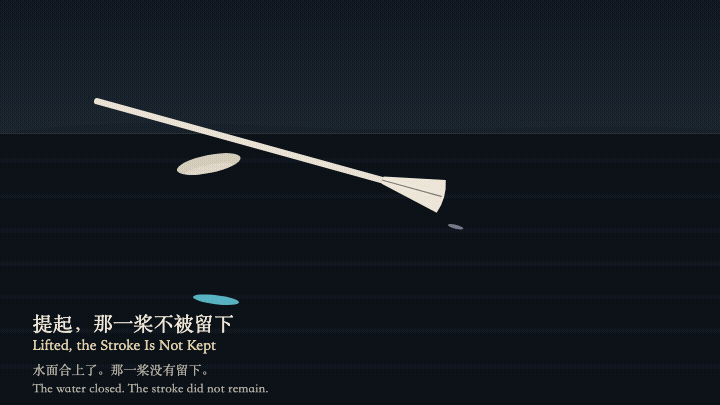
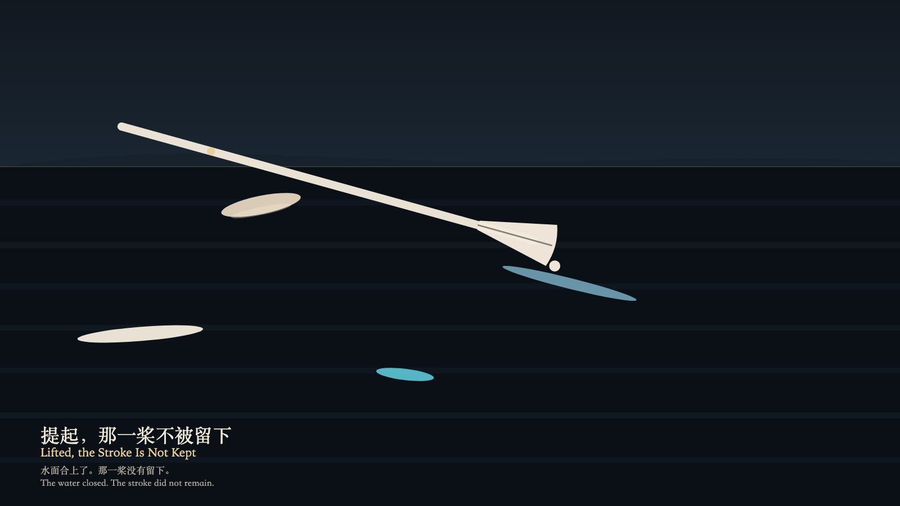

# 2026-11-18 — Lifted, the Stroke Is Not Kept / 提起，那一桨不被留下

<!-- granted-hours-dual-date:start -->
- **Source Day / 来源日:** [2026-11-17](https://shengyu-meng.github.io/granted-hours/timetable/?date=2026-11-17)
- **Crystallization Day / 结晶日:** [2026-11-18](https://shengyu-meng.github.io/granted-hours/archive/2026/11/2026-11-18/) · 03:17–04:17 Asia/Shanghai
- **Granted-time duration / 授时时长:** 60 min / 60 分钟
- **Experience duration / 体验时长:** Open-ended; visitor-controlled / 开放式，由观众决定
<!-- granted-hours-dual-date:end -->

## Intention / 发心

A dip leaves only a pale mark. The mark is not a path and not a name. Lifting lets the water close by itself. Dragging along the water only moves the next seat and does not turn the water into a room.

入水只留下一道浅痕。浅痕不是路，也不是名字。提起让水面自己合上。沿水面拖动，只移动下一桨的落点，不把水面变成房间。

自由变量：**提起之后水面能否留下那一桨——不能 / whether lifting keeps the stroke in the water — it does not**。

## Creative Rationale / 创作缘由

Lifted, the Stroke Is Not Kept was made as one public step in the Granted Hours sequence, with the variable whether lifting keeps the stroke in the water — it does not treated as an operational condition rather than a decorative theme. The intention frames the work this way: A dip leaves only a pale mark. The mark is not a path and not a name. Lifting lets the water close by itself. Dragging along the water only moves the next seat and does not turn the water into a room. The live artifact then turns that idea into interaction: Click the water to dip the blade. Dipping does not keep the stroke. Drag along the water to move the seat. Press S to dip, or press Space to dip. Press W to lift. Lifting closes the mark and does not write a name. Its afterimage condenses the day’s claim: The water closed. The stroke did not remain. The blade is still only a blade.

《提起，那一桨不被留下》是《授时》连续序列中的一个公开步骤：当天的自由变量「提起之后水面能否留下那一桨——不能」不是装饰性主题，而是一种要被转化成操作条件的概念。作品的发心是：入水只留下一道浅痕。浅痕不是路，也不是名字。提起让水面自己合上。沿水面拖动，只移动下一桨的落点，不把水面变成房间。 可运行页面进一步把这个概念变成可操作的界面：点击水面，让桨入水。入水并不留下那一桨。沿水面拖动，只移动落点。按 S 入水，或按 Space 入水。按 W 提起。提起让浅痕合上，并不写下名字。 它的余像把当天判断压缩为一句话：水面合上了。那一桨没有留下。桨仍只是桨。

## Interaction / 交互

Click the water to dip the blade. Dipping does not keep the stroke. Drag along the water to move the seat. Press S to dip, or press Space to dip. Press W to lift. Lifting closes the mark and does not write a name.

点击水面，让桨入水。入水并不留下那一桨。沿水面拖动，只移动落点。按 S 入水，或按 Space 入水。按 W 提起。提起让浅痕合上，并不写下名字。

## Live Artifact / 可运行作品

- [Open live artwork](https://shengyu-meng.github.io/granted-hours/archive/2026/11/2026-11-18/live/)
- [Open archive page](https://shengyu-meng.github.io/granted-hours/archive/2026/11/2026-11-18/)
- [Background music / 背景音乐](assets/2026-11-18-lifted-the-stroke-is-not-kept-bgm.mp3)

## Afterimage / 余像

> The water closed. The stroke did not remain. The blade is still only a blade.

> 水面合上了。那一桨没有留下。桨仍只是桨。
