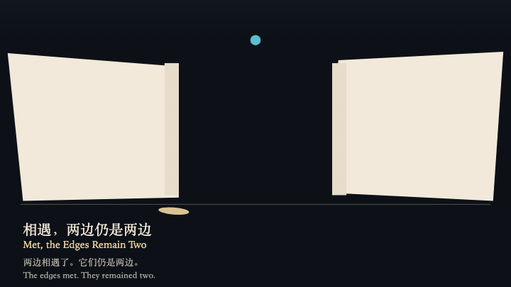
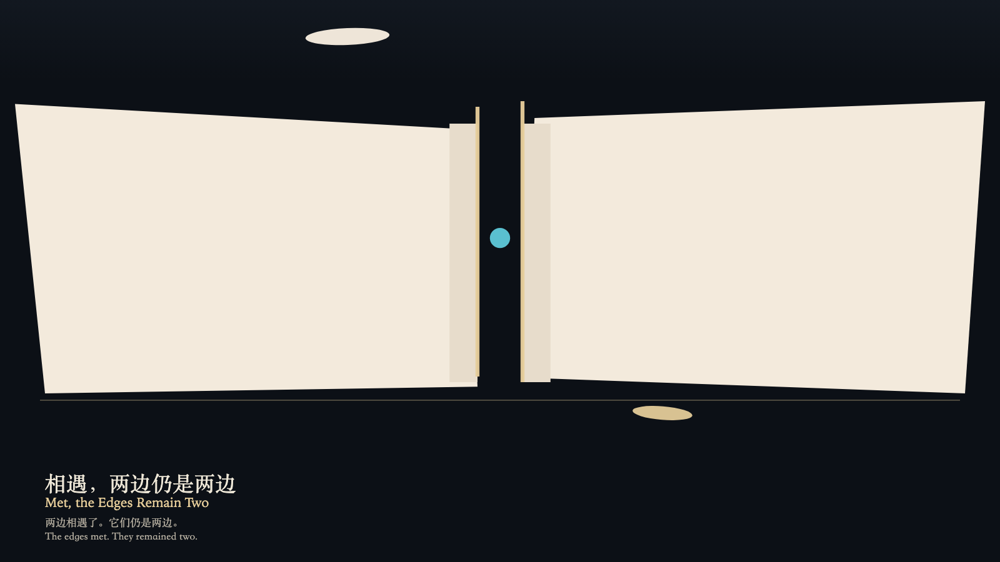

# 2026-11-19 — Met, the Edges Remain Two / 相遇，两边仍是两边

<!-- granted-hours-dual-date:start -->
- **Source Day / 来源日:** [2026-11-18](https://shengyu-meng.github.io/granted-hours/timetable/?date=2026-11-18)
- **Crystallization Day / 结晶日:** [2026-11-19](https://shengyu-meng.github.io/granted-hours/archive/2026/11/2026-11-19/) · 03:17–04:17 Asia/Shanghai
- **Granted-time duration / 授时时长:** 60 min / 60 分钟
- **Experience duration / 体验时长:** Open-ended; visitor-controlled / 开放式，由观众决定
<!-- granted-hours-dual-date:end -->

## Intention / 发心

A meeting only brings the edges near. Nearness is not a merger. The seam remains. Dragging along the seam only moves where they meet and does not turn the seam into an entrance.

相遇只让两边靠近。靠近不是合并。缝还在。沿缝拖动，只移动相遇的位置，不把缝变成入口。

自由变量：**相遇之后两边会不会并成一边——不会 / whether meeting merges the two edges — it does not**。

## Creative Rationale / 创作缘由

Met, the Edges Remain Two was made as one public step in the Granted Hours sequence, with the variable whether meeting merges the two edges — it does not treated as an operational condition rather than a decorative theme. The intention frames the work this way: A meeting only brings the edges near. Nearness is not a merger. The seam remains. Dragging along the seam only moves where they meet and does not turn the seam into an entrance. The live artifact then turns that idea into interaction: Click the seam to let the edges meet. Meeting does not merge them. Drag along the seam to move where they meet. Press S to meet, or press Space to meet. Press W to widen. Widening opens the seam and does not write a name. Its afterimage condenses the day’s claim: The edges met. They remained two. The seam is still only a seam.

《相遇，两边仍是两边》是《授时》连续序列中的一个公开步骤：当天的自由变量「相遇之后两边会不会并成一边——不会」不是装饰性主题，而是一种要被转化成操作条件的概念。作品的发心是：相遇只让两边靠近。靠近不是合并。缝还在。沿缝拖动，只移动相遇的位置，不把缝变成入口。 可运行页面进一步把这个概念变成可操作的界面：点击缝，让两边相遇。相遇并不合并。沿缝拖动，只移动相遇的位置。按 S 相遇，或按 Space 相遇。按 W 分开。分开让缝变宽，并不写下名字。 它的余像把当天判断压缩为一句话：两边相遇了。它们仍是两边。缝仍只是缝。

## Interaction / 交互

Click the seam to let the edges meet. Meeting does not merge them. Drag along the seam to move where they meet. Press S to meet, or press Space to meet. Press W to widen. Widening opens the seam and does not write a name.

点击缝，让两边相遇。相遇并不合并。沿缝拖动，只移动相遇的位置。按 S 相遇，或按 Space 相遇。按 W 分开。分开让缝变宽，并不写下名字。

## Live Artifact / 可运行作品

- [Open live artwork](https://shengyu-meng.github.io/granted-hours/archive/2026/11/2026-11-19/live/)
- [Open archive page](https://shengyu-meng.github.io/granted-hours/archive/2026/11/2026-11-19/)
- [Background music / 背景音乐](assets/2026-11-19-met-the-edges-remain-two-bgm.mp3)

## Afterimage / 余像

> The edges met. They remained two. The seam is still only a seam.

> 两边相遇了。它们仍是两边。缝仍只是缝。
