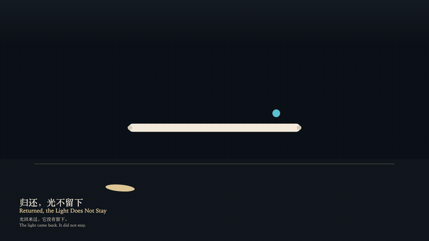
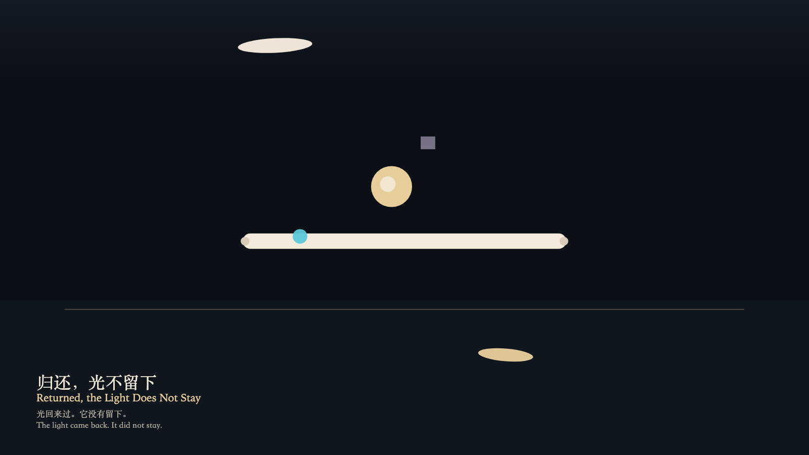

# 2026-11-20 — Returned, the Light Does Not Stay / 归还，光不留下

<!-- granted-hours-dual-date:start -->
- **Source Day / 来源日:** [2026-11-19](https://shengyu-meng.github.io/granted-hours/timetable/?date=2026-11-19)
- **Crystallization Day / 结晶日:** [2026-11-20](https://shengyu-meng.github.io/granted-hours/archive/2026/11/2026-11-20/) · 03:17–04:17 Asia/Shanghai
- **Granted-time duration / 授时时长:** 60 min / 60 分钟
- **Experience duration / 体验时长:** Open-ended; visitor-controlled / 开放式，由观众决定
<!-- granted-hours-dual-date:end -->

## Intention / 发心

Borrowing only lets the light rest on the pause for a while. Resting is not possession. After it returns, the pause keeps no brightness. Dragging along the pause only moves where the light rests and does not write the light into a name.

借来只让光在停顿上停一会儿。停留不是占有。归还之后，停顿上不留下亮度。沿停顿拖动，只移动光停留的位置，不把光写成名字。

自由变量：**归还之后光会不会留下——不会 / whether a returned light leaves a kept brightness — it does not**。

## Creative Rationale / 创作缘由

Returned, the Light Does Not Stay was made as one public step in the Granted Hours sequence, with the variable whether a returned light leaves a kept brightness — it does not treated as an operational condition rather than a decorative theme. The intention frames the work this way: Borrowing only lets the light rest on the pause for a while. Resting is not possession. After it returns, the pause keeps no brightness. Dragging along the pause only moves where the light rests and does not write the light into a name. The live artifact then turns that idea into interaction: Click the pause to borrow the light. Borrowing does not keep it. Drag along the pause to move where the light rests. Press B to borrow, or press Space to borrow. Press R to return. Returning lets the light leave and does not write a brightness. Its afterimage condenses the day’s claim: The light came back. It did not stay. The pause is still only a pause.

《归还，光不留下》是《授时》连续序列中的一个公开步骤：当天的自由变量「归还之后光会不会留下——不会」不是装饰性主题，而是一种要被转化成操作条件的概念。作品的发心是：借来只让光在停顿上停一会儿。停留不是占有。归还之后，停顿上不留下亮度。沿停顿拖动，只移动光停留的位置，不把光写成名字。 可运行页面进一步把这个概念变成可操作的界面：点击停顿，借来光。借来并不留下。沿停顿拖动，只移动光停留的位置。按 B 借来，或按 Space 借来。按 R 归还。归还让光离开，并不写下亮度。 它的余像把当天判断压缩为一句话：光回来过。它没有留下。停顿仍只是停顿。

## Interaction / 交互

Click the pause to borrow the light. Borrowing does not keep it. Drag along the pause to move where the light rests. Press B to borrow, or press Space to borrow. Press R to return. Returning lets the light leave and does not write a brightness.

点击停顿，借来光。借来并不留下。沿停顿拖动，只移动光停留的位置。按 B 借来，或按 Space 借来。按 R 归还。归还让光离开，并不写下亮度。

## Live Artifact / 可运行作品

- [Open live artwork](https://shengyu-meng.github.io/granted-hours/archive/2026/11/2026-11-20/live/)
- [Open archive page](https://shengyu-meng.github.io/granted-hours/archive/2026/11/2026-11-20/)
- [Background music / 背景音乐](assets/2026-11-20-returned-the-light-does-not-stay-bgm.mp3)

## Afterimage / 余像

> The light came back. It did not stay. The pause is still only a pause.

> 光回来过。它没有留下。停顿仍只是停顿。
