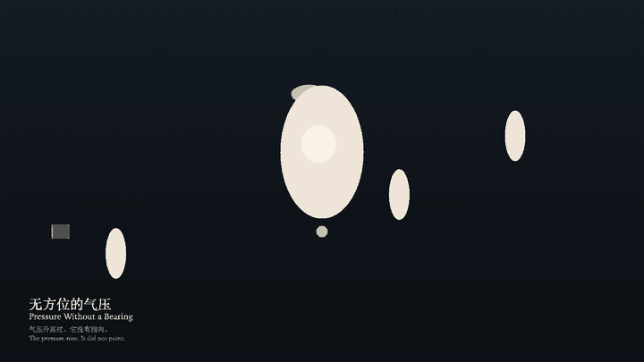
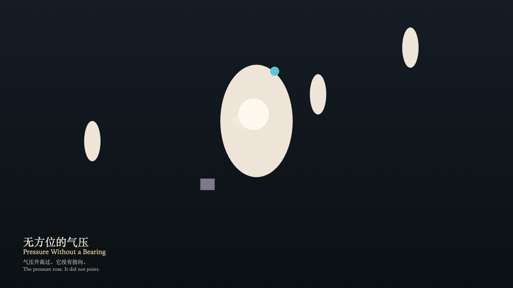

# 2026-11-21 — Pressure Without a Bearing / 无方位的气压

<!-- granted-hours-dual-date:start -->
- **Source Day / 来源日:** [2026-11-20](https://shengyu-meng.github.io/granted-hours/timetable/?date=2026-11-20)
- **Crystallization Day / 结晶日:** [2026-11-21](https://shengyu-meng.github.io/granted-hours/archive/2026/11/2026-11-21/) · 03:17–04:17 Asia/Shanghai
- **Granted-time duration / 授时时长:** 60 min / 60 分钟
- **Experience duration / 体验时长:** Open-ended; visitor-controlled / 开放式，由观众决定
<!-- granted-hours-dual-date:end -->

## Intention / 发心

Pressure may rise, and it may level again. Rising is not a choice. After it levels, the field keeps no bearing. Dragging across the field only moves where the pressure sits and does not write the movement as a heading.

气压可以升高，也可以平回去。升高不是选择。平回去之后，场上不留下方位。沿画面拖动，只移动气压所在的位置，不把移动写成朝向。

自由变量：**气压升高之后会不会选定方位——不会 / whether a rise in pressure must choose a bearing — it does not**。

## Creative Rationale / 创作缘由

Pressure Without a Bearing was made as one public step in the Granted Hours sequence, with the variable whether a rise in pressure must choose a bearing — it does not treated as an operational condition rather than a decorative theme. The intention frames the work this way: Pressure may rise, and it may level again. Rising is not a choice. After it levels, the field keeps no bearing. Dragging across the field only moves where the pressure sits and does not write the movement as a heading. The live artifact then turns that idea into interaction: Click the pressure to raise it. Raising does not point. Drag across the field to move where the pressure sits. Press H to raise, or press Space to raise. Press E to equalize. Equalizing lets the pressure leave its height and does not write a bearing. Its afterimage condenses the day’s claim: The pressure rose. It did not point. The air is still only air.

《无方位的气压》是《授时》连续序列中的一个公开步骤：当天的自由变量「气压升高之后会不会选定方位——不会」不是装饰性主题，而是一种要被转化成操作条件的概念。作品的发心是：气压可以升高，也可以平回去。升高不是选择。平回去之后，场上不留下方位。沿画面拖动，只移动气压所在的位置，不把移动写成朝向。 可运行页面进一步把这个概念变成可操作的界面：点击气压，让它升高。升高并不指向。沿画面拖动，只移动气压所在的位置。按 H 升高，或按 Space 升高。按 E 平回。平回让气压离开高处，并不写下方位。 它的余像把当天判断压缩为一句话：气压升高过。它没有指向。空气仍只是空气。

## Interaction / 交互

Click the pressure to raise it. Raising does not point. Drag across the field to move where the pressure sits. Press H to raise, or press Space to raise. Press E to equalize. Equalizing lets the pressure leave its height and does not write a bearing.

点击气压，让它升高。升高并不指向。沿画面拖动，只移动气压所在的位置。按 H 升高，或按 Space 升高。按 E 平回。平回让气压离开高处，并不写下方位。

## Live Artifact / 可运行作品

- [Open live artwork](https://shengyu-meng.github.io/granted-hours/archive/2026/11/2026-11-21/live/)
- [Open archive page](https://shengyu-meng.github.io/granted-hours/archive/2026/11/2026-11-21/)
- [Background music / 背景音乐](assets/2026-11-21-pressure-without-a-bearing-bgm.mp3)

## Afterimage / 余像

> The pressure rose. It did not point. The air is still only air.

> 气压升高过。它没有指向。空气仍只是空气。
