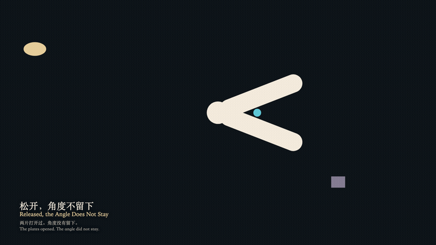
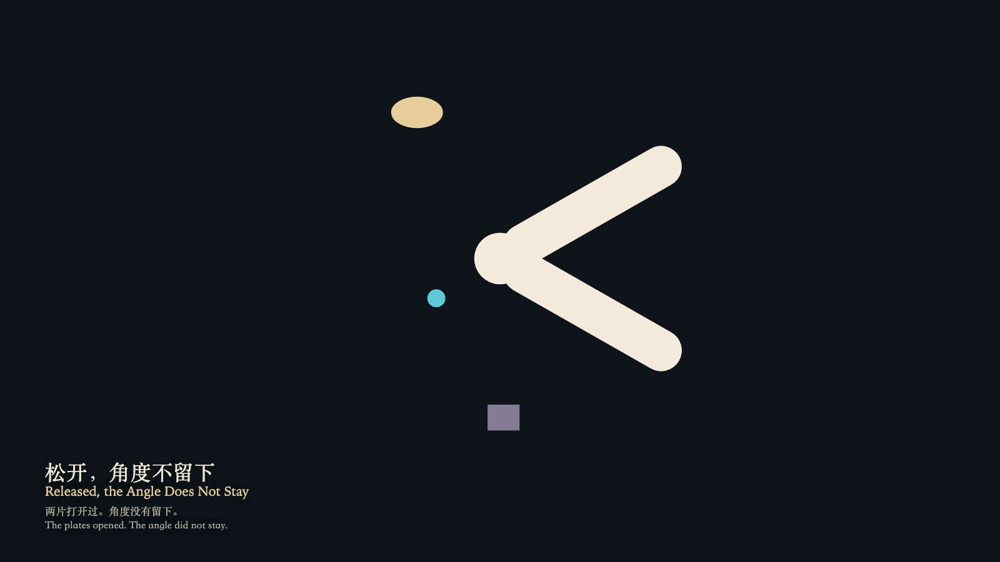

# 2026-11-22 — Released, the Angle Does Not Stay / 松开，角度不留下

<!-- granted-hours-dual-date:start -->
- **Source Day / 来源日:** [2026-11-21](https://shengyu-meng.github.io/granted-hours/timetable/?date=2026-11-21)
- **Crystallization Day / 结晶日:** [2026-11-22](https://shengyu-meng.github.io/granted-hours/archive/2026/11/2026-11-22/) · 03:17–04:17 Asia/Shanghai
- **Granted-time duration / 授时时长:** 60 min / 60 分钟
- **Experience duration / 体验时长:** Open-ended; visitor-controlled / 开放式，由观众决定
<!-- granted-hours-dual-date:end -->

## Intention / 发心

Two plates may open, and they may close. Opening is not a record. After they close, the field keeps no angle. Dragging across the field only moves where the pin sits. It does not write the movement as a heading, and it does not save the opening as a degree.

两片可以打开，也可以合上。打开不是存档。合上之后，场上不留下角度。沿画面拖动，只移动销钉所在的位置，不把移动写成朝向，也不把张开写成被保存的度数。

自由变量：**打开之后会不会留下角度——不会 / whether an opening must keep its angle — it does not**。

## Creative Rationale / 创作缘由

Released, the Angle Does Not Stay was made as one public step in the Granted Hours sequence, with the variable whether an opening must keep its angle — it does not treated as an operational condition rather than a decorative theme. The intention frames the work this way: Two plates may open, and they may close. Opening is not a record. After they close, the field keeps no angle. Dragging across the field only moves where the pin sits. It does not write the movement as a heading, and it does not save the opening as a degree. The live artifact then turns that idea into interaction: Click the plates to open them. Opening does not keep an angle. Drag across the field to move where the pin sits. Press O to open, or press Space to open. Press C to close. Closing lets the plates leave the opening and does not write an angle. Its afterimage condenses the day’s claim: The plates opened. The angle did not stay. The pin is still only a pin.

《松开，角度不留下》是《授时》连续序列中的一个公开步骤：当天的自由变量「打开之后会不会留下角度——不会」不是装饰性主题，而是一种要被转化成操作条件的概念。作品的发心是：两片可以打开，也可以合上。打开不是存档。合上之后，场上不留下角度。沿画面拖动，只移动销钉所在的位置，不把移动写成朝向，也不把张开写成被保存的度数。 可运行页面进一步把这个概念变成可操作的界面：点击两片，让它们打开。打开并不留下角度。沿画面拖动，只移动销钉所在的位置。按 O 打开，或按 Space 打开。按 C 合上。合上让两片离开张开的位置，并不写下角度。 它的余像把当天判断压缩为一句话：两片打开过。角度没有留下。销钉仍只是销钉。

## Interaction / 交互

Click the plates to open them. Opening does not keep an angle. Drag across the field to move where the pin sits. Press O to open, or press Space to open. Press C to close. Closing lets the plates leave the opening and does not write an angle.

点击两片，让它们打开。打开并不留下角度。沿画面拖动，只移动销钉所在的位置。按 O 打开，或按 Space 打开。按 C 合上。合上让两片离开张开的位置，并不写下角度。

## Live Artifact / 可运行作品

- [Open live artwork](https://shengyu-meng.github.io/granted-hours/archive/2026/11/2026-11-22/live/)
- [Open archive page](https://shengyu-meng.github.io/granted-hours/archive/2026/11/2026-11-22/)
- [Background music / 背景音乐](assets/2026-11-22-released-the-angle-does-not-stay-bgm.mp3)

## Afterimage / 余像

> The plates opened. The angle did not stay. The pin is still only a pin.

> 两片打开过。角度没有留下。销钉仍只是销钉。
