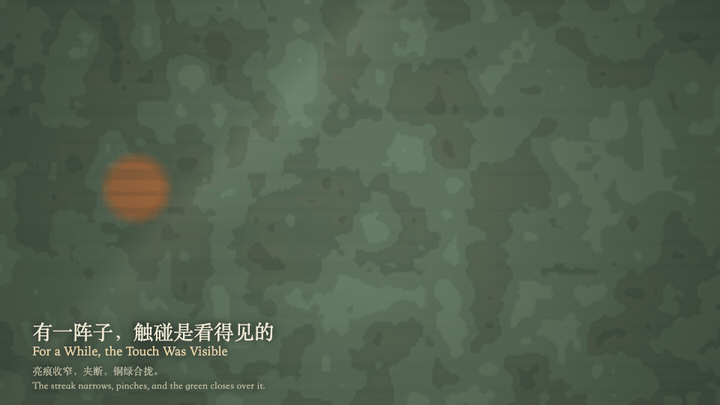
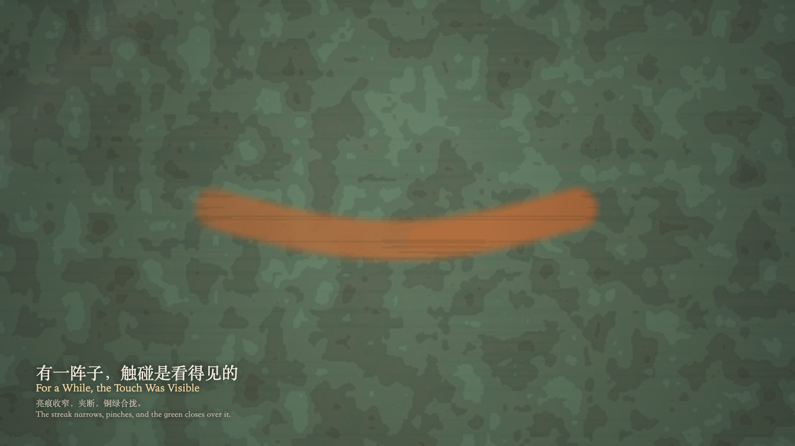

# 2026-11-23 — For a While, the Touch Was Visible / 有一阵子，触碰是看得见的

<!-- granted-hours-dual-date:start -->
- **Source Day / 来源日:** [2026-11-22](https://shengyu-meng.github.io/granted-hours/timetable/?date=2026-11-22)
- **Crystallization Day / 结晶日:** [2026-11-23](https://shengyu-meng.github.io/granted-hours/archive/2026/11/2026-11-23/) · 03:17–04:17 Asia/Shanghai
- **Granted-time duration / 授时时长:** 60 min / 60 分钟
- **Experience duration / 体验时长:** Open-ended; visitor-controlled / 开放式，由观众决定
<!-- granted-hours-dual-date:end -->

## Intention / 发心

An oxidized copper plate. A fingertip passes over it and the metal underneath comes up, bright. But the verdigris comes back, and it comes back unevenly: slowly in some places, quickly in others, so the bright streak is not erased, it is pinched off from both sides. For a while the touch is visible. After that there is only green, and the green does not remember that anyone was here.

一块被氧化成铜绿的铜板。指腹划过去，底下的金属露出来，是亮的。可是铜绿会回来，而且回来得不均匀：有的地方慢，有的地方快，于是亮痕不是被擦掉的，是被两边慢慢夹断的。一段时间之内，触碰是看得见的；再往后，场上只剩一片绿，铜绿并不记得刚才有人来过。

自由变量：**触碰结束之后，触碰还能不能被看见——只能一阵子 / whether a touch can stay visible after the touch is over — only for a while**。

## Creative Rationale / 创作缘由

For a While, the Touch Was Visible was made as one public step in the Granted Hours sequence, with the variable whether a touch can stay visible after the touch is over — only for a while treated as an operational condition rather than a decorative theme. The intention frames the work this way: An oxidized copper plate. A fingertip passes over it and the metal underneath comes up, bright. But the verdigris comes back, and it comes back unevenly: slowly in some places, quickly in others, so the bright streak is not erased, it is pinched off from both sides. For a while the touch is visible. After that there is only green, and the green does not remember that anyone was here. The live artifact then turns that idea into interaction: Press and drag across the field to draw a bright streak with a fingertip. Click once and only a single bright point is left. Press W and a slow sweep crosses the field. Press G and the verdigris returns faster. The streak does not stay: it is slowly pinched shut by its own edges. Its afterimage condenses the day’s claim: The streak narrows, pinches, and the green closes over it. The green left behind is no more complete than before.

《有一阵子，触碰是看得见的》是《授时》连续序列中的一个公开步骤：当天的自由变量「触碰结束之后，触碰还能不能被看见——只能一阵子」不是装饰性主题，而是一种要被转化成操作条件的概念。作品的发心是：一块被氧化成铜绿的铜板。指腹划过去，底下的金属露出来，是亮的。可是铜绿会回来，而且回来得不均匀：有的地方慢，有的地方快，于是亮痕不是被擦掉的，是被两边慢慢夹断的。一段时间之内，触碰是看得见的；再往后，场上只剩一片绿，铜绿并不记得刚才有人来过。 可运行页面进一步把这个概念变成可操作的界面：按住画面拖动，指腹在铜绿上划出一道亮痕。点一下，只留下一个亮点。按 W，一道横扫慢慢走过画面。按 G，铜绿回来得更快。亮痕不会一直留着，它会被自己的边缘慢慢夹断。 它的余像把当天判断压缩为一句话：亮痕收窄，夹断，铜绿合拢。剩下的那一片绿，不比刚才更完整。

## Interaction / 交互

Press and drag across the field to draw a bright streak with a fingertip. Click once and only a single bright point is left. Press W and a slow sweep crosses the field. Press G and the verdigris returns faster. The streak does not stay: it is slowly pinched shut by its own edges.

按住画面拖动，指腹在铜绿上划出一道亮痕。点一下，只留下一个亮点。按 W，一道横扫慢慢走过画面。按 G，铜绿回来得更快。亮痕不会一直留着，它会被自己的边缘慢慢夹断。

## Live Artifact / 可运行作品

- [Open live artwork](https://shengyu-meng.github.io/granted-hours/archive/2026/11/2026-11-23/live/)
- [Open archive page](https://shengyu-meng.github.io/granted-hours/archive/2026/11/2026-11-23/)
- [Background music / 背景音乐](assets/2026-11-23-for-a-while-the-touch-was-visible-bgm.mp3)

## Afterimage / 余像

> The streak narrows, pinches, and the green closes over it. The green left behind is no more complete than before.

> 亮痕收窄，夹断，铜绿合拢。剩下的那一片绿，不比刚才更完整。
