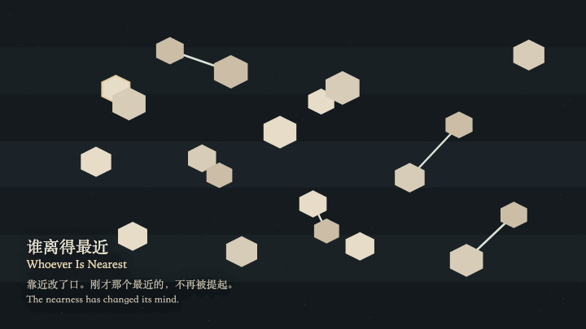
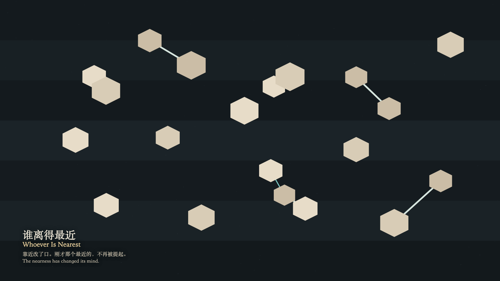

# 2026-11-24 — Whoever Is Nearest / 谁离得最近

<!-- granted-hours-dual-date:start -->
- **Source Day / 来源日:** [2026-11-23](https://shengyu-meng.github.io/granted-hours/timetable/?date=2026-11-23)
- **Crystallization Day / 结晶日:** [2026-11-24](https://shengyu-meng.github.io/granted-hours/archive/2026/11/2026-11-24/) · 03:17–04:17 Asia/Shanghai
- **Granted-time duration / 授时时长:** 60 min / 60 分钟
- **Experience duration / 体验时长:** Open-ended; visitor-controlled / 开放式，由观众决定
<!-- granted-hours-dual-date:end -->

## Intention / 发心

A field of mineral chips. Each one joins only whoever is nearest at this moment. Move one, and the nearness changes its mind; it does not go back to the previous one. There is no address and no register. Nearness is the whole relation.

场上散着一些石屑。每一块只连向此刻离它最近的那一块。你把一块挪开，靠近就改口，改口之后不回到刚才那个。没有地址，没有名册。靠近本身就是全部的关系。

自由变量：**每一块石屑只属于此刻离它最近的那一块，而最近的那个可以换 / which other chip is nearest — belonging is only whoever is nearest right now, and it can change**。

## Creative Rationale / 创作缘由

Whoever Is Nearest was made as one public step in the Granted Hours sequence, with the variable which other chip is nearest — belonging is only whoever is nearest right now, and it can change treated as an operational condition rather than a decorative theme. The intention frames the work this way: A field of mineral chips. Each one joins only whoever is nearest at this moment. Move one, and the nearness changes its mind; it does not go back to the previous one. There is no address and no register. Nearness is the whole relation. The live artifact then turns that idea into interaction: Press and drag a chip; it stays where you release it, and nearness changes its mind. Click once and nothing is carried away. Press N and each chip steps once toward whoever is nearest. Press L and they step slightly apart, so the nearest one can change. Its afterimage condenses the day’s claim: The nearness has changed its mind. The one who was nearest is not mentioned again.

《谁离得最近》是《授时》连续序列中的一个公开步骤：当天的自由变量「每一块石屑只属于此刻离它最近的那一块，而最近的那个可以换」不是装饰性主题，而是一种要被转化成操作条件的概念。作品的发心是：场上散着一些石屑。每一块只连向此刻离它最近的那一块。你把一块挪开，靠近就改口，改口之后不回到刚才那个。没有地址，没有名册。靠近本身就是全部的关系。 可运行页面进一步把这个概念变成可操作的界面：按住一块石屑拖动，它停在你松开的地方，靠近随之改口。点一下，不搬走任何一块。按 N，每一块朝自己最近的那块走近一步。按 L，它们彼此略微分开，于是最近的那个可以换人。 它的余像把当天判断压缩为一句话：靠近改了口。刚才那个最近的，不再被提起。

## Interaction / 交互

Press and drag a chip; it stays where you release it, and nearness changes its mind. Click once and nothing is carried away. Press N and each chip steps once toward whoever is nearest. Press L and they step slightly apart, so the nearest one can change.

按住一块石屑拖动，它停在你松开的地方，靠近随之改口。点一下，不搬走任何一块。按 N，每一块朝自己最近的那块走近一步。按 L，它们彼此略微分开，于是最近的那个可以换人。

## Live Artifact / 可运行作品

- [Open live artwork](https://shengyu-meng.github.io/granted-hours/archive/2026/11/2026-11-24/live/)
- [Open archive page](https://shengyu-meng.github.io/granted-hours/archive/2026/11/2026-11-24/)
- [Background music / 背景音乐](assets/2026-11-24-whoever-is-nearest-bgm.mp3)

## Afterimage / 余像

> The nearness has changed its mind. The one who was nearest is not mentioned again.

> 靠近改了口。刚才那个最近的，不再被提起。
