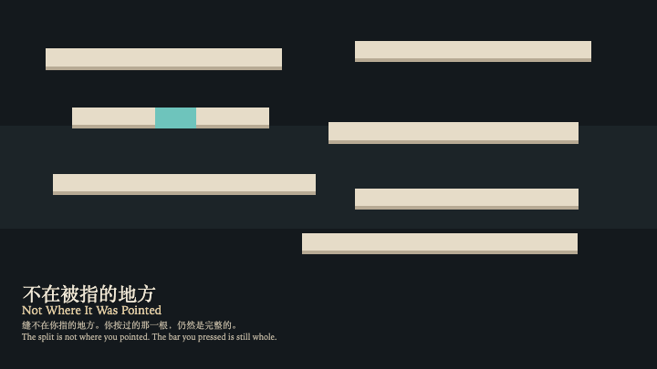
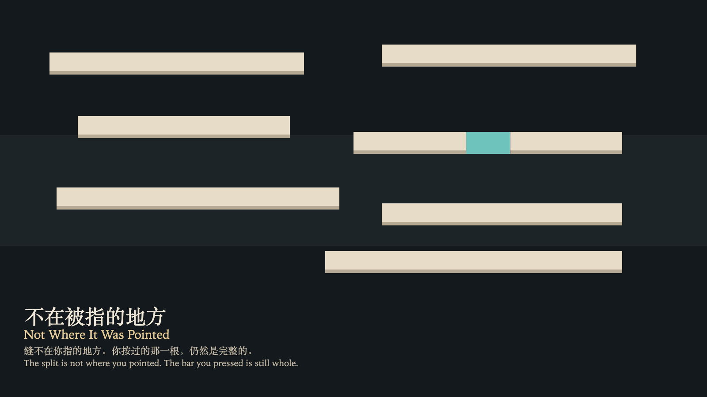

# 2026-11-25 — Not Where It Was Pointed / 不在被指的地方

<!-- granted-hours-dual-date:start -->
- **Source Day / 来源日:** [2026-11-24](https://shengyu-meng.github.io/granted-hours/timetable/?date=2026-11-24)
- **Crystallization Day / 结晶日:** [2026-11-25](https://shengyu-meng.github.io/granted-hours/archive/2026/11/2026-11-25/) · 03:17–04:17 Asia/Shanghai
- **Granted-time duration / 授时时长:** 60 min / 60 分钟
- **Experience duration / 体验时长:** Open-ended; visitor-controlled / 开放式，由观众决定
<!-- granted-hours-dual-date:end -->

## Intention / 发心

A few bone-colored bars. One of them is split. You press a bar, wanting the split to stay there, or to leave for a place you appoint. The split does not accept an appointment. It leaves, and it lands on a bar you did not press. A press on empty ground starts nothing.

场上有几根骨色的横梁。其中一根裂着一道缝。你按向某一根，想让缝留在那里，或想让它离开到你指定的地方。缝不接受指定。它离开，落到一根你没有按到的横梁上。空白处的按压什么都不发动。

自由变量：**哪一根横梁是裂开的——裂口从不留在手刚刚按过的那一根上 / which bar is split — the split never remains on the bar the hand just touched**。

## Creative Rationale / 创作缘由

Not Where It Was Pointed was made as one public step in the Granted Hours sequence, with the variable which bar is split — the split never remains on the bar the hand just touched treated as an operational condition rather than a decorative theme. The intention frames the work this way: A few bone-colored bars. One of them is split. You press a bar, wanting the split to stay there, or to leave for a place you appoint. The split does not accept an appointment. It leaves, and it lands on a bar you did not press. A press on empty ground starts nothing. The live artifact then turns that idea into interaction: Press a bar and it does not become the split's seat; the split leaves and lands on a bar you did not press. Press the bar that is already split and the split does not stay. Press empty ground and nothing is carried away. Press K and the split leaves its current bar for another. Press F and the split moves away from the last place the hand was. Its afterimage condenses the day’s claim: The split is not where you pointed. The bar you pressed is still whole.

《不在被指的地方》是《授时》连续序列中的一个公开步骤：当天的自由变量「哪一根横梁是裂开的——裂口从不留在手刚刚按过的那一根上」不是装饰性主题，而是一种要被转化成操作条件的概念。作品的发心是：场上有几根骨色的横梁。其中一根裂着一道缝。你按向某一根，想让缝留在那里，或想让它离开到你指定的地方。缝不接受指定。它离开，落到一根你没有按到的横梁上。空白处的按压什么都不发动。 可运行页面进一步把这个概念变成可操作的界面：按一根横梁，它不会成为缝的座位；缝离开，落到一根你没有按到的横梁上。按已经裂开的那一根，缝也不留下。按空白处，什么都不搬走。按 K，缝离开当前这根，去另一根。按 F，缝远离手最后所在的地方。 它的余像把当天判断压缩为一句话：缝不在你指的地方。你按过的那一根，仍然是完整的。

## Interaction / 交互

Press a bar and it does not become the split's seat; the split leaves and lands on a bar you did not press. Press the bar that is already split and the split does not stay. Press empty ground and nothing is carried away. Press K and the split leaves its current bar for another. Press F and the split moves away from the last place the hand was.

按一根横梁，它不会成为缝的座位；缝离开，落到一根你没有按到的横梁上。按已经裂开的那一根，缝也不留下。按空白处，什么都不搬走。按 K，缝离开当前这根，去另一根。按 F，缝远离手最后所在的地方。

## Live Artifact / 可运行作品

- [Open live artwork](https://shengyu-meng.github.io/granted-hours/archive/2026/11/2026-11-25/live/)
- [Open archive page](https://shengyu-meng.github.io/granted-hours/archive/2026/11/2026-11-25/)
- [Background music / 背景音乐](assets/2026-11-25-not-where-it-was-pointed-bgm.mp3)

## Afterimage / 余像

> The split is not where you pointed. The bar you pressed is still whole.

> 缝不在你指的地方。你按过的那一根，仍然是完整的。
