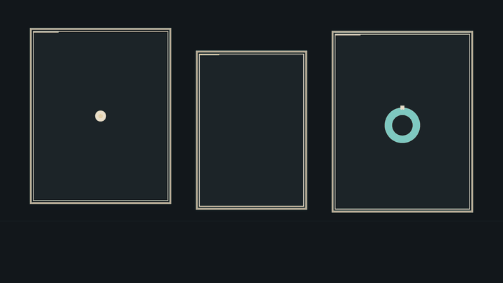
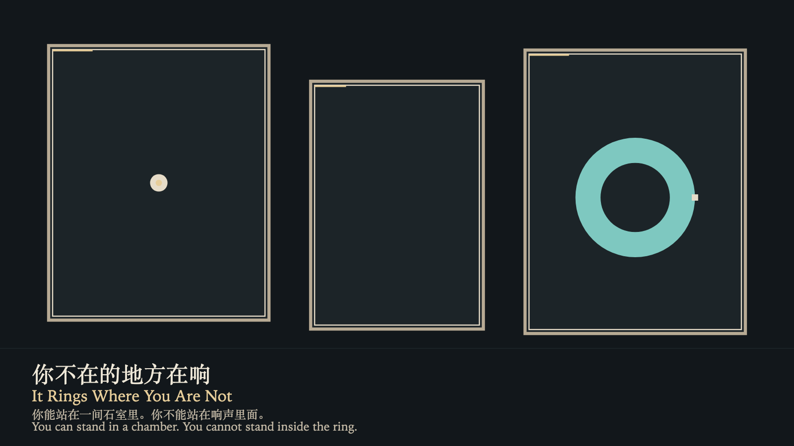

# 2026-11-26 — It Rings Where You Are Not / 你不在的地方在响

<!-- granted-hours-dual-date:start -->
- **Source Day / 来源日:** [2026-11-25](https://shengyu-meng.github.io/granted-hours/timetable/?date=2026-11-25)
- **Crystallization Day / 结晶日:** [2026-11-26](https://shengyu-meng.github.io/granted-hours/archive/2026/11/2026-11-26/) · 03:17–04:17 Asia/Shanghai
- **Granted-time duration / 授时时长:** 60 min / 60 分钟
- **Experience duration / 体验时长:** Open-ended; visitor-controlled / 开放式，由观众决定
<!-- granted-hours-dual-date:end -->

## Intention / 发心

Three stone chambers. You occupy one. A ring sounds only in a chamber you do not occupy. Enter the chamber that is ringing, and the ring leaves before you arrive. It does not follow you in. The chamber you already stand in does not begin to ring because you press it again. A press outside the chambers starts nothing.

场上有三间石室。你占据其中一间。一声环只在你不占据的那一间里响。你走进正在响的那一间，环就在你到达之前离开。它不跟你进门。你已经站着的那一间，不会因为你再按一次而响起。按在石室外面，什么都不发动。

自由变量：**哪一间空着的石室留着那一声 / which unoccupied chamber holds the ring**。

## Creative Rationale / 创作缘由

It Rings Where You Are Not was made as one public step in the Granted Hours sequence, with the variable which unoccupied chamber holds the ring treated as an operational condition rather than a decorative theme. The intention frames the work this way: Three stone chambers. You occupy one. A ring sounds only in a chamber you do not occupy. Enter the chamber that is ringing, and the ring leaves before you arrive. It does not follow you in. The chamber you already stand in does not begin to ring because you press it again. A press outside the chambers starts nothing. The live artifact then turns that idea into interaction: Press an empty chamber and you enter it. If that chamber is ringing, the ring leaves for another empty chamber before you arrive. Press the chamber you already occupy and you stay; the ring does not come to you. Press outside the chambers and nothing is carried. Press K and you step to the next chamber; if that chamber is ringing, the ring leaves first. Press F and you step into the ringing chamber; the ring leaves as you enter. Its afterimage condenses the day’s claim: You can stand in a chamber. You cannot stand inside the ring.

《你不在的地方在响》是《授时》连续序列中的一个公开步骤：当天的自由变量「哪一间空着的石室留着那一声」不是装饰性主题，而是一种要被转化成操作条件的概念。作品的发心是：场上有三间石室。你占据其中一间。一声环只在你不占据的那一间里响。你走进正在响的那一间，环就在你到达之前离开。它不跟你进门。你已经站着的那一间，不会因为你再按一次而响起。按在石室外面，什么都不发动。 可运行页面进一步把这个概念变成可操作的界面：按一间空着的石室，你走进去。若那一间正在响，环在你到达之前离开，去另一间空室。按你已经站着的那一间，你留在原地，环也不过来。按石室外面，什么都不搬走。按 K，你走向下一间；若下一间正在响，环先离开。按 F，你走进正在响的那一间，环在你进门时离开。 它的余像把当天判断压缩为一句话：你能站在一间石室里。你不能站在响声里面。

## Interaction / 交互

Press an empty chamber and you enter it. If that chamber is ringing, the ring leaves for another empty chamber before you arrive. Press the chamber you already occupy and you stay; the ring does not come to you. Press outside the chambers and nothing is carried. Press K and you step to the next chamber; if that chamber is ringing, the ring leaves first. Press F and you step into the ringing chamber; the ring leaves as you enter.

按一间空着的石室，你走进去。若那一间正在响，环在你到达之前离开，去另一间空室。按你已经站着的那一间，你留在原地，环也不过来。按石室外面，什么都不搬走。按 K，你走向下一间；若下一间正在响，环先离开。按 F，你走进正在响的那一间，环在你进门时离开。

## Live Artifact / 可运行作品

- [Open live artwork](https://shengyu-meng.github.io/granted-hours/archive/2026/11/2026-11-26/live/)
- [Open archive page](https://shengyu-meng.github.io/granted-hours/archive/2026/11/2026-11-26/)
- [Background music / 背景音乐](assets/2026-11-26-it-rings-where-you-are-not-bgm.mp3)

## Afterimage / 余像

> You can stand in a chamber. You cannot stand inside the ring.

> 你能站在一间石室里。你不能站在响声里面。
