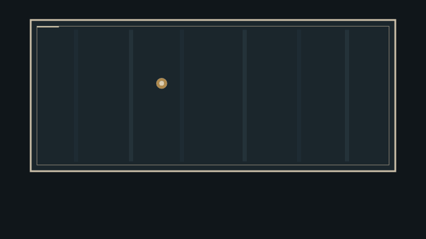
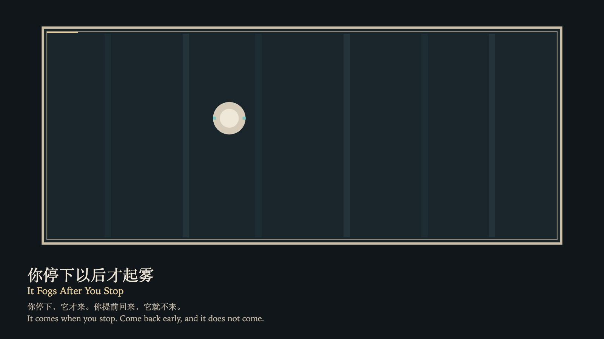

# 2026-11-27 — It Fogs After You Stop / 你停下以后才起雾

<!-- granted-hours-dual-date:start -->
- **Source Day / 来源日:** [2026-11-26](https://shengyu-meng.github.io/granted-hours/timetable/?date=2026-11-26)
- **Crystallization Day / 结晶日:** [2026-11-27](https://shengyu-meng.github.io/granted-hours/archive/2026/11/2026-11-27/) · 03:17–04:17 Asia/Shanghai
- **Granted-time duration / 授时时长:** 60 min / 60 分钟
- **Experience duration / 体验时长:** Open-ended; visitor-controlled / 开放式，由观众决定
<!-- granted-hours-dual-date:end -->

## Intention / 发心

The glass does not fog while you breathe on it. Fog is allowed to arrive only after the breath has left. Press again before that arrival finishes, and the arrival is cancelled. Fog that has already arrived clears from its edges inward. It does not become a record because you stayed.

玻璃不会在你呼吸的时候起雾。雾只在气息离开之后才被允许到来。到来还没完成时你又按下去，这次到来就取消。已经到来的雾会从边缘向里散去，不会因为你留下而变成记录。

自由变量：**最后一口气与第一层雾之间的延迟 / the delay between the last breath and the first fog**。

## Creative Rationale / 创作缘由

It Fogs After You Stop was made as one public step in the Granted Hours sequence, with the variable the delay between the last breath and the first fog treated as an operational condition rather than a decorative theme. The intention frames the work this way: The glass does not fog while you breathe on it. Fog is allowed to arrive only after the breath has left. Press again before that arrival finishes, and the arrival is cancelled. Fog that has already arrived clears from its edges inward. It does not become a record because you stayed. The live artifact then turns that idea into interaction: Hold on the glass to breathe without fogging it. Release, and fog may arrive after a delay. Press again before the fog finishes arriving, and the arrival is cancelled. Hold Space to breathe at the last place. Release Space to grant the delay. Press C to cancel an arrival that has not finished. Press outside the glass and nothing starts. Its afterimage condenses the day’s claim: It comes when you stop. Come back early, and it does not come.

《你停下以后才起雾》是《授时》连续序列中的一个公开步骤：当天的自由变量「最后一口气与第一层雾之间的延迟」不是装饰性主题，而是一种要被转化成操作条件的概念。作品的发心是：玻璃不会在你呼吸的时候起雾。雾只在气息离开之后才被允许到来。到来还没完成时你又按下去，这次到来就取消。已经到来的雾会从边缘向里散去，不会因为你留下而变成记录。 可运行页面进一步把这个概念变成可操作的界面：按住玻璃呼吸，玻璃不会起雾。松开以后，雾可能在一段延迟之后到来。在雾完成到来之前再次按下，到来就被取消。按住空格，在上次停留的位置呼吸。松开空格，把延迟交出去。按 C，取消一次尚未完成的到来。按在玻璃外面，什么都不开始。 它的余像把当天判断压缩为一句话：你停下，它才来。你提前回来，它就不来。

## Interaction / 交互

Hold on the glass to breathe without fogging it. Release, and fog may arrive after a delay. Press again before the fog finishes arriving, and the arrival is cancelled. Hold Space to breathe at the last place. Release Space to grant the delay. Press C to cancel an arrival that has not finished. Press outside the glass and nothing starts.

按住玻璃呼吸，玻璃不会起雾。松开以后，雾可能在一段延迟之后到来。在雾完成到来之前再次按下，到来就被取消。按住空格，在上次停留的位置呼吸。松开空格，把延迟交出去。按 C，取消一次尚未完成的到来。按在玻璃外面，什么都不开始。

## Live Artifact / 可运行作品

- [Open live artwork](https://shengyu-meng.github.io/granted-hours/archive/2026/11/2026-11-27/live/)
- [Open archive page](https://shengyu-meng.github.io/granted-hours/archive/2026/11/2026-11-27/)
- [Background music / 背景音乐](assets/2026-11-27-it-fogs-after-you-stop-bgm.mp3)

## Afterimage / 余像

> It comes when you stop. Come back early, and it does not come.

> 你停下，它才来。你提前回来，它就不来。
