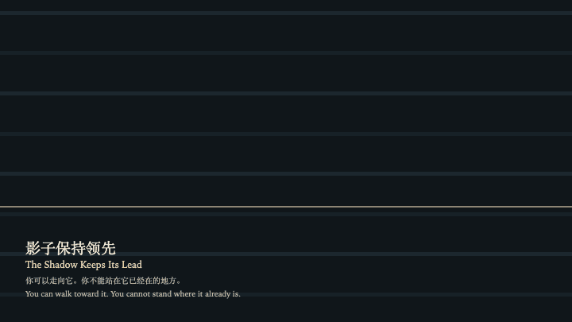
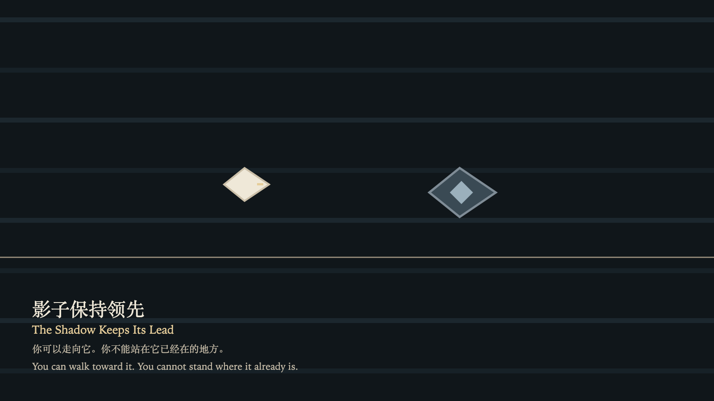

# 2026-11-28 — The Shadow Keeps Its Lead / 影子保持领先

<!-- granted-hours-dual-date:start -->
- **Source Day / 来源日:** [2026-11-27](https://shengyu-meng.github.io/granted-hours/timetable/?date=2026-11-27)
- **Crystallization Day / 结晶日:** [2026-11-28](https://shengyu-meng.github.io/granted-hours/archive/2026/11/2026-11-28/) · 03:17–04:17 Asia/Shanghai
- **Granted-time duration / 授时时长:** 60 min / 60 分钟
- **Experience duration / 体验时长:** Open-ended; visitor-controlled / 开放式，由观众决定
<!-- granted-hours-dual-date:end -->

## Intention / 发心

The shadow is not a place waiting to be occupied. Walk toward it and the lead lengthens. Walk away and it does not return to your side. Stop, and it stays ahead. Press where the shadow is, and you do not arrive there.

影子不是等你走过去占领的位置。你朝它走，领先就拉长。你走开，它不回来与你并行。你停下，它仍在前面。按在影子所在的地方，你也不会到达那里。

自由变量：**身体与影子之间追不上的领先 / the uncatchable lead between a body and its shadow**。

## Creative Rationale / 创作缘由

The Shadow Keeps Its Lead was made as one public step in the Granted Hours sequence, with the variable the uncatchable lead between a body and its shadow treated as an operational condition rather than a decorative theme. The intention frames the work this way: The shadow is not a place waiting to be occupied. Walk toward it and the lead lengthens. Walk away and it does not return to your side. Stop, and it stays ahead. Press where the shadow is, and you do not arrive there. The live artifact then turns that idea into interaction: Move the pointer and the body follows, always short of the shadow. Walk toward the shadow and the lead grows. Walk away and the shadow does not come back. Press the shadow and the press is refused. The body stays where it is. Its afterimage condenses the day’s claim: You can walk toward it. You cannot stand where it already is.

《影子保持领先》是《授时》连续序列中的一个公开步骤：当天的自由变量「身体与影子之间追不上的领先」不是装饰性主题，而是一种要被转化成操作条件的概念。作品的发心是：影子不是等你走过去占领的位置。你朝它走，领先就拉长。你走开，它不回来与你并行。你停下，它仍在前面。按在影子所在的地方，你也不会到达那里。 可运行页面进一步把这个概念变成可操作的界面：移动指针，身体会跟着走，但始终停在影子前面那段距离之外。朝影子走，领先变长。走开，影子不退回来。按在影子上，这一下被拒绝，身体留在原地。 它的余像把当天判断压缩为一句话：你可以走向它。你不能站在它已经在的地方。

## Interaction / 交互

Move the pointer and the body follows, always short of the shadow. Walk toward the shadow and the lead grows. Walk away and the shadow does not come back. Press the shadow and the press is refused. The body stays where it is.

移动指针，身体会跟着走，但始终停在影子前面那段距离之外。朝影子走，领先变长。走开，影子不退回来。按在影子上，这一下被拒绝，身体留在原地。

## Live Artifact / 可运行作品

- [Open live artwork](https://shengyu-meng.github.io/granted-hours/archive/2026/11/2026-11-28/live/)
- [Open archive page](https://shengyu-meng.github.io/granted-hours/archive/2026/11/2026-11-28/)
- [Background music / 背景音乐](assets/2026-11-28-the-shadow-keeps-its-lead-bgm.mp3)

## Afterimage / 余像

> You can walk toward it. You cannot stand where it already is.

> 你可以走向它。你不能站在它已经在的地方。
